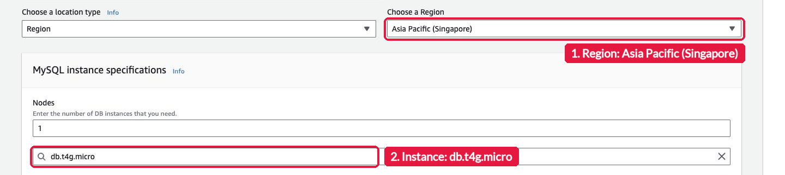
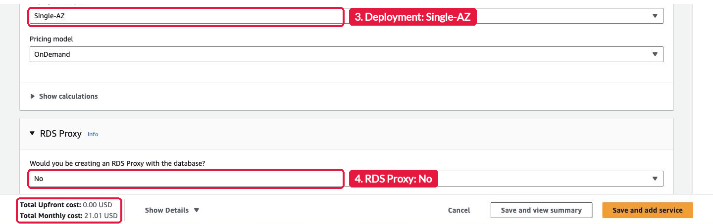

# Assignment 3: Price the Database Before You Build It

> Submit one Pull Request per group to this repository. Then one groupmate submits the Pull Request link in the Google Form: https://forms.gle/ftSQ77MaprGrMHEN9. Both are due on Friday, November 6, 2026, at 11:59 PM (Asia/Manila). Do not merge your own Pull Request.

This is a self-guided activity. A cloud engineer prices a database before anyone creates it. Your group prices an Amazon RDS for MySQL database for the client from your [Lab 3](../lab-3/lab.md) case, in the AWS Pricing Calculator. You create nothing in AWS, so this activity costs nothing. Read [`README.md`](README.md) before you start. It explains the choices that change the price.

## The tool

The AWS Pricing Calculator is at <https://calculator.aws>. You do not sign in. Choose **Create estimate**, search for **Amazon RDS for MySQL**, and choose **Configure**.

Set the Region first. Then pick the instance class.

Check every field before you trust a total. When I opened the calculator on October 30, it started with a `db.m4.10xlarge` instance, Multi-AZ, an RDS Proxy, and Database Insights. In Singapore, that default cost USD 8,507.28 a month. With `db.t4g.micro`, Single-AZ, no proxy, no Database Insights, and 20 GB of storage, the total was USD 21.01 a month.

## Your three estimates

Use Asia Pacific (Singapore), MySQL, OnDemand, and 100% utilization for all three. Set **RDS Proxy** and **Database Insights** to **No**.

| Option | Instance | Deployment | Nodes | Storage |
| --- | --- | --- | --- | --- |
| A. Small and cheap | `db.t4g.micro` | Single-AZ | 1 | 20 GB, General Purpose SSD (gp3) |
| B. High availability | `db.t4g.micro` | Multi-AZ | 1 | 20 GB, gp3 |
| C. Read scaling | `db.t4g.micro` | Single-AZ | 2, the primary and one read replica | 20 GB, gp3 |

The **Nodes** field is the number of DB instances. Option C uses 2 nodes because a read replica is a second DB instance of the same class. For each option, note the **Total Monthly cost**. Then choose **Save and add service** or **Save and view summary**, and use **Share** to get a public link to the estimate. One link with all three services is fine.

## What to submit

1. Create the folder `submissions/assignment-3/group-<number>/` on a branch named `assignment-3-group-<number>`.
2. Copy [`submission-template.md`](submission-template.md) to that folder as `submission.md`. Fill in every item:
   - Your section, group number, and Lab 3 client.
   - A table with the three options, their settings, and their monthly totals in USD.
   - The share link of your estimate.
   - A recommendation of five sentences: which option fits your client, and why. Use the client's users, the cost of downtime for that client, and the read load.
   - The answer to this question: why is a Multi-AZ standby not the same as a read replica?
   - One line per groupmate: GitHub username and what each one did.
3. Open one Pull Request. One groupmate submits its link in the Google Form for the whole group: https://forms.gle/ftSQ77MaprGrMHEN9.

| Check | Points |
| --- | --- |
| Three options with the correct settings and their monthly totals | 4 |
| A share link that opens your estimate | 2 |
| A five-sentence recommendation tied to your client | 3 |
| A correct answer about the Multi-AZ standby and the read replica | 1 |
| **Total** | **10** |

## If you get stuck

- The total does not change: click outside the field you typed in, so the calculator updates.
- You cannot find `db.t4g.micro`: type it in the instance search box, then choose it from the list.
- Check your share link before you submit: open it in a private browser window and confirm that all three options show.
- Anything else: message me in the group chat.

AWS documentation, if you want more detail: [What is AWS Pricing Calculator?](https://docs.aws.amazon.com/pricing-calculator/latest/userguide/what-is-pricing-calculator.html) and [Amazon RDS for MySQL pricing](https://aws.amazon.com/rds/mysql/pricing/).
