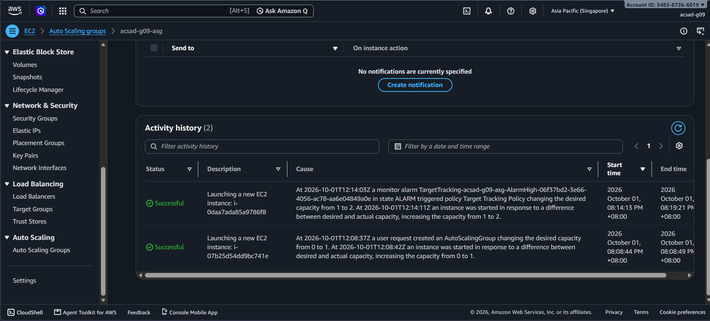

# Lab 2 Submission

## Instance Tracking
**First Instance**
- Instance ID: i-07b25d54dd9bc741e
- Availability Zone: ap-southeast-1b

**Second Instance**
- Instance ID: i-0daa7ada85a9786f8
- Availability Zone: ap-southeast-1a

## Proof (Screenshots)
1. **Activity History:** Add a screenshot showing the Auto Scaling group's Activity history when the second instance launched.

   

2. **CloudWatch Alarm:** Add a screenshot of the target tracking alarm in the "In alarm" state.

   

## Questions
1. Why did the group stop at 2 instances?
   The group stopped at 2 instances because the maximum capacity was set to 2, and the CPU target was set to 70 percent.

2. Why did terminating an instance by hand not remove the cost?
   The Auto Scaling group maintains the desired capacity. When an instance is terminated, the group launches a replacement, so the number of instances and the cost remain.

3. Why is the target value set to your assigned value (e.g., 30-85 percent) instead of 99 percent?
   Setting the target to 99 percent could overload the instance before a new instance finishes launching and passing health checks. A target of 70 percent leaves 30 percent headroom.

4. What did the automatic cutoff protect us from?
   The automatic cutoff protected us from unexpected AWS charges if resources were not cleaned up.

5. What changes when a load balancer sits in front of the group?
   A load balancer provides a stable DNS endpoint, distributes traffic across instances, and routes traffic away from unhealthy instances.

## Questions
1. Why did the group stop at 2 instances?
   The group stopped at 2 instances because the maximum capacity was set to 2, and the CPU target was set to 70 percent.

2. Why did terminating an instance by hand not remove the cost?
   The Auto Scaling group maintains the desired capacity. When an instance is terminated, the group launches a replacement, so the number of instances and the cost remain.

3. Why is the target value set to your assigned value (e.g., 30-85 percent) instead of 99 percent?
   Setting the target to 99 percent could overload the instance before a new instance finishes launching and passing health checks. A target of 70 percent leaves 30 percent headroom.

4. What did the automatic cutoff protect us from?
   The automatic cutoff protected us from unexpected AWS charges if resources were not cleaned up.

5. What changes when a load balancer sits in front of the group?
   A load balancer provides a stable DNS endpoint, distributes traffic across instances, and routes traffic away from unhealthy instances.
## Questions
1. Why did the group stop at 2 instances?
   The group stopped at 2 instances because the maximum capacity was set to 2, and the CPU target was set to 70 percent.

2. Why did terminating an instance by hand not remove the cost?
   The Auto Scaling group maintains the desired capacity. When an instance is terminated, the group launches a replacement, so the number of instances and the cost remain.

3. Why is the target value set to your assigned value (e.g., 30-85 percent) instead of 99 percent?
   Setting the target to 99 percent could overload the instance before a new instance finishes launching and passing health checks. A target of 70 percent leaves 30 percent headroom.

4. What did the automatic cutoff protect us from?
   The automatic cutoff protected us from unexpected AWS charges if resources were not cleaned up.

5. What changes when a load balancer sits in front of the group?
   A load balancer provides a stable DNS endpoint, distributes traffic across instances, and routes traffic away from unhealthy instances.
