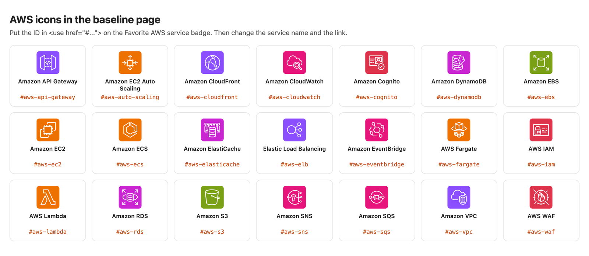

# Seatwork 2: Build Your Group Linktree Page

> Submit one Pull Request per group to this repository. Then one groupmate submits the Pull Request link in the Google Form that I post in the group chat. Both are due on Friday, November 6, 2026, at 11:59 PM (Asia/Manila). Do not merge your own Pull Request.

This is a self-guided activity. Your group builds one HTML page, like a linktree: one page with a card for each groupmate and a few links. In [Seatwork 3](../seatwork-3/seatwork.md), you put this page on the internet with Amazon S3. Finish this seatwork first. Read [`README.md`](README.md) before you start. It explains what you build and why each part is there.

## Privacy rules

Your page becomes public in Seatwork 3. Anyone with the link can read it.

- Use first names or nicknames only.
- Do not put student numbers, phone numbers, personal email addresses, home addresses, or birthdays on the page.
- Link only to pages that are already public and that you are comfortable to share, for example a GitHub profile, a LinkedIn profile, a portfolio, or your thesis project page.
- A groupmate who does not want a public profile link can use a link to a course page, for example <https://aws.amazon.com/s3/>.
- Photos are optional. If you use one, link to a public image URL, for example your GitHub avatar at `https://github.com/<username>.png`.

## Start from the baseline page

The file [`baseline/index.html`](baseline/index.html) is a complete page for a made-up Group 0. Copy it, open it in your browser, and then change the content to your group's.

Each card has three parts that you change:

| Part | What to change |
| --- | --- |
| Avatar, name, bio, and role | The initials, a first name or nickname, one short sentence, and a role in your group |
| GitHub and LinkedIn icons | The two `href` values: your own GitHub profile and LinkedIn profile |
| Favorite AWS service | The icon ID in `<use href="#...">`, the service name, and the link to the service page |

The page holds an icon library for 21 AWS services. To pick one, change only the icon ID, for example `#aws-s3` to `#aws-lambda`. The comment at the top of the file lists every ID with its service page.

Do not change the icon library at the bottom of the file. Your cards use those icons by ID.

## What your page must have

| Requirement | Points |
| --- | --- |
| One file named `index.html` that opens in a browser with no missing parts | 4 |
| A heading with your group number and section, and one card for each groupmate with a first name or nickname and a role | 4 |
| At least two working links on each card | 4 |
| A `<title>`, a `<meta name="viewport" ...>` tag, and one `<style>` block inside the file | 4 |
| No private data from the list above | 4 |
| **Total** | **20** |

The baseline with your own content can earn all 20 points. Keep everything in one file. Do not link to other local files, because Seatwork 3 uploads only `index.html`.

## Bonus: make it your own

Your group can earn up to 5 bonus points for a better design than the baseline. Each change below earns 1 point.

| Design change | Bonus |
| --- | --- |
| Your own color theme and font, and the text stays easy to read | +1 |
| A new layout, for example a header with a group logo or motto, or a different card arrangement | +1 |
| An animation or transition, for example cards that lift when you point at them | +1 |
| More icons, for example a third link per card with its own inline SVG icon | +1 |
| One more section that the baseline does not have, for example your group project or what you are learning | +1 |
| **Total bonus** | **up to +5** |

Bonus points count only when the page meets every requirement in the table above. The highest score for Seatwork 2 is 25. List your design changes in your Pull Request description.

## Steps

1. Fork this repository and clone your fork. Create a branch named `seatwork-2-group-<number>`, for example `seatwork-2-group-04`.
2. Create the folder `submissions/seatwork-2/group-<number>/`.
3. Copy `activities/seatwork-2/baseline/index.html` into that folder.
4. Change the header, then make one card for each groupmate.
5. Open the file in your browser. Click every link and check that each one opens.
6. Copy [`contribution-template.md`](contribution-template.md) to the same folder as `contribution.md`. List each groupmate by GitHub username and write one line about what each one did.
7. Commit, push, and open one Pull Request to this repository.
8. One groupmate submits the Pull Request link in the Google Form for the whole group.

## If you get stuck

- The page shows raw text with tags: the file name must end in `.html`, not `.html.txt`.
- An icon is empty: the ID in `<use href="#...">` must match an ID in the list at the top of the file, with the `#` in front.
- The layout breaks on a phone: check that the `<meta name="viewport" content="width=device-width, initial-scale=1">` tag is inside `<head>`.
- Anything else: message me in the group chat.
