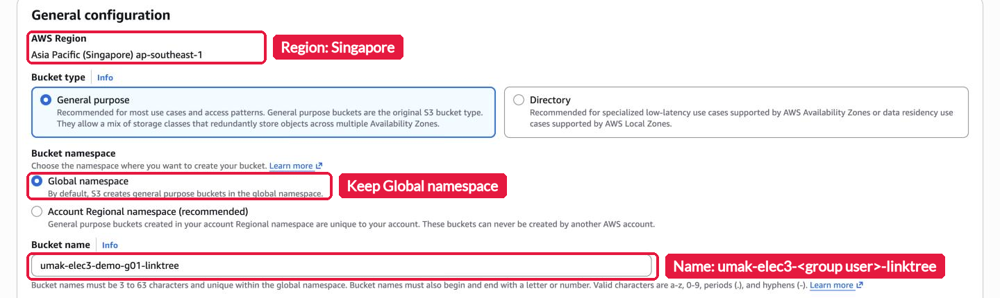
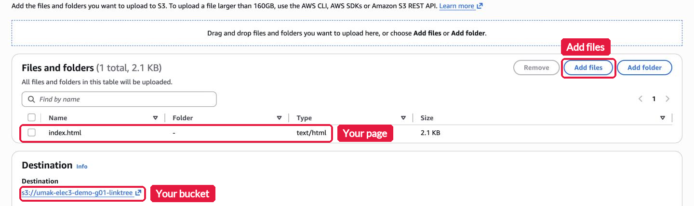
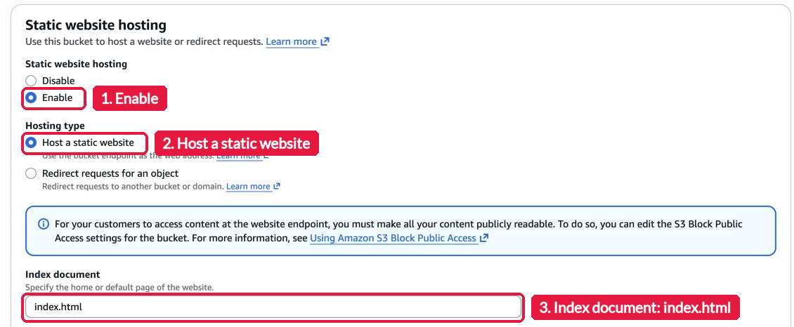
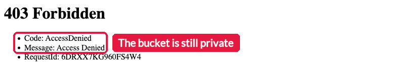
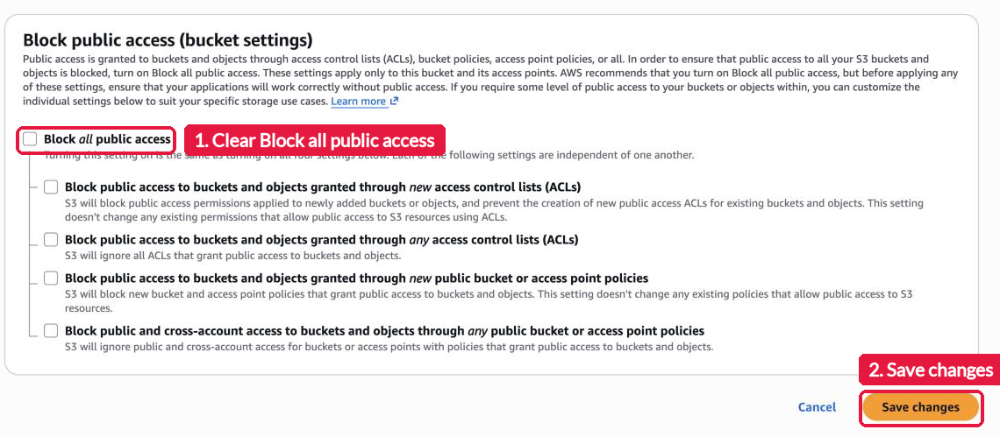
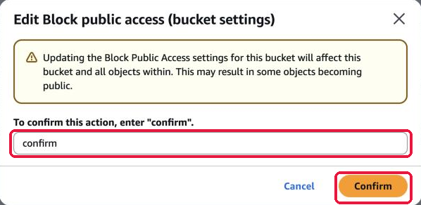
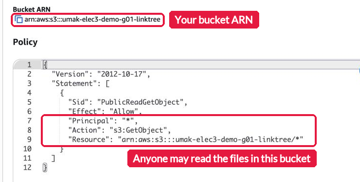
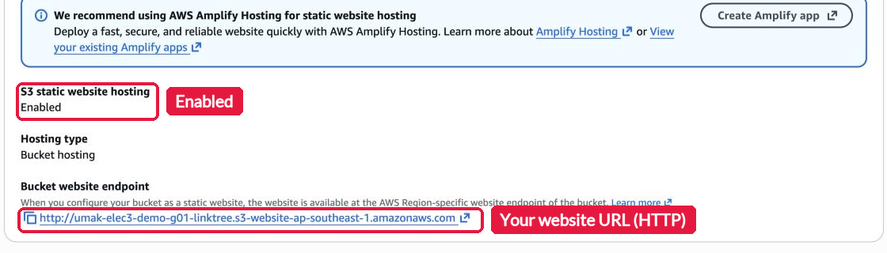
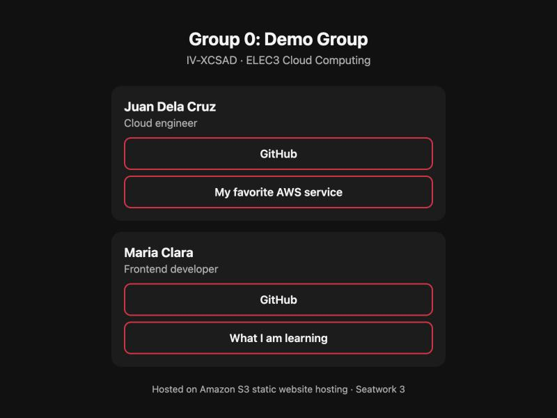

# Seatwork 3: Host Your Linktree Page on Amazon S3

> Submit one Pull Request per group to this repository. Then one groupmate submits the Pull Request link in the Google Form that I post in the group chat. Both are due on Friday, November 6, 2026, at 11:59 PM (Asia/Manila). Do not merge your own Pull Request.

This is a self-guided activity. You take the `index.html` from [Seatwork 2](../seatwork-2/seatwork.md) and serve it as a public website from an Amazon S3 bucket. Finish Seatwork 2 first. Read [`README.md`](README.md) before you start. It explains the S3 ideas that each step uses.

## Before you start

- Sign in at the class sign-in URL with your group IAM user, the same user from Lab 1 and Lab 2, for example `acsad-g03`. Do not change the group password. A new password locks out your groupmates.
- Work in Asia Pacific (Singapore), `ap-southeast-1`.
- Your user can create and change only one kind of bucket: a bucket whose name starts with `umak-elec3-` and your user name. Use exactly this name:

  ```text
  umak-elec3-<group user>-linktree
  ```

  For example, group user `acsad-g03` uses `umak-elec3-acsad-g03-linktree`. Any other name gets `Access Denied`.
- Upload only your `index.html`. Do not upload other files.

## Step 1. Create the bucket

Open the S3 console and choose **Create bucket**. Check that the Region is Asia Pacific (Singapore). Keep **General purpose** and **Global namespace**. Type your bucket name. Keep every other setting, including **Block all public access**, and choose **Create bucket** at the bottom of the page.



## Step 2. Upload the page

Open your bucket. Choose **Upload**, then **Add files**, and pick your `index.html`. Check that the type is `text/html` and that the destination is your bucket. Choose **Upload**.



## Step 3. Turn on static website hosting

Open the **Properties** tab and scroll to the bottom. In **Static website hosting**, choose **Edit**. Choose **Enable** and **Host a static website**. Type `index.html` as the **Index document**. Choose **Save changes**.



S3 now shows a **Bucket website endpoint** at the bottom of the **Properties** tab. If you open it now, you get `403 Forbidden`. That is expected. A new bucket is private, and the next two steps make the page readable.



## Step 4. Turn off Block Public Access for this bucket

Open the **Permissions** tab. In **Block public access (bucket settings)**, choose **Edit**. Clear **Block all public access** and choose **Save changes**.



S3 asks you to confirm. Read the warning, type `confirm`, and choose **Confirm**.



Do this only for your website bucket. Never turn off Block Public Access for a bucket that holds private data.

## Step 5. Add the bucket policy

Still on the **Permissions** tab, find **Bucket policy** and choose **Edit**. Paste this policy. Replace `<your bucket>` with your bucket name, then choose **Save changes**.

```json
{
  "Version": "2012-10-17",
  "Statement": [
    {
      "Sid": "PublicReadGetObject",
      "Effect": "Allow",
      "Principal": "*",
      "Action": "s3:GetObject",
      "Resource": "arn:aws:s3:::<your bucket>/*"
    }
  ]
}
```

The policy lets anyone read (`s3:GetObject`) the files in your bucket. It does not let anyone write, list, or delete.



## Step 6. Open your website

Open the **Properties** tab and scroll to **Static website hosting**. Copy the **Bucket website endpoint**. It has this form:

```text
http://umak-elec3-<group user>-linktree.s3-website-ap-southeast-1.amazonaws.com
```



Open the endpoint in a private browser window. You see your page. The browser shows "Not secure" because S3 website endpoints use HTTP only. That is expected for this seatwork.



## What to submit

1. Create the folder `submissions/seatwork-3/group-<number>/` on a branch named `seatwork-3-group-<number>`.
2. Add three screenshots to that folder:
   - `hosting.png`: the **Static website hosting** section with the endpoint.
   - `policy.png`: your saved bucket policy.
   - `site.png`: your page open in the browser, with the address bar visible.
3. Crop the AWS console top bar out of the first two screenshots. The top bar shows the account number.
4. Copy [`submission-template.md`](submission-template.md) to the same folder as `submission.md`. Fill in your section, group number, group IAM user, bucket name, website endpoint, and one line per groupmate (GitHub username and what each one did).
5. Open one Pull Request. One groupmate puts its link in the Google Form for the whole group.

| Check | Points |
| --- | --- |
| The website endpoint loads your Seatwork 2 page | 8 |
| The bucket name follows the rule and the bucket is in Singapore | 3 |
| The bucket policy allows only `s3:GetObject` on your bucket's objects | 4 |
| Three screenshots, with the console top bar cropped out | 3 |
| `submission.md` is complete | 2 |
| **Total** | **20** |

Keep your bucket until grading is done. After grading, I delete every website bucket. Your page then goes offline.

## If you get stuck

| What you see | What to check |
| --- | --- |
| `Access Denied` when you create the bucket | The bucket name must be exactly `umak-elec3-<group user>-linktree`, in lowercase, in Singapore |
| `403 Forbidden` on the endpoint | Step 4 or Step 5 is missing, or the policy has a typo in the bucket name |
| `404 Not Found` on the endpoint | The index document is not `index.html`, or the file sits in a folder inside the bucket |
| "Policy has invalid resource" | The `Resource` line must end with `/*` and use your exact bucket name |
| The console says you cannot sign in | Your group IAM user works until November 6, 11:59 PM. Message me in the group chat |

AWS documentation, if you want more detail: [Tutorial: Configuring a static website on Amazon S3](https://docs.aws.amazon.com/AmazonS3/latest/userguide/HostingWebsiteOnS3Setup.html) and [Setting permissions for website access](https://docs.aws.amazon.com/AmazonS3/latest/userguide/WebsiteAccessPermissionsReqd.html).
