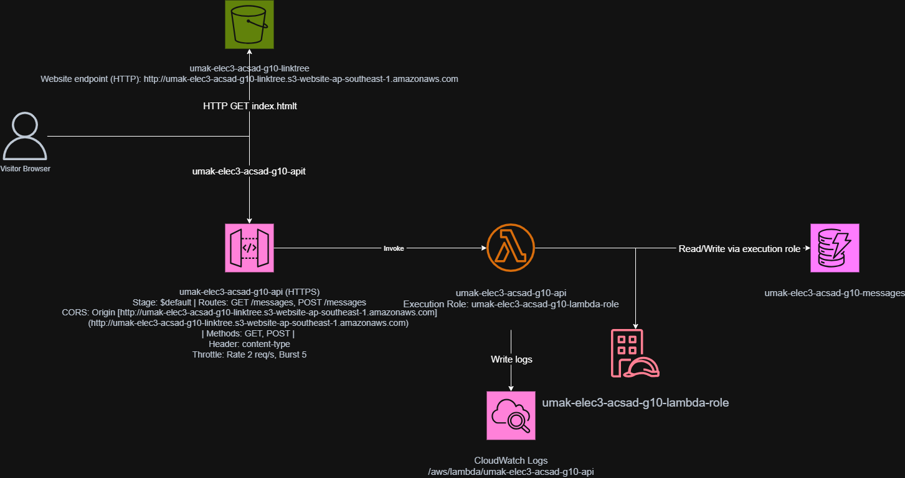

# Assignment 5 Submission

## About us

- Group number: 10
- Section: IV-ACSAD
- Group IAM user: acsad-g10

## Diagram

## Estimate

Asia Pacific (Singapore), one month: 100,000 page views and 5,000 posts.

| Service | Settings | Monthly cost (USD) |
| --- | --- | --- |
| Amazon S3 | S3 Standard, 1 GB, 100,000 GET requests | 0.07 USD |
| Amazon API Gateway | HTTP API, 0.105 million requests, 1 KB each | 0.13 USD |
| AWS Lambda | Without Free Tier, x86, 105,000 requests, 100 ms, 128 MB | 0.04 USD |
| Amazon DynamoDB | On-demand, Standard, 1 GB, 1 KB items, 0.005 million writes, 0.1 million eventually consistent reads | 0.29 USD |
| **Total** | | 0.53 USD |

Share link of our estimate: https://calculator.aws/#/estimate?id=026855496adce3c79eae89cb8c6a1bf104ea55e9

## Ten times the traffic

With 1,000,000 page views and 50,000 posts a month, which service's monthly cost grows the most in US dollars, and why?

Amazon DynamoDB grows the most in US dollars. Starting from 0.29 USD/month at 100,000 page views (0.1 million eventually consistent reads) and 5,000 posts (0.005 million writes) with 1 GB storage, scaling traffic by 10x raises reads to 1.0 million and writes to 0.05 million (while S3 GETs reach 1,000,000 and API Gateway/Lambda requests reach 1.05 million / 1,050,000, with storage still at 1 GB). DynamoDB on-demand charges significantly more per million write request units than per million read request units—and has a higher per-request cost than S3 GETs or Lambda/API calls at this scale—so its monthly USD cost increases more than S3 (0.07 USD baseline), API Gateway (0.13 USD baseline), or Lambda (0.04 USD baseline).

## The throttle and one more improvement

Which Well-Architected pillar does the throttle on the `$default` stage serve, and why?

The throttle (rate 2 requests/second, burst 5) primarily serves the Reliability pillar (while also supporting Cost Optimization and Security). Returning `429 Too Many Requests` when traffic exceeds the limit protects downstream Lambda invocations and DynamoDB reads/writes from traffic spikes or excessive bursts and helps prevent cascading slowdowns or resource exhaustion.

One more improvement for the same architecture, and the pillar that it serves:

Adding Amazon CloudFront in front of the site/guestbook (or adding pagination/query limits on `GET /messages` instead of scanning the full table as items grow) serves the Performance Efficiency pillar (and supports Cost Optimization) by reducing latency for visitors and avoiding unnecessary full-table read and transfer overhead as messages accumulate.

## Contribution

| GitHub username | What this groupmate did |
| --- | --- |
| silicon-dioxide | Answered questions |
| Kwin-Talattad | Answered questions & pulled |
| santiagojohncarlop-blip | Main navigator & answered questions |
| jmiranda12345681 | Answered questions |