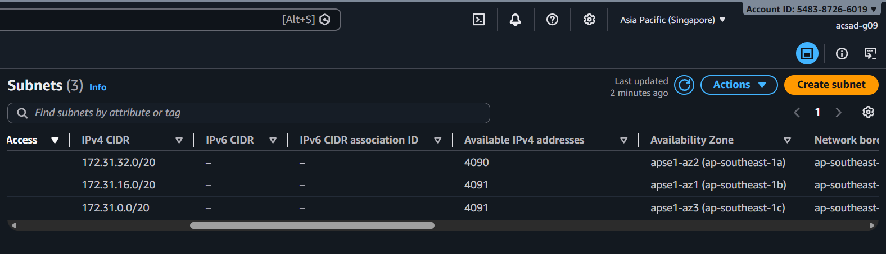
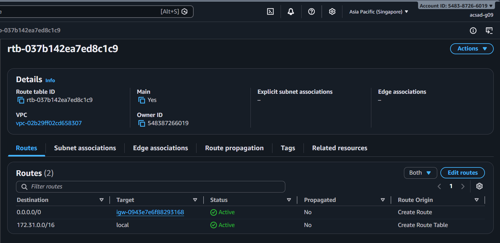
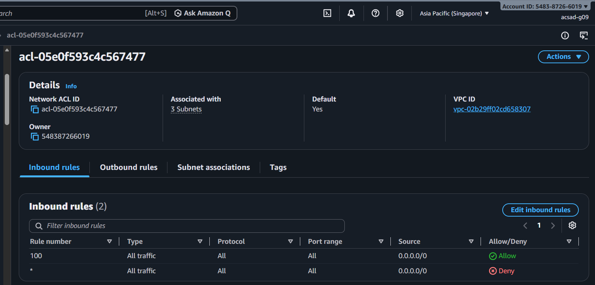
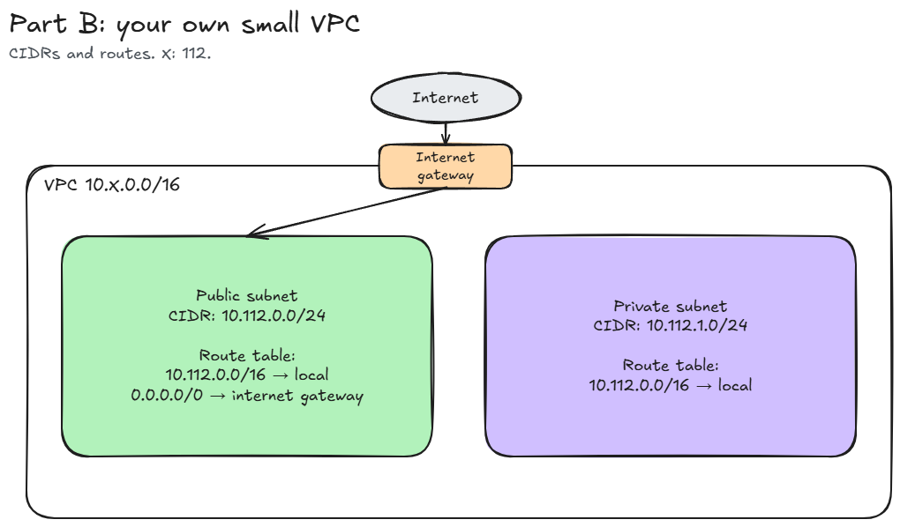

# Assignment 2 Submission

<!--
How to use this template:

1. Copy this file to submissions/assignment-2/<your-github-username>/submission.md
2. Replace every answer placeholder with your own answer. Delete the angle brackets too.
3. Save your four images in the same folder, with the exact file names below.
4. Do not write your full name or your student number in this file.
-->

## About me

- GitHub username: Azores-Mea
- Section: IV-ACSAD
- IAM user name that I signed in with: acsad-g09
- X: 112

---

## Part A. Explore

### A1. The VPC

Default VPC IPv4 CIDR:

172.31.0.0/16

Number of addresses in that CIDR:

65,536

### A2. The subnets

| Availability Zone | IPv4 CIDR |
| --- | --- |
| apse1-az2 (ap-southeast-1a) | 172.31.32.0/20 |
| apse1-az1 (ap-southeast-1b) | 172.31.16.0/20 |
| apse1-az3 (ap-southeast-1c) | 172.31.0.0/20 |

Screenshot 1. Save it as `screenshot-1-subnets.png` in your folder. The image line below shows it.

### A3. Available addresses

Available IPv4 addresses in each subnet:

4090
4091
4091

Why is the number lower than 4,096?

A /20 subnet has 4096 addresses and AWS reserves 5 addresses in every subnet which means that 4091 is the most available subnet can show.

What uses the missing address in the subnet with the lowest number?

The subnet with 4090 available IPv4 addresses has 1 more address in use than the others. This extra address is most likely held by a network interface that might belong to an instance, and a stopped instance that still keeps its address.

### A4. The route table

| Destination | Target |
| --- | --- |
| 0.0.0.0/0 | igw-... |
| 172.31.0.0/16 | local |

Screenshot 2. Save it as `screenshot-2-routes.png` in your folder. The image line below shows it.

### A5. Public or private

Are the default subnets public or private? Which route proves it?

Public, because 0.0.0.0/0 goes to the internet gateway

### A6. The internet gateway

State of the internet gateway:

State is Attached.

What happens to the default subnets if the gateway is detached?

If detached, the 0.0.0.0/0 route will not have a working target and subnet will lose internet access while the local route still works.

### A7. NAT gateways

Number of NAT gateways:

It says no NAT gateway found so the number will be 0.

Can a server in a new private subnet download updates? Why?

No, it will not be able to download updates because it has no route to an internet gateway and no NAT gateway to start connections.

### A8. The network ACL

| Rule number | Source | Allow or Deny |
| --- | --- | --- |
| 100 | 0.0.0.0/0 | Allow |
| * | 0.0.0.0/0 | Deny |

How is a network ACL different from a security group?

A network ACL is on the subnet and has allow and deny rules, it is checked by rule number and is stateless. While, security group is on the resource that has allow only and has state.

Screenshot 3. Save it as `screenshot-3-network-acl.png` in your folder. The image line below shows it.

### A9. The default security group

Inbound rule (type and source):

Type is All traffic and source is sg-0c5b6d4081cf0a534 - default

Which resources can send traffic to an instance that uses it?

Only those resources that belong to that same security group and will not allow traffic from other resources since there is no rule set for it.

---

## Part B. Prepare

### B1. Plan two subnets

- Public subnet CIDR: 10.112.0.0/24
- Private subnet CIDR: 10.112.1.0/24

### B2. Route tables

Route table of the public subnet:

| Destination | Target |
| --- | --- |
| 10.112.0.0/16 | local |
| 0.0.0.0/0 | internet gateway |

Route table of the private subnet:

| Destination | Target |
| --- | --- |
| 10.112.0.0/16 | local |

### B3. My VPC diagram

Tool used (Excalidraw, draw.io, Lucidchart, or paper):

Excalidraw

Save your diagram as `vpc-diagram.png` in your folder. The image line below shows it.

### B4. Predict a change

Can you still open the web page from your laptop? Why?

No, since 0.0.0.0/0 route targets the internet gateway, the request from my laptop won't get into the subnet which also means no replies can get back. The security group still allows HTTP, however, it won't help without a route.

Can the instance still reach another instance in the VPC? Why?

Yes, the local destination 172.31.0.0/16 wasn't deleted which means that the instances can still talk as long as their security groups allow the traffic. This is because 172.31.0.0/16 or local route is a separate route that doesn't depend on the internet gateway.

### B5. Place a database

Which subnet gets the database? Why?

I put the database in 10.112.1.0/24 or the private subnet because its route table only has local as target, which means that there’s no route to the internet gateway and nothing outside or on the internet can reach the database, making it more secure while still being reachable by servers in the VPC through the local route.

### B6. My question about VPCs

What is your question, and what made you think of it?

A question I have in mind while doing the assignment is why does NAT gateway sit in public subnet, according to the README file, and not in a private subnet? I thought of this while reading that part in the README, it says it sits in a public subnet but did not explain why.