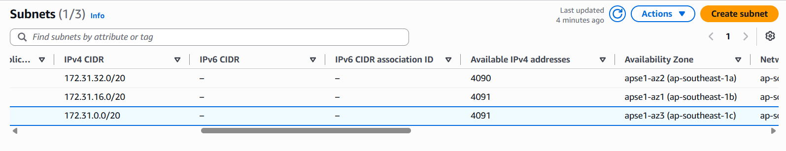
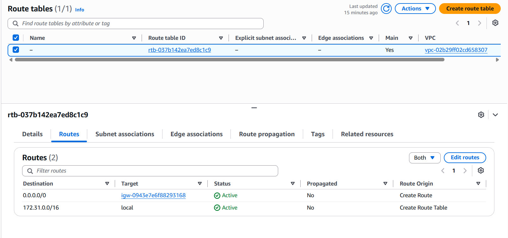
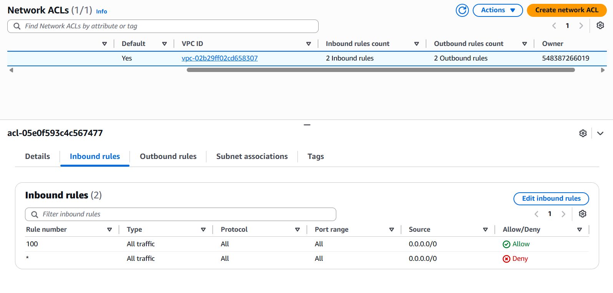
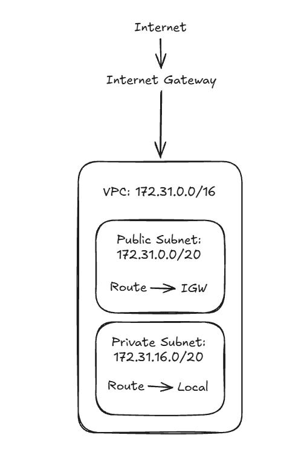

# Assignment 2 Submission

<!--
How to use this template:

1. Copy this file to submissions/assignment-2/<your-github-username>/submission.md
2. Replace every answer placeholder with your own answer. Delete the angle brackets too.
3. Save your four images in the same folder, with the exact file names below.
4. Do not write your full name or your student number in this file.
-->

## About me

- GitHub username: JCSK003
- Section: IV-ACSAD
- IAM user name that I signed in with: acsad-g07
- X: 141

---

## Part A. Explore

### A1. The VPC

Default VPC IPv4 CIDR:

172.31.0.0/16

Number of addresses in that CIDR:

65,536

### A2. The subnets

| Availability Zone | IPv4 CIDR |
| --- | --- |
| `apse1-az2 (ap-southeast-1a)` | `172.31.32.0/20` |
| `apse1-az1 (ap-southeast-1b)` | `172.31.16.0/20` |
| `apse1-az3 (ap-southeast-1c)` | `172.31.0.0/20` |

Screenshot 1. Save it as `screenshot-1-subnets.png` in your folder. The image line below shows it.

### A3. Available addresses

Available IPv4 addresses in each subnet:

4090, 4091, 4091

Why is the number lower than 4,096?

AWS keeps 5 IP addresses in each subnet for its own network services. So, out of the 4,096 addresses, only 4,091 are available for us to use.

What uses the missing address in the subnet with the lowest number?

One additional IPv4 address is currently being used by an AWS resource in that subnet, which reduces the available addresses from 4,091 to 4,090.

### A4. The route table

| Destination | Target |
| --- | --- |
| `172.31.0.0/16` | `local` |
| `0.0.0.0/0` | `igw-0943e7e6f88293168` |

Screenshot 2. Save it as `screenshot-2-routes.png` in your folder. The image line below shows it.

### A5. Public or private

Are the default subnets public or private? Which route proves it?

The default subnets are public because their route table has a route that points to the Internet Gateway, allowing them to access the internet.

### A6. The internet gateway

State of the internet gateway:

Attached

What happens to the default subnets if the gateway is detached?

The default subnets would no longer have internet access because they would not have a connection to the Internet Gateway.

### A7. NAT gateways

Number of NAT gateways:

0

Can a server in a new private subnet download updates? Why?

No. A server in a new private subnet cannot download updates because there is no NAT Gateway to provide internet access while keeping the server private.

### A8. The network ACL

| Rule number | Source | Allow or Deny |
| --- | --- | --- |
| `100` | `0.0.0.0/0` | `Allow` |
| `*` | `0.0.0.0/0` | `Deny` |

How is a network ACL different from a security group?

A network ACL controls traffic for an entire subnet, while a security group controls traffic for individual resources such as EC2 instances.

Screenshot 3. Save it as `screenshot-3-network-acl.png` in your folder. The image line below shows it.

### A9. The default security group

Inbound rule (type and source):

All traffic from the default security group.

Which resources can send traffic to an instance that uses it?

Resources that use the same default security group can send traffic to the instance.

---

## Part B. Prepare

### B1. Plan two subnets

- Public subnet CIDR: `172.31.0.0/20`
- Private subnet CIDR: `172.31.16.0/20`

### B2. Route tables

Route table of the public subnet:

| Destination | Target |
| --- | --- |
| `172.31.0.0/16` | `local` |
| `0.0.0.0/0` | `Internet Gateway` |

Route table of the private subnet:

| Destination | Target |
| --- | --- |
| `172.31.0.0/16` | `local` |

### B3. My VPC diagram

Tool used (Excalidraw, draw.io, Lucidchart, or paper):

Excalidraw

Save your diagram as `vpc-diagram.png` in your folder. The image line below shows it.

### B4. Predict a change

Can you still open the web page from your laptop? Why?

No. The instance is in a private subnet without a route to the Internet Gateway, so it cannot be accessed directly from the internet.

Can the instance still reach another instance in the VPC? Why?

Yes. The instance can still communicate with another instance in the VPC because the route table has a local route for communication within the VPC.

### B5. Place a database

Which subnet gets the database? Why?

The database goes in the private subnet because it does not need to be directly accessible from the internet. This makes it more secure while still allowing other resources in the VPC to access it.

### B6. My question about VPCs

What is your question, and what made you think of it?

How can a private subnet access the internet without being publicly accessible? I thought that being private meant it couldnt access the internet, so I became curious about how servers in it can still download updates.
