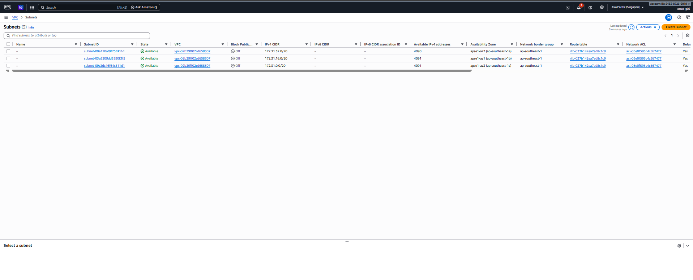
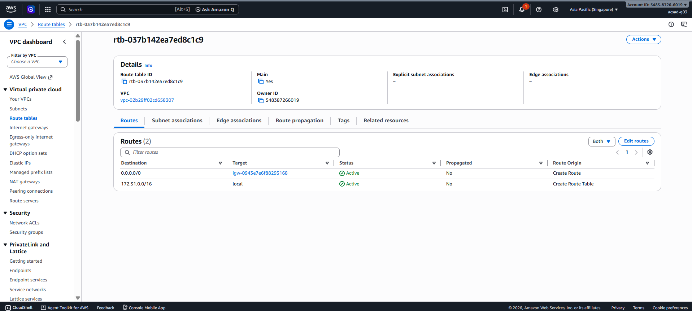
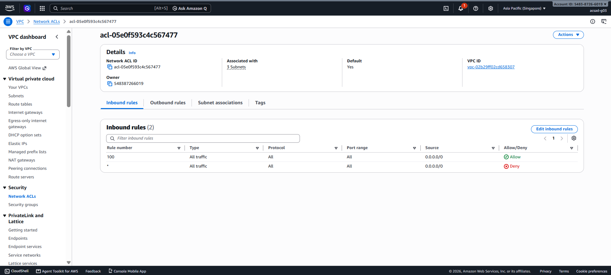
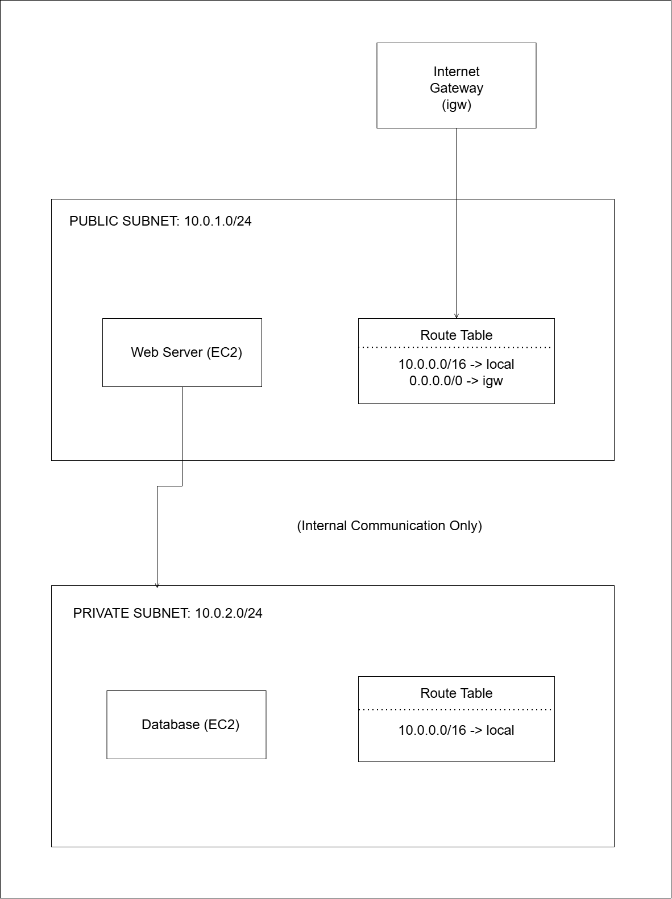

# Assignment 2 Submission

<!--
How to use this template:

1. Copy this file to submissions/assignment-2/<your-github-username>/submission.md
2. Replace every answer placeholder with your own answer. Delete the angle brackets too.
3. Save your four images in the same folder, with the exact file names below.
4. Do not write your full name or your student number in this file.
-->

## About me

- GitHub username: LUZADA-SARAH
- Section: acsad
- IAM user name that I signed in with: acsad-g03
- X: 110

---

## Part A. Explore

### A1. The VPC

Default VPC IPv4 CIDR:

172.31.0.0/16

Number of addresses in that CIDR:

65,536

### A2. The subnets

| Availability Zone | IPv4 CIDR |
| --- | --- |
| ap-southeast-1a | 172.31.0.0/20 |
| ap-southeast-1b | 172.31.16.0/20 |
| ap-southeast-1c | 172.31.32.0/20 |

Screenshot 1. Save it as `screenshot-1-subnets.png` in your folder. The image line below shows it.

### A3. Available addresses

Available IPv4 addresses in each subnet:

4,091

Why is the number lower than 4,096?

A /20 subnet has 4,096 total IP addresses, but AWS reserves 5 IP addresses per subnet for internal networking purposes (network address, VPC router, DNS, future use, and broadcast address).

What uses the missing address in the subnet with the lowest number?

An active EC2 instance or AWS service interface (Network Interface / ENI) provisioned in that subnet is using that additional IP address.

### A4. The route table

| Destination | Target |
| --- | --- |
| 172.31.0.0/16 | local |
| 0.0.0.0/0 | igw-0943e7e6f88293168 |

Screenshot 2. Save it as `screenshot-2-routes.png` in your folder. The image line below shows it.

### A5. Public or private

Are the default subnets public or private? Which route proves it?

The default subnets are public. The route `0.0.0.0/0` pointing to an internet gateway (`igw-0943e7e6f88293168`) as its target proves they are public.

### A6. The internet gateway

State of the internet gateway:

Attached

What happens to the default subnets if the gateway is detached?

They lose direct connectivity to and from the public internet, effectively becoming isolated or private subnets.

### A7. NAT gateways

Number of NAT gateways:

0

Can a server in a new private subnet download updates? Why?

No. A private subnet has no direct route to an Internet Gateway, and without a NAT Gateway, outbound traffic to the internet cannot be translated or routed.

### A8. The network ACL

| Rule number | Source | Allow or Deny |
| --- | --- | --- |
| 100 | 0.0.0.0/0 | Allow |
| * | 0.0.0.0/0 | Deny |

How is a network ACL different from a security group?

A network ACL operates at the subnet level and is stateless (explicit rules are required for both inbound and outbound traffic), whereas a security group operates at the instance level and is stateful (return traffic is automatically allowed).

Screenshot 3. Save it as `screenshot-3-network-acl.png` in your folder. The image line below shows it.

### A9. The default security group

Inbound rule (type and source):

All traffic from source sg-0c5b6d4081cf0a534 (the default security group itself).

Which resources can send traffic to an instance that uses it?

Only instances or resources that are assigned to the exact same default security group.

---

## Part B. Prepare

### B1. Plan two subnets

- Public subnet CIDR: 10.0.1.0/24
- Private subnet CIDR: 10.0.2.0/24

### B2. Route tables

Route table of the public subnet:

| Destination | Target |
| --- | --- |
| 10.0.0.0/16 | local |
| 0.0.0.0/0 | igw-0943e7e6f88293168 |

Route table of the private subnet:

| Destination | Target |
| --- | --- |
| 10.0.0.0/16 | local |

### B3. My VPC diagram

Tool used (Excalidraw, draw.io, Lucidchart, or paper):

draw.io

Save your diagram as `vpc-diagram.png` in your folder. The image line below shows it.

### B4. Predict a change

Can you still open the web page from your laptop? Why?

No. Removing the route to the Internet Gateway breaks external inbound/outbound communication from the public internet.

Can the instance still reach another instance in the VPC? Why?

Yes. The local route (`10.0.0.0/16 -> local`) is still intact, allowing internal communication between instances within the same VPC.

### B5. Place a database

Which subnet gets the database? Why?

The private subnet. Placing a database in a private subnet keeps it inaccessible from the public internet, protecting sensitive data while allowing application servers in the public subnet to communicate with it locally.

### B6. My question about VPCs

What is your question, and what made you think of it?

Question: How does AWS prevent IP address conflicts when connecting two different VPCs using VPC Peering or Transit Gateway?
Reason: Seeing how subnets use strict CIDR ranges made me wonder what happens if two companies or departments accidentally choose the exact same CIDR block (like 10.0.0.0/16) and try to connect their networks later.