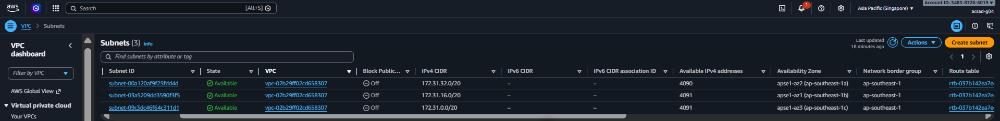
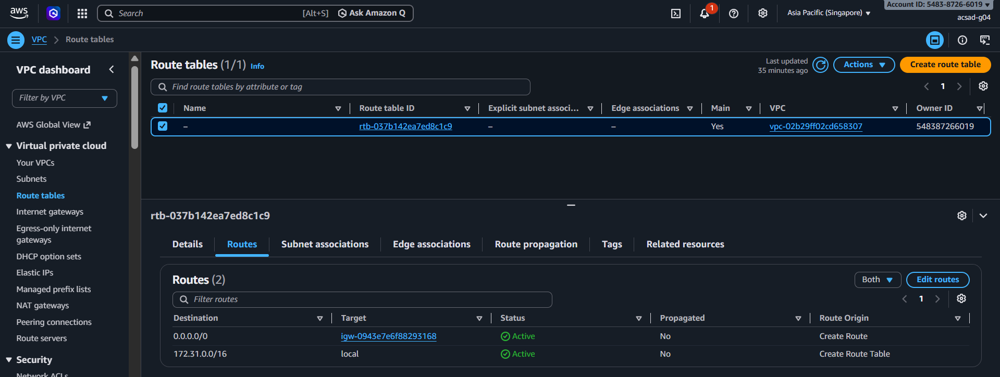
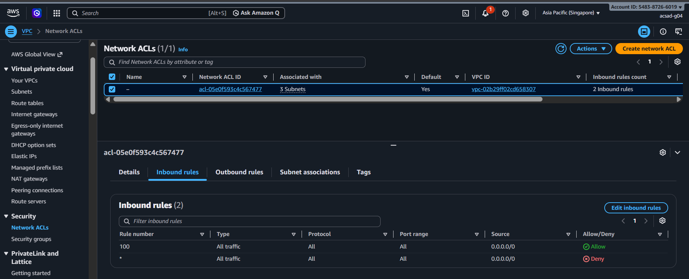
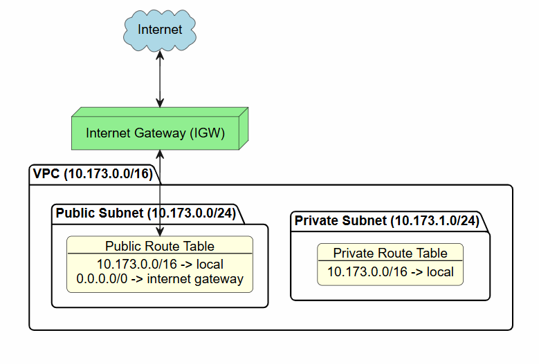

# Assignment 2 Submission

<!--
How to use this template:

1. Copy this file to submissions/assignment-2/<your-github-username>/submission.md
2. Replace every answer placeholder with your own answer. Delete the angle brackets too.
3. Save your four images in the same folder, with the exact file names below.
4. Do not write your full name or your student number in this file.
-->

## About me

- GitHub username: chupapichuros
- Section: IV-ACSAD
- IAM user name that I signed in with: acsad-g04
- X: 173

---

## Part A. Explore

### A1. The VPC

Default VPC IPv4 CIDR:

`172.31.0.0/16`

Number of addresses in that CIDR:

65,536

### A2. The subnets

| Availability Zone | IPv4 CIDR |
| --- | --- |
| `ap-southeast-1a` | `172.31.32.0/20` |
| `ap-southeast-1b` | `172.31.16.0/20` |
| `ap-southeast-1c` | `172.31.0.0/20` |

Screenshot 1. Save it as `screenshot-1-subnets.png` in your folder. The image line below shows it.

### A3. Available addresses

Available IPv4 addresses in each subnet:

`ap-southeast-1a` 4,090, `ap-southeast-1b` 4,091, `ap-southeast-1c` 4,091

Why is the number lower than 4,096?

A `/20` subnet contains 4,096 total IP addresses, but AWS reserves 5 IP addresses in each subnet for internal networking and management (network address, VPC router, DNS server, future use, and broadcast). This leaves 4,091 initially available addresses per subnet.

What uses the missing address in the subnet with the lowest number?

`ap-southeast-1a` has 4,090 available addresses (1 less than the other subnets). The missing address is occupied by an active network interface (such as a running EC2 instance) provisioned in that subnet.

### A4. The route table

| Destination | Target |
| --- | --- |
| `172.31.0.0/16` | `local` |
| `0.0.0.0/0` | `igw-0943e7e6f88293168` |

Screenshot 2. Save it as `screenshot-2-routes.png` in your folder. The image line below shows it.

### A5. Public or private

Are the default subnets public or private? Which route proves it?

Public. The default route `0.0.0.0/0` targeting the internet gateway (`igw-0943e7e6f88293168`) proves that the subnets are public because traffic can route directly to and from the internet.

### A6. The internet gateway

State of the internet gateway:

Attached

What happens to the default subnets if the gateway is detached?

If the internet gateway is detached from the VPC, the `0.0.0.0/0` route loses its target and the subnets lose all inbound and outbound internet connectivity. However, internal traffic between instances within the VPC will continue to function via the `local` route.

### A7. NAT gateways

Number of NAT gateways:

0

Can a server in a new private subnet download updates? Why?

No. There are no NAT gateways provisioned in the VPC, and private subnets do not have direct routes to an internet gateway. Therefore, a server in a private subnet has no outbound route to reach the internet and download updates.

### A8. The network ACL

| Rule number | Source | Allow or Deny |
| --- | --- | --- |
| 100 | `0.0.0.0/0` | Allow |
| `*` | `0.0.0.0/0` | Deny |

How is a network ACL different from a security group?

A network ACL controls traffic at the subnet boundary and is stateless, requiring explicit inbound and outbound rules for traffic to flow in both directions. A security group controls traffic at the individual instance level and is stateful, automatically allowing return response traffic. Additionally, network ACLs support explicit deny rules, while security groups only support allow rules.

Screenshot 3. Save it as `screenshot-3-network-acl.png` in your folder. The image line below shows it.

### A9. The default security group

Inbound rule (type and source):

All traffic, from `sg-0c5b6d4081cf0a534` (the default security group itself).

Which resources can send traffic to an instance that uses it?

Only resources that are assigned this same default security group (`sg-0c5b6d4081cf0a534`) can send traffic to the instance. All other inbound traffic is blocked.

---

## Part B. Prepare

### B1. Plan two subnets

- Public subnet CIDR: `10.173.0.0/24`
- Private subnet CIDR: `10.173.1.0/24`

### B2. Route tables

Route table of the public subnet:

| Destination | Target |
| --- | --- |
| `10.173.0.0/16` | `local` |
| `0.0.0.0/0` | `internet gateway` |

Route table of the private subnet:

| Destination | Target |
| --- | --- |
| `10.173.0.0/16` | `local` |

### B3. My VPC diagram

Tool used (Excalidraw, draw.io, Lucidchart, or paper):

Lucidchart

Save your diagram as `vpc-diagram.png` in your folder. The image line below shows it.

### B4. Predict a change

Can you still open the web page from your laptop? Why?

No. Without the `0.0.0.0/0` route pointing to the internet gateway in the route table, internet traffic cannot reach the instance and response traffic cannot return to your laptop, even if the instance has a public IP address.

Can the instance still reach another instance in the VPC? Why?

Yes. The `local` route for `172.31.0.0/16` remains active in the route table, allowing all instances inside the VPC to communicate with each other over the internal network.

### B5. Place a database

Which subnet gets the database? Why?

The private subnet (`10.173.1.0/24`). Database servers store sensitive data and should not be directly accessible from the public internet. Placing the database in the private subnet isolates it from internet threats while still allowing backend web/application servers in the public subnet to communicate with it internally.

### B6. My question about VPCs

What is your question, and what made you think of it?

How do administrators securely connect to and manage backend servers inside a private subnet without assigning them public IP addresses? I thought of this because while isolating databases and private servers prevents external attacks, operations teams still need a way to perform maintenance, apply security patches, and inspect server logs.
