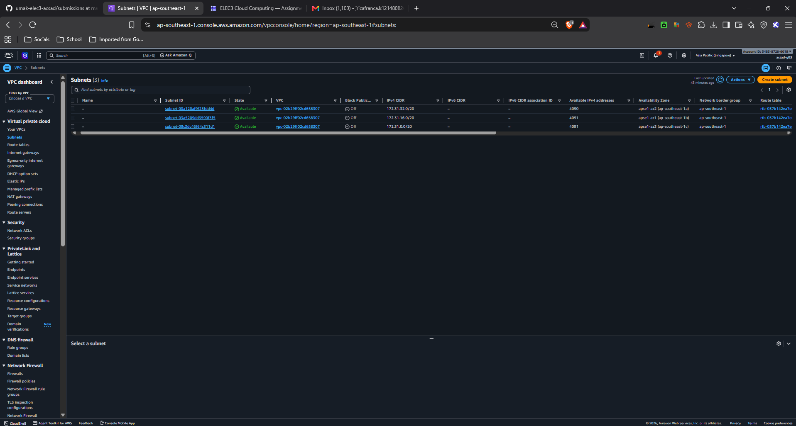
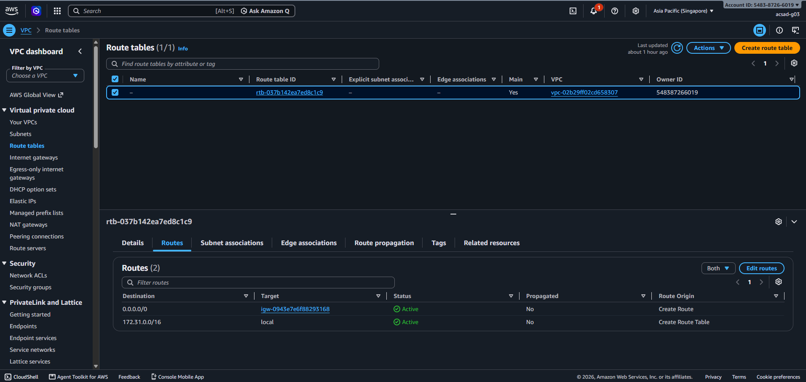
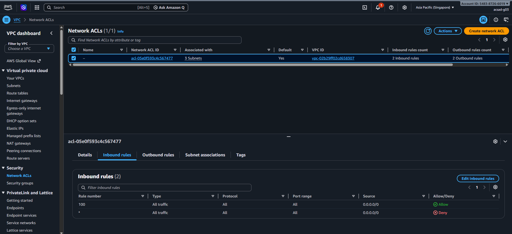
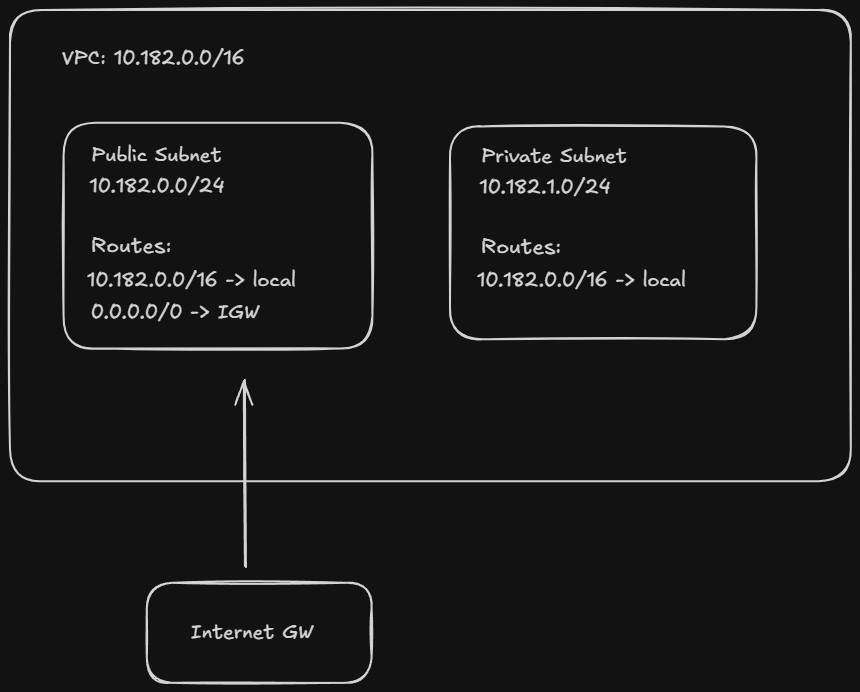

# Assignment 2 Submission

## About me

- GitHub username: johnclefordicafranca
- Section: [Your Section, e.g., IV-ACSAD]
- IAM user name that I signed in with: acsad-g03
- X: 182

---

## Part A. Explore

### A1. The VPC

Default VPC IPv4 CIDR:

`172.31.0.0/16`

Number of addresses in that CIDR:

65,536

### A2. The subnets

| Availability Zone | IPv4 CIDR |
| --- | --- |
| `ap-southeast-1a` | `172.31.32.0/20` |
| `ap-southeast-1b` | `172.31.16.0/20` |
| `ap-southeast-1c` | `172.31.0.0/20` |

Screenshot 1. Save it as `screenshot-1-subnets.png` in your folder. The image line below shows it.

### A3. Available addresses

Available IPv4 addresses in each subnet:

`4090`, `4091`, `4091`

Why is the number lower than 4,096?

AWS reserves 5 addresses in every subnet. An empty subnet has 4,096 - 5 = 4,091 available addresses.

What uses the missing address in the subnet with the lowest number?

Network interfaces use one address each. The subnet with 4090 has one interface taking up an address, likely the EC2 instance from Lab 2.

### A4. The route table

| Destination | Target |
| --- | --- |
| `0.0.0.0/0` | `igw-...` |
| `172.31.0.0/16` | `local` |

Screenshot 2. Save it as `screenshot-2-routes.png` in your folder. The image line below shows it.

### A5. Public or private

Are the default subnets public or private? Which route proves it?

Public. The route `0.0.0.0/0` sends traffic to the internet gateway (`igw-...`).

### A6. The internet gateway

State of the internet gateway:

`Attached`

What happens to the default subnets if the gateway is detached?

The route `0.0.0.0/0` has no working target. The subnets lose their path to the internet. Instances can still reach each other inside the VPC through the `local` route.

### A7. NAT gateways

Number of NAT gateways:

`0`

Can a server in a new private subnet download updates? Why?

No. A private subnet only has a local route. It needs a route to a NAT gateway to download updates, and there are no NAT gateways in this account.

### A8. The network ACL

| Rule number | Source | Allow or Deny |
| --- | --- | --- |
| 100 | `0.0.0.0/0` | Allow |
| `*` | `0.0.0.0/0` | Deny |

How is a network ACL different from a security group?

A network ACL protects a whole subnet. It is stateless, meaning inbound and outbound traffic are evaluated separately. It has both Allow and Deny rules, and rules are evaluated by number (lowest first). A Security Group protects a resource (like an EC2 instance). It is stateful, meaning if traffic is allowed in, the reply is automatically allowed out. It only has Allow rules.

Screenshot 3. Save it as `screenshot-3-network-acl.png` in your folder. The image line below shows it.

### A9. The default security group

Inbound rule (type and source):

All traffic, from `sg-0c5b6d4081cf0a534` (itself).

Which resources can send traffic to an instance that uses it?

Only resources that also use the `default` security group. No other inbound rule exists, so it blocks traffic from every other source.

---

## Part B. Prepare

### B1. Plan two subnets

- Public subnet CIDR: `10.182.0.0/24`
- Private subnet CIDR: `10.182.1.0/24`

### B2. Route tables

Route table of the public subnet:

| Destination | Target |
| --- | --- |
| `10.182.0.0/16` | `local` |
| `0.0.0.0/0` | internet gateway |

Route table of the private subnet:

| Destination | Target |
| --- | --- |
| `10.182.0.0/16` | `local` |

### B3. My VPC diagram

Tool used (Excalidraw, draw.io, Lucidchart, or paper):

Excalidraw

Save your diagram as `vpc-diagram.png` in your folder. The image line below shows it.

### B4. Predict a change

Can you still open the web page from your laptop? Why?

No. Without the `0.0.0.0/0` route, the instance has no path to the internet. A public IP address alone is not enough.

Can the instance still reach another instance in the VPC? Why?

Yes. The `local` route for the VPC range is still in the route table, so instances can still talk to each other inside the VPC.

### B5. Place a database

Which subnet gets the database? Why?

The private subnet (`10.182.1.0/24`). Because it has no route to the internet gateway, so nobody on the internet can reach the database.

### B6. My question about VPCs

What is your question, and what made you think of it?

Can two VPCs in the same account talk to each other, and must their CIDRs be different? I thought of it because many accounts use the same default range, `172.31.0.0/16`.
