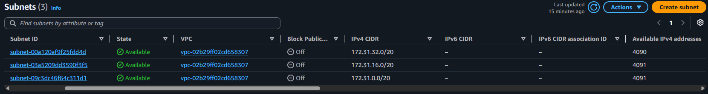
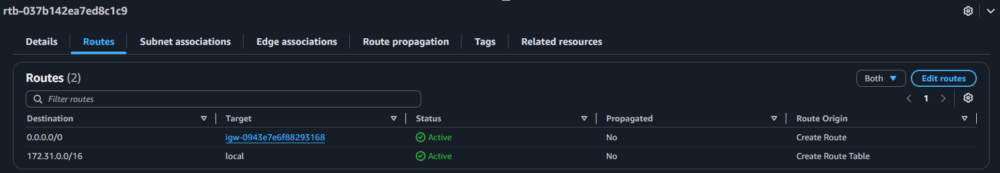
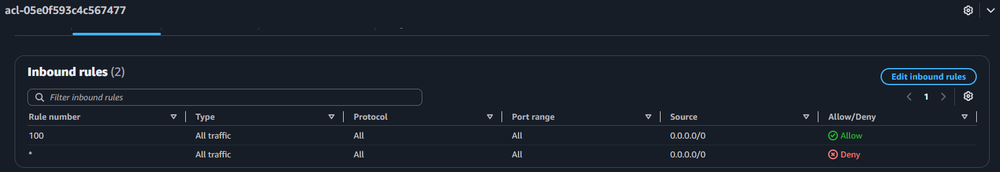
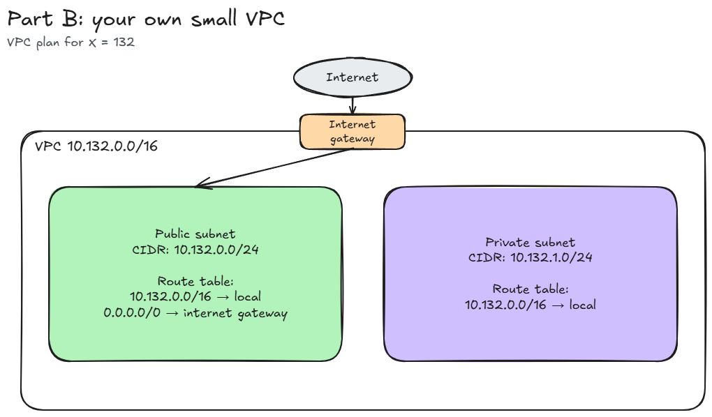

# Assignment 2 Submission

<!--
How to use this template:

1. Copy this file to submissions/assignment-2/<your-github-username>/submission.md
2. Replace every answer placeholder with your own answer. Delete the angle brackets too.
3. Save your four images in the same folder, with the exact file names below.
4. Do not write your full name or your student number in this file.
-->

## About me

- GitHub username: klienfinity123
- Section: IV-ACSAD
- IAM user name that I signed in with: acsad-g05
- X: 132

---

## Part A. Explore

### A1. The VPC

Default VPC IPv4 CIDR:

172.31.0.0/16

Number of addresses in that CIDR:

65,536

### A2. The subnets

| Availability Zone | IPv4 CIDR |
| --- | --- |
| ap-southeast-1a | 172.31.32.0/20 |
| ap-southeast-1b | 172.31.16.0/20 |
| ap-southeast-1c | 172.31.0.0/20 |

Screenshot 1. Save it as `screenshot-1-subnets.png` in your folder. The image line below shows it.

### A3. Available addresses

Available IPv4 addresses in each subnet:

ap-southeast-1a (172.31.32.0/20): 4,090
ap-southeast-1b (172.31.16.0/20): 4,091
ap-southeast-1c (172.31.0.0/20): 4,091

Why is the number lower than 4,096?

A /20 subnet has 4,096 IPv4 addresses. AWS reserves 5 IP addresses in each subnet, so only 4,091 addresses are normally available for use.

What uses the missing address in the subnet with the lowest number?

The ap-southeast-1a subnet has 4,090 available addresses, which is one fewer than the other two subnets. This means one additional IPv4 address is currently allocated to a resource in that subnet.

### A4. The route table

| Destination | Target |
| --- | --- |
| 0.0.0.0/0 | igw-0943e7e6f88293168 |
| 172.31.0.0/16 | local |

Screenshot 2. Save it as `screenshot-2-routes.png` in your folder. The image line below shows it.

### A5. Public or private

Are the default subnets public or private? Which route proves it?

The default subnets are public because their route table has a default route of 0.0.0.0/0 pointing to the Internet Gateway (igw-0943e7e6f88293168).

### A6. The internet gateway

State of the internet gateway:

Attached

What happens to the default subnets if the gateway is detached?

If the Internet Gateway is detached, the default subnets will no longer have Internet connectivity through the 0.0.0.0/0 route. Resources in the subnets can still communicate with other resources in the VPC through the local route, but they cannot use the Internet Gateway to access the Internet.

### A7. NAT gateways

Number of NAT gateways:

0

Can a server in a new private subnet download updates? Why?

No. A server in a new private subnet cannot download updates through a NAT gateway because there are no NAT gateways in the VPC. A private subnet does not use the Internet Gateway directly, so it would need a NAT gateway or another appropriate outbound connection to reach the Internet.

### A8. The network ACL

| Rule number | Source | Allow or Deny |
| --- | --- | --- |
| 100 | 0.0.0.0/0 | Allow |
| * | 0.0.0.0/0 | Deny |

How is a network ACL different from a security group?

A network ACL controls traffic at the subnet level and can allow or deny traffic using numbered rules. A security group controls traffic at the instance or network interface level and is stateful, meaning return traffic is automatically allowed for an allowed connection.

Screenshot 3. Save it as `screenshot-3-network-acl.png` in your folder. The image line below shows it.

### A9. The default security group

Inbound rule (type and source):

Type: All Traffic
Source: sg-0c5b6d4081cf0a534

Which resources can send traffic to an instance that uses it?

Resources that are associated with the same default security group (sg-0c5b6d4081cf0a534) can send traffic to the instance, because the inbound rule allows all traffic from that security group.

---

## Part B. Prepare

### B1. Plan two subnets

- Public subnet CIDR: 10.132.0.0/24
- Private subnet CIDR: 10.132.1.0/24

### B2. Route tables

Route table of the public subnet:

| Destination | Target |
| --- | --- |
| 10.132.0.0/16 | local |
| 0.0.0.0/0 | internet gateway |

Route table of the private subnet:

| Destination | Target |
| --- | --- |
| 10.132.0.0/16 | local |

### B3. My VPC diagram

Tool used (Excalidraw, draw.io, Lucidchart, or paper):

Excalidraw

Save your diagram as `vpc-diagram.png` in your folder. The image line below shows it.

### B4. Predict a change

Can you still open the web page from your laptop? Why?

No. If the Internet Gateway is detached, the public subnet can no longer use the 0.0.0.0/0 → Internet Gateway route to communicate with the Internet. Therefore, I cannot open the web page from my laptop.

Can the instance still reach another instance in the VPC? Why?

Yes. Instances can still communicate with other instances inside the same VPC through the local route 10.132.0.0/16 → local. This communication uses private IP addresses and does not require the Internet Gateway.

### B5. Place a database

Which subnet gets the database? Why?

The database gets placed in the private subnet (10.132.1.0/24). This keeps the database from being directly accessible from the public Internet while still allowing servers inside the VPC to communicate with it using private IP addresses.

### B6. My question about VPCs

What is your question, and what made you think of it?

What will happen if a certain VPC has multiple private subnets but just only have one NAT gateway?
