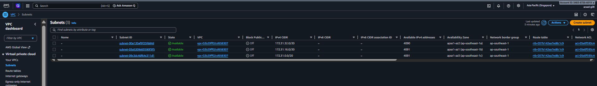
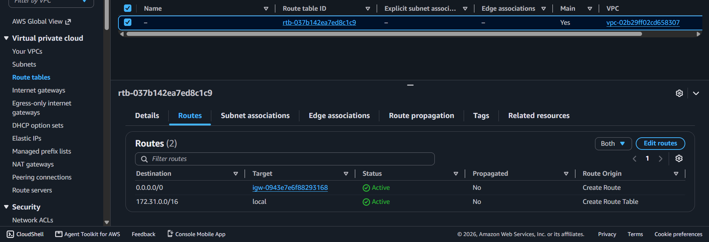
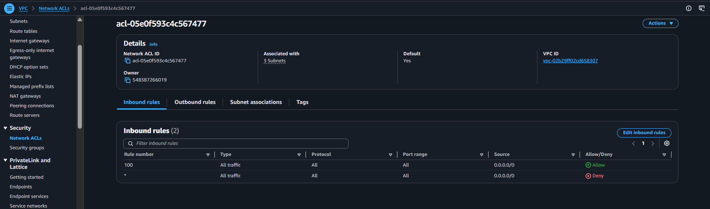
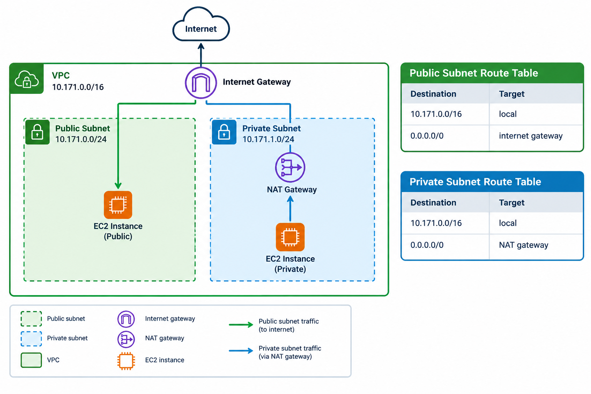

# Assignment 2 Submission

## About me

- GitHub username: klomol-jo
- Section: 4 - ACSAD
- IAM user name that I signed in with: GROUP 9
- X: 171

---

## Part A. Explore

### A1. The VPC

Default VPC IPv4 CIDR:

172.31.0.0/16

Number of addresses in that CIDR:

65,536

### A2. The subnets

| Availability Zone | IPv4 CIDR |
| --- | --- |
| ap-southeast-1a | 172.31.32.0/20 |
| ap-southeast-1b | 172.31.16.0/20 |
| ap-southeast-1c | 172.31.0.0/20 |

Screenshot 1. Save it as `screenshot-1-subnets.png` in your folder. The image line below shows it.

### A3. Available addresses

Available IPv4 addresses in each subnet:

- ap-southeast-1a: 4090
- ap-southeast-1b: 4091
- ap-southeast-1c: 4091

Why is the number lower than 4,096?

AWS reserves 5 IPv4 addresses in each subnet, so they are not available for use.

What uses the missing address in the subnet with the lowest number?

One additional private IPv4 address is currently allocated in the ap-southeast-1a subnet.

### A4. The route table

| Destination | Target |
| --- | --- |
| 0.0.0.0/0 | igw-0943e7e6f88293168 |
| 172.31.0.0/16 | local |

Screenshot 2. Save it as `screenshot-2-routes.png` in your folder. The image line below shows it.

### A5. Public or private

Are the default subnets public or private? Which route proves it?

The default subnets are public. The route `0.0.0.0/0` points to the internet gateway `igw-0943e7e6f88293168`, which provides a route to the internet.

### A6. The internet gateway

State of the internet gateway:

Attached

What happens to the default subnets if the gateway is detached?

The default subnets would lose internet connectivity through the internet gateway, but resources in the VPC could still communicate using the local route.

### A7. NAT gateways

Number of NAT gateways:

0

Can a server in a new private subnet download updates? Why?

No. There is no NAT gateway, so the private subnet would not have a route that allows the server to access the internet for updates.

### A8. The network ACL

| Rule number | Source | Allow or Deny |
| --- | --- | --- |
| 100 | 0.0.0.0/0 | Allow |
| * | 0.0.0.0/0 | Deny |

How is a network ACL different from a security group?

A network ACL controls traffic at the subnet level and can allow or deny traffic. A security group controls traffic at the instance level and uses allow rules.

Screenshot 3. Save it as `screenshot-3-network-acl.png` in your folder. The image line below shows it.

### A9. The default security group

Inbound rule (type and source):

All traffic from `sg-0c5b6d4081cf0a534`.

Which resources can send traffic to an instance that uses it?

Resources that are associated with the same security group can send traffic to the instance.

---

## Part B. Prepare

### B1. Plan two subnets

- Public subnet CIDR: 10.171.0.0/24
- Private subnet CIDR: 10.171.1.0/24

### B2. Route tables

Route table of the public subnet:

| Destination | Target |
| --- | --- |
| 10.171.0.0/16 | local |
| 0.0.0.0/0 | internet gateway |

Route table of the private subnet:

| Destination | Target |
| --- | --- |
| 0.0.0.0/0 | NAT gateway |

### B3. My VPC diagram

Tool used: draw.io

Save your diagram as `vpc-diagram.png` in your folder. The image line below shows it.

### B4. Predict a change

Can you still open the web page from your laptop? Why?

No. If the `0.0.0.0/0` route is deleted from the default route table, the instance no longer has a default route to the internet gateway.

Can the instance still reach another instance in the VPC? Why?

Yes. The local route for the VPC remains, so instances in the same VPC can still communicate.

### B5. Place a database

Which subnet gets the database? Why?

The database should be placed in the private subnet because it does not need to be directly accessible from the internet.

### B6. My question about VPCs

What is your question, and what made you think of it?

How does a VPC handle traffic between resources in different subnets? I thought of this while planning the public and private subnets and considering how the resources would communicate with each other.
