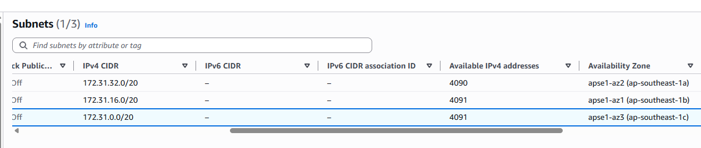
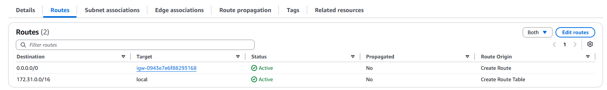
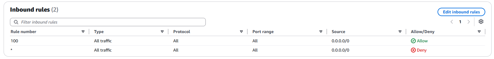
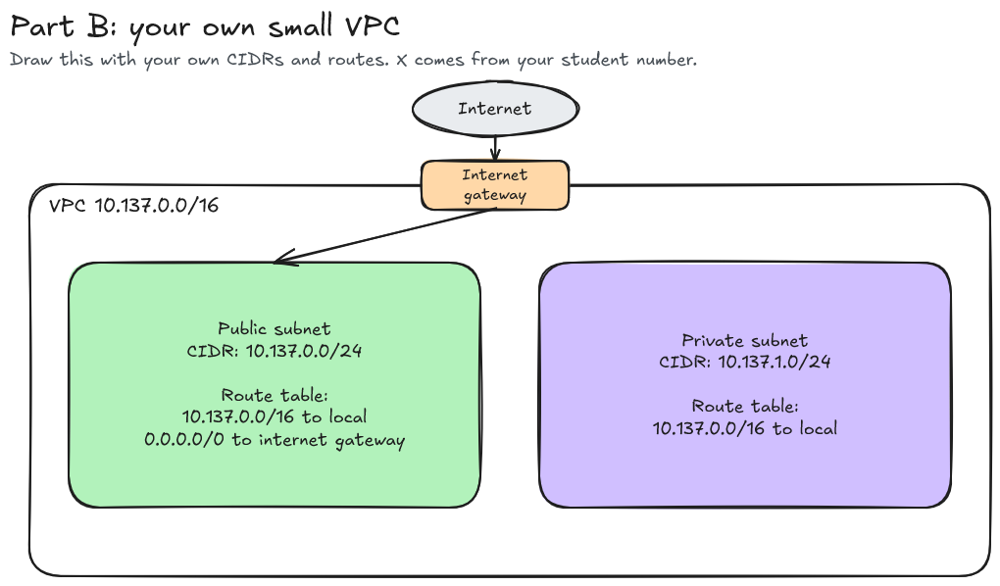

# Assignment 2 Submission

<!--
How to use this template:

1. Copy this file to submissions/assignment-2/<your-github-username>/submission.md
2. Replace every answer placeholder with your own answer. Delete the angle brackets too.
3. Save your four images in the same folder, with the exact file names below.
4. Do not write your full name or your student number in this file.
-->

## About me

- GitHub username: mik4rin
- Section: IV - ACSAD
- IAM user name that I signed in with: acsad-g02
- X: 137

---

## Part A. Explore

### A1. The VPC

Default VPC IPv4 CIDR: 

172.31.0.0/16

Number of addresses in that CIDR: 

65,536

### A2. The subnets

| Availability Zone | IPv4 CIDR |
| --- | --- |
| apse1-az2 | 172.31.32.0/20 |
| apse1-az1 | 172.31.16.0/20 |
| apse1-az3 | 172.31.0.0/20 |

### A3. Available addresses

Available IPv4 addresses in each subnet:

apse1-az2 4090, apse1-az1 4091, apse1-az3 4091

Why is the number lower than 4,096?

Because AWS reserves 5 addresses for each subnet. /20 has a total of 4096 IPv4 address, 4096 - 5 = 4091. 

What uses the missing address in the subnet with the lowest number?

apse1-az2 has 1 fewer address than the others. I think it's because 1 additional IP address is currently assigned to a network interface which was done during lab-2.

### A4. The route table

| Destination | Target |
| --- | --- |
| 0.0.0.0/0 | igw-0943e7e6f88293168 |
| 172.31.0.0/16 | local |

### A5. Public or private

Are the default subnets public or private? Which route proves it?

Public. The route 0.0.0.0/0 -> igw-0943e7e6f88293168 proves it because it sends traffic to an Internet Gateway.

### A6. The internet gateway

State of the internet gateway:

Attached

What happens to the default subnets if the gateway is detached?

Internet Traffic is dropped and they stop being public.

### A7. NAT gateways

Number of NAT gateways:

0

Can a server in a new private subnet download updates? Why?

No because it only has the local route by default.

### A8. The network ACL

| Rule number | Source | Allow or Deny |
| --- | --- | --- |
| 100 | 0.0.0.0/0 | Allow |
| * | 0.0.0.0/0 | Deny |

How is a network ACL different from a security group?

In Network ACL, all rules can be allowed/denied while in Security Group, it is Allowed only.

### A9. The default security group

Inbound rule (type and source):

Type: All traffic
Source: sg-0c5b6d4081cf0a534 / default

Which resources can send traffic to an instance that uses it?

Resources that are members of the same security group.

---

## Part B. Prepare

### B1. Plan two subnets

- Public subnet CIDR: 10.137.0.0/24
- Private subnet CIDR: 10.137.1.0/24

### B2. Route tables

Route table of the public subnet:

| Destination | Target |
| --- | --- |
| 10.137.0.0/16 | local |
| 0.0.0.0/0 | internet gateway |

Route table of the private subnet:

| Destination | Target |
| --- | --- |
| 10.137.0.0/16 | local |

### B3. My VPC diagram

Tool used (Excalidraw, draw.io, Lucidchart, or paper):

Excalidraw

### B4. Predict a change

Can you still open the web page from your laptop? Why?

Without the 0.0.0.0/0 to internet gateway, there's no route for internet traffic so the request cannot be routed in.

Can the instance still reach another instance in the VPC? Why?

Yes, because traffic between instances in the VPC still works, as long as the security groups and network acl allow it

### B5. Place a database

Which subnet gets the database? Why?

The private subnet 10.137.1.0/24 because it doesn't need to be reachable from the internet. 
 
### B6. My question about VPCs

What is your question, and what made you think of it?

What are the uses of other subnet prefixes such as /8, /17, /18, /32, etc... in AWS' VPCs I thought of it since only /24 and /16 are used in this activity.