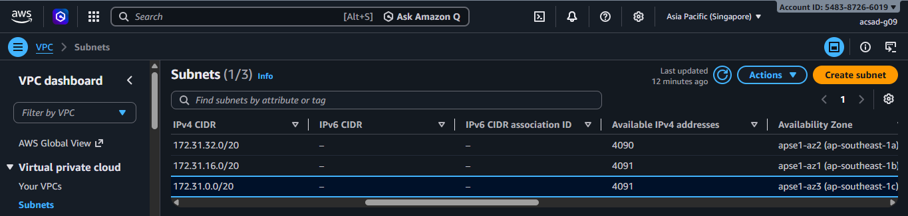
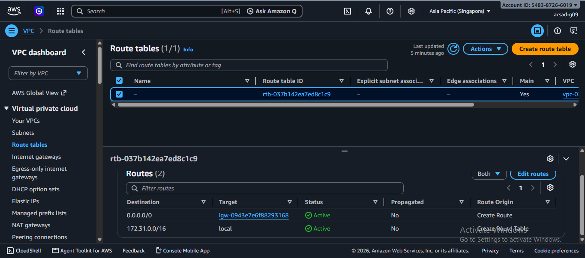
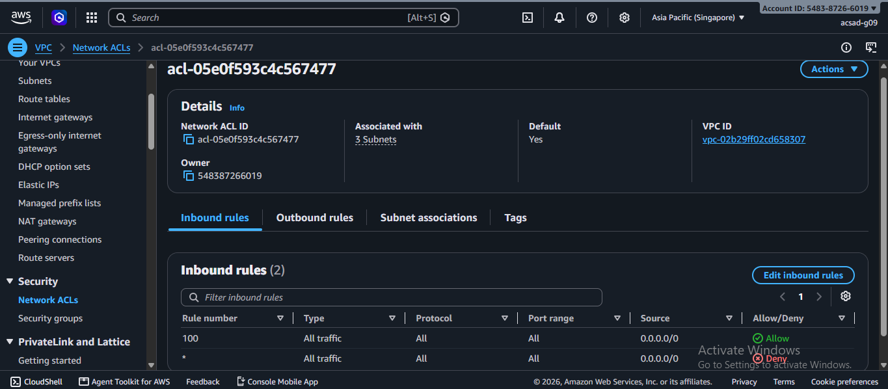
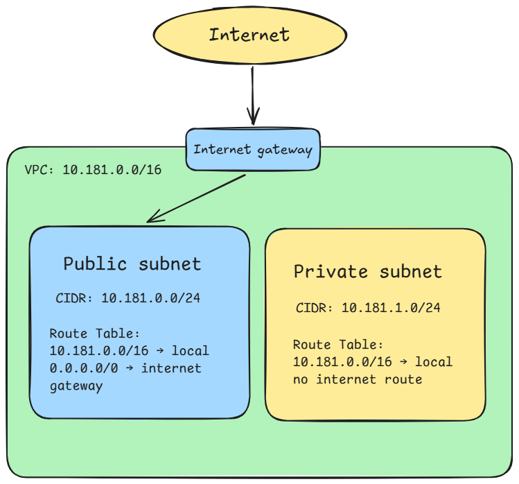

# Assignment 2 Submission

<!--
How to use this template:

1. Copy this file to submissions/assignment-2/<your-github-username>/submission.md
2. Replace every answer placeholder with your own answer. Delete the angle brackets too.
3. Save your four images in the same folder, with the exact file names below.
4. Do not write your full name or your student number in this file.
-->

## About me

- GitHub username: rdanlogA12345581
- Section: IV-ACSAD
- IAM user name that I signed in with: acsad-g09
- X: 181

---

## Part A. Explore

### A1. The VPC

Default VPC IPv4 CIDR: 

172.31.0.0/16

Number of addresses in that CIDR:

65,536

### A2. The subnets

| Availability Zone | IPv4 CIDR |
| --- | --- |
| ap-southeast-1a | 172.31.32.0/20 |
| ap-southeast-1b | 172.31.16.0/20 |
| ap-southeast-1c | 172.31.0.0/20 |

Screenshot 1. Save it as `screenshot-1-subnets.png` in your folder. The image line below shows it.

### A3. Available addresses

Available IPv4 addresses in each subnet:

ap-southeast-1a 4,090, ap-southeast-1b 4,091, ap-southeast-1c 4,091

Why is the number lower than 4,096?

because /20 CIDR block has 4,096 total IP addresses but AWS reserves 5 addresses in every subnets for its own internal use. So: 4,096 - 5 = 4,091

If one subnet shows a lower number than the others, what uses the missing address in the subnet with the lowest number?

ap-southeast-1a 4,090 has the lowest subnet number, one EC2 instance has its network interface in ap-southeast-1a

### A4. The route table

| Destination | Target |
| --- | --- |
| 0.0.0.0/0 | igw-0943e7e6f88293168 |
| 172.31.0.0/16 | local |

Screenshot 2. Save it as `screenshot-2-routes.png` in your folder. The image line below shows it.

### A5. Public or private

Are the default subnets public or private? Which route proves it?

They are in public, 0.0.0.0/0 igw-0943e7e6f88293168 sends all outbound traffic to the internet gateway, proving the subnet has a direct path to the internet.

### A6. The internet gateway

State of the internet gateway:

Attached

What happens to the default subnets if the gateway is detached?

I think the 0.0.0.0/0 route will no longer have a working target making the subnets lose their path to the internet. However, instances can still reach each other due to the local route which is 172.31.0.0/16 local

### A7. NAT gateways

Number of NAT gateways:

None. No NAT gateways found

Can a server in a new private subnet download updates? Why?

I have no own answer for this as there was no NAT gateways found, but I did my research. According to Google, a private subnet has no route to an internet gateway, so it can't reach the internet directly. The only other path would be through a NAT gateway. But, since I have no NAT gateway, it needs to create a NAT gateway and the private subnet's route table would need a route to it before updates could be downloaded

### A8. The network ACL

| Rule number | Source | Allow or Deny |
| --- | --- | --- |
| 100 | 0.0.0.0/0 | Allow |
| * | 0.0.0.0/0 | Deny |

How is a network ACL different from a security group?

A network ACL protects a whole subnet, while a security group protects a single resource. A network ACL is stateless (needs separate inbound and outbound rules) and can both allow and deny traffic, while a security group is stateful and can only allow traffic

Screenshot 3. Save it as `screenshot-3-network-acl.png` in your folder. The image line below shows it.

### A9. The default security group

Inbound rule (type and source):

Type: All traffic; Source: sg-0c5b6d4081cf0a534 - default

Which resources can send traffic to an instance that uses it?

Only resources that also use the default security group can send traffic to it. No other inbound rule exists, so traffic from any other source is blocked

---

## Part B. Prepare

### B1. Plan two subnets

- Public subnet CIDR: 10.181.0.0/24
- Private subnet CIDR: 10.181.1.0/24

### B2. Route tables

Route table of the public subnet:

| Destination | Target |
| --- | --- |
| 10.181.0.0/16 | local |
| 0.0.0.0/0 | internet gateway |

Route table of the private subnet:

| Destination | Target |
| --- | --- |
| 10.181.0.0/16 | local |

### B3. My VPC diagram

Tool used (Excalidraw, draw.io, Lucidchart, or paper):

Excalidraw

Save your diagram as `vpc-diagram.png` in your folder. The image line below shows it.

### B4. Predict a change

Can you still open the web page from your laptop? Why?

No, you can't reach the instance from the internet without 0.0.0.0/0 route

Can the instance still reach another instance in the VPC? Why?

Yes, you can still reach another instance in the VPC, because the local route still connects the whole VPC range

### B5. Place a database

Which subnet gets the database? Why?

The private subnet (10.181.1.0/24), because its route table has no path to the internet gateway, so nobody outside the VPC can reach it.

### B6. My question about VPCs

What is your question, and what made you think of it?

Nothing much, I just want to ask why there was no NAT gateways? or was it just an error in my end? I first think of it because I'm afraid I might do something wrong
