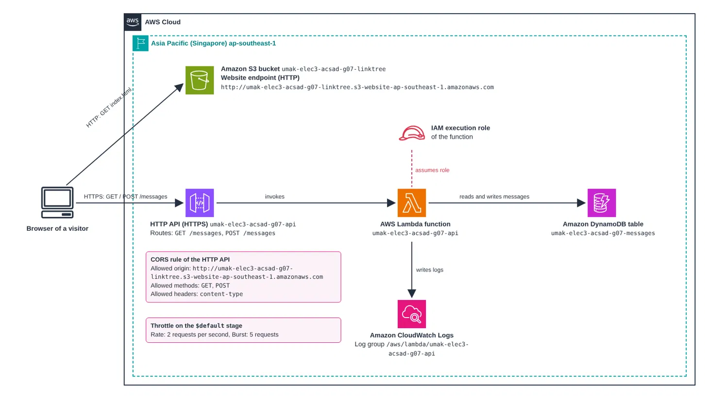

# Assignment 5 Submission

<!--
How to use this template:

1. Copy this file to submissions/assignment-5/group-<number>/submission.md
2. Replace every <answer> with your group's answer. Delete the angle brackets too.
3. Save diagram.png in the same folder.
4. Keep your invoke URL, your API ID, every ARN, and the account number out of this folder.
5. Write GitHub usernames, not full names or student numbers.
-->

## About us

- Group number: 07
- Section: IV - ACSAD
- Group IAM user: acsad-g07

## Diagram

## Estimate

Asia Pacific (Singapore), one month: 100,000 page views and 5,000 posts.

| Service | Settings | Monthly cost (USD) |
| --- | --- | --- |
| Amazon S3 | S3 Standard, 1 GB, 100,000 GET requests | 0.07 |
| Amazon API Gateway | HTTP API, 0.105 million requests, 1 KB each | 0.13 |
| AWS Lambda | Without Free Tier, x86, 105,000 requests, 100 ms, 128 MB | 0.04 |
| Amazon DynamoDB | On-demand, Standard, 1 GB, 1 KB items, 0.005 million writes, 0.1 million eventually consistent reads | 30.40 |
| **Total** | | 30.64 |

Share link of our estimate: https://calculator.aws/#/estimate?id=f1828c267d113ca581181d49808b56d3c8a8b094

## Ten times the traffic

With 1,000,000 page views and 50,000 posts a month, which service's monthly cost grows the most in US dollars, and why?

Amazon API Gateway grows the most. Its cost is almost all per request, and it has the highest price for each request of the four services. Ten times the requests (0.105 million to 1.05 million) takes it from 0.13 USD to about 1.30 USD, an increase of about 1.17 USD. Lambda grows from 0.04 USD to about 0.43 USD, and S3 from 0.07 USD to about 0.43 USD, because their requests cost less. Part of the S3 and DynamoDB cost is storage, and storage stays at 1 GB, so that part does not grow.

## The throttle and one more improvement

Which Well-Architected pillar does the throttle on the `$default` stage serve, and why?

The throttle serves the Reliability pillar. When too many requests come at once, API Gateway answers 429 Too Many Requests and does not call our function, so a flood of requests cannot overload our Lambda function and DynamoDB table, and the API keeps working for normal visitors.

One more improvement for the same architecture, and the pillar that it serves:

Put Amazon CloudFront in front of the S3 website endpoint, so visitors open our site over HTTPS instead of HTTP. This serves the Security pillar, because it encrypts the traffic between the browser and our site.
## Contribution

| GitHub username | What this groupmate did |
| --- | --- |
| Sdjada | Created the AWS Calculator |
| yoonice0393 | edited the submission.md and did the PR |
| N0micon18 | tested and checked the results |
| JCKS003 | Created the diagram |
