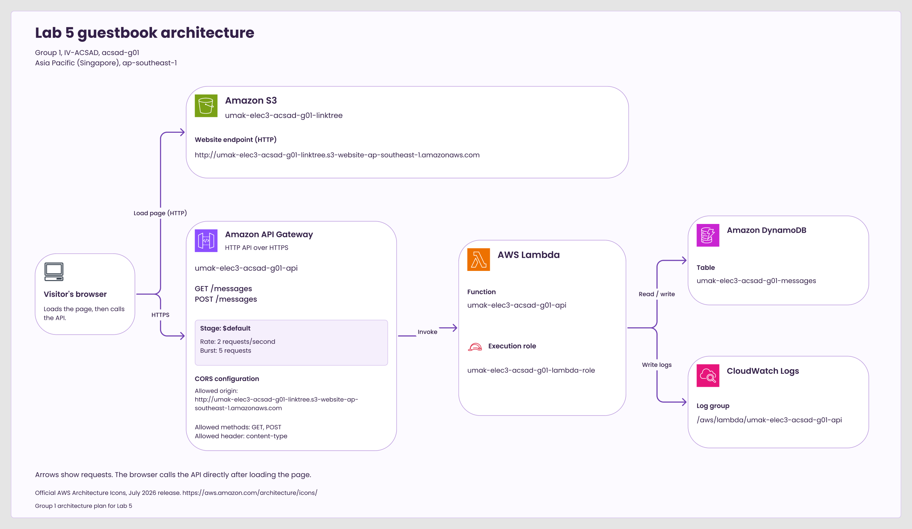

# Assignment 5 Submission

<!--
How to use this template:

1. Copy this file to submissions/assignment-5/group-<number>/submission.md
2. Replace every <answer> with your group's answer. Delete the angle brackets too.
3. Save diagram.png in the same folder.
4. Keep your invoke URL, your API ID, every ARN, and the account number out of this folder.
5. Write GitHub usernames, not full names or student numbers.
-->

## About us

- Group number: 1
- Section: IV-ACSAD
- Group IAM user: acsad-g01

## Diagram

[Editable FigJam diagram](https://www.figma.com/board/gYVCqI85gL4s3CWl9176rd)

## Estimate

Asia Pacific (Singapore), one month: 100,000 page views and 5,000 posts.

| Service | Settings | Monthly cost (USD) |
| --- | --- | --- |
| Amazon S3 | S3 Standard, 1 GB, 100,000 GET requests | 0.07 |
| Amazon API Gateway | HTTP API, 0.105 million requests, 1 KB each | 0.13 |
| AWS Lambda | Without Free Tier, x86, 105,000 requests, 100 ms, 128 MB | 0.04 |
| Amazon DynamoDB | On-demand, Standard, 1 GB, 1 KB items, 0.005 million writes, 0.1 million eventually consistent reads | 0.29 |
| **Total** | | **0.53** |

Share link of our estimate: [Group 1 AWS Pricing Calculator estimate](https://calculator.aws/#/estimate?id=dfbdc0778dc761cdf6dd35e6740beaaf0529ce1e).

Upfront cost: **USD 0.00**. All four services use Asia Pacific (Singapore). We verified the saved link in an Edge InPrivate window without signing in. Costs are the calculator's displayed monthly amounts, rounded to two decimal places.

As instructed, the estimate excludes internet data transfer, CloudWatch Logs, and the additional preflight and message-reload requests.

## Ten times the traffic

With 1,000,000 page views and 50,000 posts a month, which service's monthly cost grows the most in US dollars, and why?

**Amazon API Gateway grows the most.** HTTP API requests rise from 105,000 to 1,050,000 at USD 1.25 per million requests. Its monthly charge therefore rises from USD 0.13125 to USD 1.3125, an increase of **USD 1.18125**, or about **USD 1.18**.

Using the unit rates shown in the calculator's calculations, the increases are:

| Service | Calculation using additional monthly usage | Increase (USD) |
| --- | --- | --- |
| Amazon S3 | 900,000 GET requests × 0.0000004 | 0.3600 |
| Amazon API Gateway | 945,000 requests × 0.00000125 | **1.1813** |
| AWS Lambda | (945,000 requests × 0.0000002) + (11,812.5 GB-seconds × 0.0000166667) | 0.3859 |
| Amazon DynamoDB | (45,000 write units × 0.00000071) + (450,000 read units × 0.0000001425) | 0.0961 |

Increases are calculated before rounding the service totals and are shown to four decimal places. S3 and DynamoDB storage remain at 1 GB. Lambda remains at 128 MB and 100 ms; each GET still reads one 1 KB item, using half a read unit for an eventually consistent read. A temporary calculator copy with ten times the traffic displayed USD 2.55 per month. The Task 2 share link retains the original traffic estimate.

## The throttle and one more improvement

Which Well-Architected pillar does the throttle on the `$default` stage serve, and why?

**Reliability.** The rate of 2 requests per second and burst of 5 limit sudden demand on Lambda and DynamoDB. API Gateway can reject excess requests with `429 Too Many Requests`, helping prevent resource exhaustion (Amazon Web Services, *REL05-BP02 Throttle requests*).

One more improvement for the same architecture, and the pillar that it serves:

**Security:** serve the S3 website through Amazon CloudFront over HTTPS to encrypt traffic between the browser and the website. The current S3 website endpoint supports HTTP only (Amazon Web Services, *Website endpoints*).

## Contribution

| GitHub username | What this groupmate did |
| --- | --- |
| Jerothegreat | Tasks 1–4: co-created the architecture diagram, prepared the pricing estimate and ten-times-traffic comparison, and contributed to the throttle and improvement answers. |
| cess-O | Task 1: co-created the architecture diagram with saintschalice and Jerothegreat. |
| Vnslv | Task 4: prepared the throttle and improvement answers with Jerothegreat. |
| saintschalice | Task 1: co-created the architecture diagram with cess-O and Jerothegreat. |

## References

Amazon Web Services. *AWS architecture icons*. https://aws.amazon.com/architecture/icons/

Amazon Web Services. *AWS Pricing Calculator*. Estimate dated November 16, 2026. https://calculator.aws/#/estimate?id=dfbdc0778dc761cdf6dd35e6740beaaf0529ce1e

Amazon Web Services. *REL05-BP02 Throttle requests*. AWS Well-Architected Framework. https://docs.aws.amazon.com/wellarchitected/latest/reliability-pillar/rel_mitigate_interaction_failure_throttle_requests.html

Amazon Web Services. *Website endpoints*. Amazon Simple Storage Service user guide. https://docs.aws.amazon.com/AmazonS3/latest/userguide/WebsiteEndpoints.html
