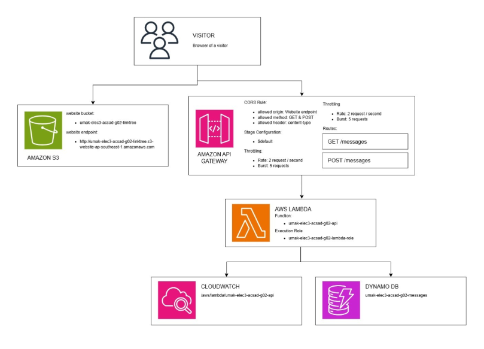

# Assignment 5 Submission

<!--
How to use this template:

1. Copy this file to submissions/assignment-5/group-<number>/submission.md
2. Replace every <answer> with your group's answer. Delete the angle brackets too.
3. Save diagram.png in the same folder.
4. Keep your invoke URL, your API ID, every ARN, and the account number out of this folder.
5. Write GitHub usernames, not full names or student numbers.
-->

## About us

- Group number: 2
- Section: 4-ACSAD
- Group IAM user: acsad-g02

## Diagram

## Estimate

Asia Pacific (Singapore), one month: 100,000 page views and 5,000 posts.

| Service | Settings | Monthly cost (USD) |
| --- | --- | --- |
| Amazon S3 | S3 Standard, 1 GB, 100,000 GET requests | 0.07 USD |
| Amazon API Gateway | HTTP API, 0.105 million requests, 1 KB each | 0.13 USD |
| AWS Lambda | Without Free Tier, x86, 105,000 requests, 100 ms, 128 MB | 0.04 USD |
| Amazon DynamoDB | On-demand, Standard, 1 GB, 1 KB items, 0.005 million writes, 0.1 million eventually consistent reads | 0.29 USD |
| **Total** | | 0.53 |

Share link of our estimate: https://calculator.aws/#/estimate?id=945118c92f71769882dcc16326d5e61f2418b27e

## Ten times the traffic

With 1,000,000 page views and 50,000 posts a month, which service's monthly cost grows the most in US dollars, and why?

Amazon API Gateway grows the most in US dollars because its pricing is 100% request-based and every single get and post request in this architecture passes through it. Unlike S3 and DynamoDB, whose baseline storage costs stay fixed regardless of visitor count, API Gateway scales directly with total request volume at a higher per-million request rate than the other services.

## The throttle and one more improvement

Which Well-Architected pillar does the throttle on the `$default` stage serve, and why?

This serves the Reliability pillar of the AWS Well-Architected Framework. By capping steady traffic at 2 requests per second and bursts at 5 requests (returning 429 Too Many Requests when exceeded), it prevents sudden traffic spikes, accidental loops, or request floods from overwhelming the Lambda function and DynamoDB table, helping the system stay stable and avoid cascading failures.

One more improvement for the same architecture, and the pillar that it serves:

Add Amazon CloudFront in front of the S3 website endpoint to cache static content at edge locations closer to visitors, which serves the Performance Efficiency pillar by reducing latency and offloading repeated requests from the origin.

## Contribution

| GitHub username | What this groupmate did |
| --- | --- |
| shinu-syr | built the diagram, .md file, and PR |
| eyakmwamwa | assisted in navigating the process and questions |
| carlcawas | navigated the whole process and answered the questions |
| mik4rin | rechecked the works , answers and process |