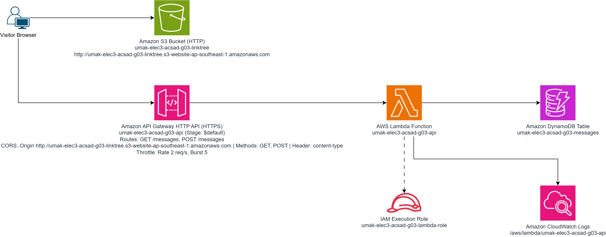

# Assignment 5 Submission

<!--
How to use this template:

1. Copy this file to submissions/assignment-5/group-<number>/submission.md
2. Replace every <answer> with your group's answer. Delete the angle brackets too.
3. Save diagram.png in the same folder.
4. Keep your invoke URL, your API ID, every ARN, and the account number out of this folder.
5. Write GitHub usernames, not full names or student numbers.
-->

## About us

- Group number: 3
- Section: IV-ACSAD
- Group IAM user: acsad-g03

## Diagram

## Estimate

Asia Pacific (Singapore), one month: 100,000 page views and 5,000 posts.

| Service | Settings | Monthly cost (USD) |
| --- | --- | --- |
| Amazon S3 | S3 Standard, 1 GB, 100,000 GET requests | 0.01 |
| Amazon API Gateway | HTTP API, 0.105 million requests, 1 KB each | 0.13 |
| AWS Lambda | Without Free Tier, x86, 105,000 requests, 100 ms, 128 MB | 0.00 |
| Amazon DynamoDB | On-demand, Standard, 1 GB, 1 KB items, 0.005 million writes, 0.1 million eventually consistent reads | 0.29 |
| **Total** | | 0.43 |

Share link of our estimate: [PASTE_YOUR_AWS_CALCULATOR_SHARE_LINK_HERE](https://calculator.aws/#/estimate?id=84a3aab2511bfe42d666d04c4700fa3c36122ed3)

## Ten times the traffic

With 1,000,000 page views and 50,000 posts a month, which service's monthly cost grows the most in US dollars, and why?

**Amazon API Gateway** grows the most in US dollars. Its cost scales linearly with request volume (`0.105` million requests = `$0.13`), so multiplying traffic by 10 (`1.05` million requests) increases its cost 10x to `~$1.30` (a `+$1.17` increase). Although Amazon DynamoDB has the highest initial cost (`$0.29`), almost all of that (`~$0.285`) comes from fixed `1 GB` storage rather than request volume (`0.1M` reads and `0.005M` writes cost less than `$0.02`), so 10x traffic only adds `~$0.18` (`~$0.47` total), while S3 and Lambda remain minimal.

## The throttle and one more improvement

Which Well-Architected pillar does the throttle on the `$default` stage serve, and why?

It serves the **Reliability** pillar (and also supports **Cost Optimization**). Setting a rate limit of 2 requests per second and a burst of 5 protects the backend Lambda function and DynamoDB table from sudden traffic spikes or request floods by rejecting excess calls with `429 Too Many Requests`, keeping the application available for normal users and preventing unnecessary compute and database charges[cite: 11, 12].

One more improvement for the same architecture, and the pillar that it serves:

Adding **Amazon CloudFront** in front of the S3 website bucket serves the **Security** and **Performance Efficiency** pillars by enabling end-to-end HTTPS encryption in transit (instead of serving the frontend over plain HTTP) and caching static assets at edge locations closer to visitors[cite: 11].

## Contribution

| GitHub username | What this groupmate did |
| --- | --- |
| RICAFRANCA_johnclefordricafranca  | Drew the architecture diagram, configured the AWS Pricing Calculator estimate, and assembled the submission |
| DELA CRUZed_jjff | Reviewed the architecture diagram and verified the AWS Pricing Calculator service inputs |
| LUZADA_LUZADA_SARAH  | Verified the public share link and answered the 10x traffic cost growth question |
| MANGINSAY_reymarttskrt  | Answered the Well-Architected Framework pillar questions and checked the final submission |
