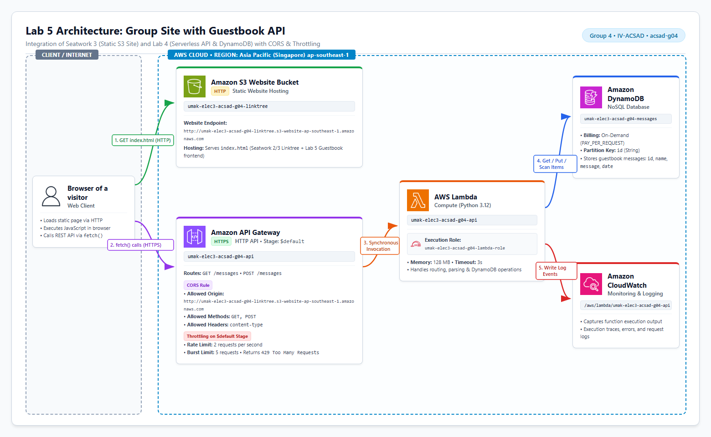

# Assignment 5 Submission

<!--
How to use this template:

1. Copy this file to submissions/assignment-5/group-<number>/submission.md
2. Replace every <answer> with your group's answer. Delete the angle brackets too.
3. Save diagram.png in the same folder.
4. Keep your invoke URL, your API ID, every ARN, and the account number out of this folder.
5. Write GitHub usernames, not full names or student numbers.
-->

## About us

- Group number: 4
- Section: IV-ACSAD
- Group IAM user: acsad-g04

## Diagram

## Estimate

Asia Pacific (Singapore), one month: 100,000 page views and 5,000 posts.

| Service | Settings | Monthly cost (USD) |
| --- | --- | --- |
| Amazon S3 | S3 Standard, 1 GB, 100,000 GET requests | 0.07 |
| Amazon API Gateway | HTTP API, 0.105 million requests, 1 KB each | 0.13 |
| AWS Lambda | Without Free Tier, x86, 105,000 requests, 100 ms, 128 MB | 0.04 |
| Amazon DynamoDB | On-demand, Standard, 1 GB, 1 KB items, 0.005 million writes, 0.1 million eventually consistent reads | 0.02 |
| **Total** | | 0.26 |

Share link of our estimate: https://calculator.aws/#/estimate?id=0fa1fa466678f52b27059ddbda4637284437dafc

## Ten times the traffic

With 1,000,000 page views and 50,000 posts a month, which service's monthly cost grows the most in US dollars, and why?

With 1,000,000 page views and 50,000 posts a month (a tenfold increase in traffic), Amazon API Gateway's monthly cost grows the most in US dollars. At the baseline traffic of 105,000 requests (0.105 million), API Gateway costs USD 0.13. Scaling traffic tenfold to 1,050,000 requests (1.05 million) increases API Gateway's monthly cost to USD 1.31, representing an absolute growth of USD 1.18. In contrast, Amazon S3 costs grow by approximately USD 0.40 (from USD 0.07 to USD 0.47 for 1,000,000 GET requests and 1 GB storage), AWS Lambda costs grow by USD 0.39 (from USD 0.04 to USD 0.43 for 1,050,000 invocations running 100 ms at 128 MB), and Amazon DynamoDB costs grow by approximately USD 0.21 (from USD 0.02 to USD 0.23 for 50,000 standard writes and 1,000,000 eventually consistent reads). API Gateway experiences the highest dollar increase because its unit rate of USD 1.25 per million HTTP API requests is significantly higher than the per-million equivalent pricing of Lambda compute and requests (USD 0.41 per million), S3 GET requests (USD 0.44 per million), and DynamoDB on-demand request units, and 100% of all incoming requests must pass through API Gateway without any tiered volume discounts or free tier offset at this volume.

## The throttle and one more improvement

Which Well-Architected pillar does the throttle on the `$default` stage serve, and why?

The throttle on the `$default` stage (rate limit of 2 requests per second and burst limit of 5 requests) primarily serves the **Cost Optimization** pillar (as well as the **Reliability** pillar). By enforcing rate and burst limits at the API Gateway layer, requests exceeding the threshold are immediately rejected at the cloud edge with an HTTP `429 Too Many Requests` status code. Because API Gateway handles and rejects these requests directly, downstream AWS Lambda functions are never invoked and DynamoDB operations are never initiated for excess traffic. This prevents denial-of-wallet scenarios, unintended runaway billing from infinite loops or flood traffic, and unbudgeted cloud expenses. Additionally, under the Reliability pillar, throttling protects backend dependencies from being overwhelmed by traffic spikes, ensuring that legitimate requests continue to be processed stably.

One more improvement for the same architecture, and the pillar that it serves:

**Improvement:** Deploy an **Amazon CloudFront** distribution in front of the Amazon S3 website bucket (configured with HTTPS encryption and edge caching) and attach **AWS WAF (Web Application Firewall)** to CloudFront and Amazon API Gateway.  
**Pillars served:** **Security** and **Performance Efficiency**.  
Under the Security pillar, CloudFront delivers the static site over encrypted HTTPS rather than plaintext HTTP, mitigating eavesdropping and man-in-the-middle attacks, while AWS WAF inspects web traffic to filter out malicious requests (such as SQL injection, cross-site scripting, and bot traffic) before reaching API Gateway or Lambda. Under the Performance Efficiency pillar, CloudFront caches `index.html` and static assets across global edge locations close to visitors, drastically reducing latency and offloading GET request volume from the S3 origin bucket.

## Contribution

| GitHub username | What this groupmate did |
| --- | --- |
| chupapichuros | Calculated the baseline 1-month service estimates for S3, API Gateway, Lambda, and DynamoDB in the AWS Pricing Calculator, validated the settings, and generated the public share link. |
| EvapeGT | Designed, structured, and labeled the official AWS architecture diagram (`diagram.png`) showing all components, group identifiers, HTTP/HTTPS protocols, CORS rules, and throttle limits. |
| Note-Program | Analyzed the tenfold traffic growth scenario, performed the cost increase calculations across all four services, and formulated the explanation for why API Gateway exhibits the largest dollar growth. |
| Steeshesh | Researched and articulated how stage throttling aligns with the Well-Architected Cost Optimization and Reliability pillars, and proposed the CloudFront/WAF architectural improvement. |
