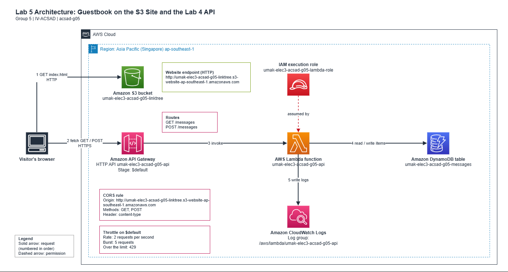

# Assignment 5 Submission

## About us

- Group number: 5
- Section: IV-ACSAD
- Group IAM user: acsad-g05

## Diagram

## Estimate

Asia Pacific (Singapore), one month: 100,000 page views and 5,000 posts.

| Service | Settings | Monthly cost (USD) |
| --- | --- | --- |
| Amazon S3 | S3 Standard, 1 GB, 100,000 GET requests | 0.07 |
| Amazon API Gateway | HTTP API, 0.105 million requests, 1 KB each | 0.13 |
| AWS Lambda | Without Free Tier, x86, 105,000 requests, 100 ms, 128 MB | 0.04 |
| Amazon DynamoDB | On-demand, Standard, 1 GB, 1 KB items, 0.005 million writes, 0.1 million eventually consistent reads | 0.29 |
| **Total** | | 0.53 |

Share link of our estimate: https://calculator.aws/#/estimate?id=992cb49468a3f620e3b20a55606266b4f5bdcd50

## Ten times the traffic

With 1,000,000 page views and 50,000 posts a month, which service's monthly cost grows the most in US dollars, and why?

Amazon API Gateway grows the most. At ten times the traffic, API requests go from 0.105 million to 1.05 million a month. API Gateway charges only per request, so its cost grows about ten times, from $0.13 to $1.31, an increase of $1.18. S3 and Lambda also grow, but their price per request is lower, so their increases are smaller (S3: +$0.35, Lambda: +$0.39). DynamoDB grows the least (+$0.10) because most of its $0.29 is the 1 GB of storage, which does not change with traffic.

## The throttle and one more improvement

Which Well-Architected pillar does the throttle on the `$default` stage serve, and why?

The throttle serves the Reliability pillar. The `$default` stage allows 2 requests per second with a burst of 5, so if too many requests arrive at once, the extra ones get `429 Too Many Requests` and never reach the Lambda function or the DynamoDB table. This keeps the backend working normally for real visitors instead of being overloaded. It also helps Cost Optimization, because a bot or a flood of requests cannot keep raising the bill.

One more improvement for the same architecture, and the pillar that it serves:

Put Amazon CloudFront in front of the S3 bucket so the page is served over HTTPS and cached. This serves the Security pillar (encrypted traffic to the page) and also Performance Efficiency (cached pages load faster).

## Contribution

| GitHub username | What this groupmate did |
| --- | --- |
| MrBep | **Task 1 (Diagram):** Made most of the architecture diagram. This covers the visitor's browser, the S3 bucket and website endpoint, the HTTP API with its two routes, the CORS rule, the throttle, the Lambda function and its role, the DynamoDB table, CloudWatch Logs, and the arrows for each request. |
| Rengokunn | **Task 2 (Estimate):** Filled in the AWS Pricing Calculator for Amazon S3, Amazon API Gateway, AWS Lambda, and Amazon DynamoDB in Asia Pacific (Singapore), recorded the monthly cost of each and the total, and made the share link. **Task 3 (Ten times the traffic):** Made a copy of the estimate with ten times the traffic, compared the monthly costs, and wrote the answer that API Gateway grows the most. |
| klienfinity123 | **Task 1 (Diagram):** Helped MrBep with the diagram. **Pull Request:** Created the branch and the pull request for the group. |
| stratterium | **Task 2 (Estimate):** Guided Rengokunn step by step while filling in the calculator. **Task 4 (Throttle and improvement):** Wrote the answer about the throttle and its Well-Architected pillar, and the CloudFront improvement. |
