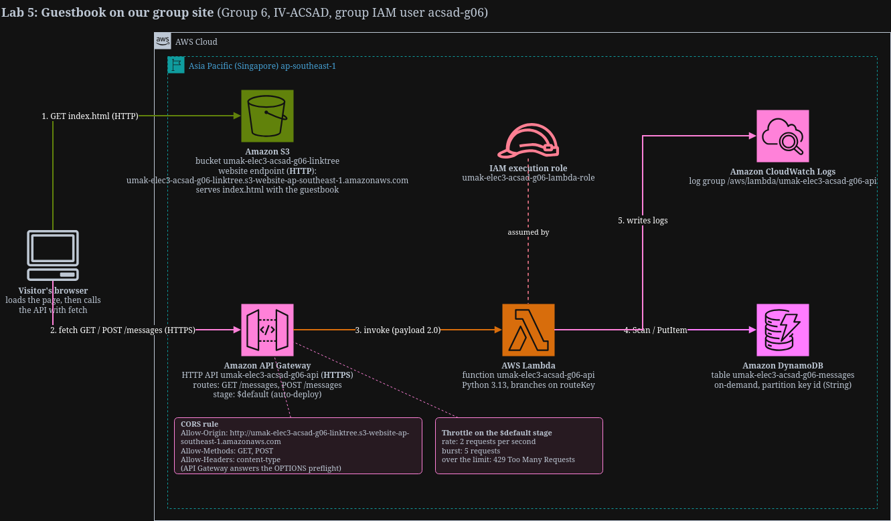

# Assignment 5 Submission

## About us

- Group number: 6
- Section: IV-ACSAD
- Group IAM user: acsad-g06

## Diagram

## Estimate

Asia Pacific (Singapore), one month: 100,000 page views and 5,000 posts.

| Service | Settings | Monthly cost (USD) |
| --- | --- | --- |
| Amazon S3 | S3 Standard, 1 GB, 100,000 GET requests | 0.07 |
| Amazon API Gateway | HTTP API, 0.105 million requests, 1 KB each | 0.13 |
| AWS Lambda | Without Free Tier, x86, 105,000 requests, 100 ms, 128 MB | 0.04 |
| Amazon DynamoDB | On-demand, Standard, 1 GB, 1 KB items, 0.005 million writes, 0.1 million eventually consistent reads | 0.29 |
| **Total** | | 0.53 |

Share link of our estimate: https://calculator.aws/#/estimate?id=b9f326620a0afd203b7b76adf37547e0de4b9483

## Ten times the traffic

With 1,000,000 page views and 50,000 posts a month, which service's monthly cost grows the most in US dollars, and why?

Amazon API Gateway grows the most, from about 0.13 USD to about 1.31 USD, an increase of about 1.18 USD. API Gateway has no fixed part in our estimate: it charges 1.25 USD for each million requests, and every page view (a GET) and every post (a POST) is a request, so ten times the requests is ten times the cost. Lambda also grows tenfold, but from a smaller base, to about 0.43 USD (+0.39 USD), because it charges 0.20 USD per million requests plus a small charge per millisecond at 128 MB. S3 grows to about 0.43 USD (+0.36 USD), because only its GET requests grow and its 1 GB of storage stays the same. DynamoDB grows the least, to about 0.39 USD (+0.09 USD), because most of its cost is the 0.29 USD for 1 GB of storage, which does not change with traffic, and its reads and writes are cheap.

## The throttle and one more improvement

Which Well-Architected pillar does the throttle on the `$default` stage serve, and why?

Reliability, and also Cost Optimization. The throttle lets through at most 2 requests per second with a burst of 5, and answers `429 Too Many Requests` to the rest without calling our function, so a flood of requests from a bot or a script cannot overload our Lambda function or our DynamoDB table and the guestbook keeps working for real visitors. Because API Gateway stops the extra requests before they reach Lambda and DynamoDB, a flood also cannot run up our bill for those services.

One more improvement for the same architecture, and the pillar that it serves:

Put Amazon CloudFront in front of the S3 website endpoint, with an AWS Certificate Manager certificate, so that visitors load the page over HTTPS instead of HTTP and the bucket no longer has to be public (CloudFront reads it through Origin Access Control). This serves the Security pillar, because it encrypts the traffic between the visitor and our site and removes the public bucket policy. It also serves Performance Efficiency, because CloudFront caches the page in edge locations closer to the visitors.

## Contribution

| GitHub username | What this groupmate did |
| --- | --- |
| tlswlgus | Built the estimate in the AWS Pricing Calculator and made the share link |
| yellowboeing120 | Drew the architecture diagram in draw.io with the AWS icons |
| amagpantaya12345923-gif | Worked out the costs for ten times the traffic |
| Bewoop | Wrote the throttle and improvement answers and filled in submission.md |
