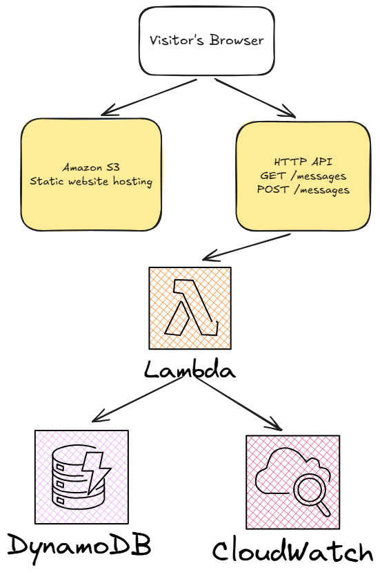

# Assignment 5 Submission

<!--
How to use this template:

1. Copy this file to submissions/assignment-5/group-<number>/submission.md
2. Replace every <answer> with your group's answer. Delete the angle brackets too.
3. Save diagram.png in the same folder.
4. Keep your invoke URL, your API ID, every ARN, and the account number out of this folder.
5. Write GitHub usernames, not full names or student numbers.
-->

## About us

- Group number: g08
- Section: IV - ACSAD
- Group IAM user: acsad-g08

## Diagram

## Estimate

Asia Pacific (Singapore), one month: 100,000 page views and 5,000 posts.

| Service | Settings | Monthly cost (USD) |
| --- | --- | --- |
| Amazon S3 | S3 Standard, 1 GB, 100,000 GET requests | 0.07 USD |
| Amazon API Gateway | HTTP API, 0.105 million requests, 1 KB each | 0.13 USD |
| AWS Lambda | Without Free Tier, x86, 105,000 requests, 100 ms, 128 MB | 0.04 USD |
| Amazon DynamoDB | On-demand, Standard, 1 GB, 1 KB items, 0.005 million writes, 0.1 million eventually consistent reads | 	
0.29 USD |
| **Total** | | 6.36 USD |

Share link of our estimate: https://calculator.aws/#/estimate?id=4fc87ce92d5ea3f824a72403b2039b4fbbcc6598 

## Ten times the traffic

With 1,000,000 page views and 50,000 posts a month, which service's monthly cost grows the most in US dollars, and why?

Amazon API Gateway is expected to have the largest increase in monthly cost because it processes the HTTP requests sent by visitors. When traffic increases ten times, the number of API requests also increases from 105,000 to 1,050,000 per month. This results in more requests being processed and a higher monthly API Gateway cost.

## The throttle and one more improvement

Which Well-Architected pillar does the throttle on the `$default` stage serve, and why?

The throttle serves the Reliability pillar because it limits incoming requests to 2 requests per second with a burst limit of 5. This helps prevent sudden traffic spikes from overwhelming the API and backend services, keeping the application available and stable.

One more improvement for the same architecture, and the pillar that it serves:

One improvement is to configure CloudWatch alarms to monitor Lambda errors, API failures, and throttled requests. This serves the Operational Excellence pillar because it helps the team monitor the system, identify problems, and respond to issues more effectively.
## Contribution

| GitHub username | What this groupmate did |
| --- | --- |
| JanRodCanlas | Mainly handled the architecture diagram using Excalidraw, AWS Pricing Calculator estimates, documentation, and GitHub submission. |
| szapatak12153026-hash | Assisted with reviewing the architecture requirements and checking the assignment details. |
| silverperson | Assisted with reviewing the diagram, pricing requirements, and submission contents. |
