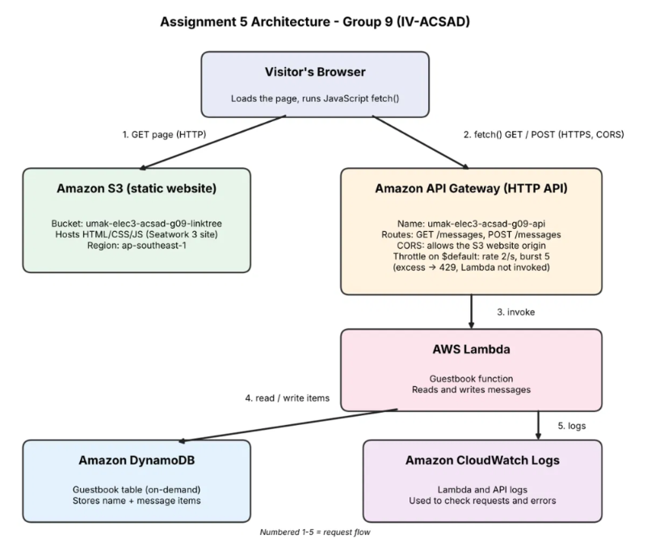

# Assignment 5 Submission

## About us

- Group number: 9
- Section: IV-ACSAD
- Group IAM user: acsad-g09

## Diagram

## Estimate

Asia Pacific (Singapore), one month: 100,000 page views and 5,000 posts.

| Service | Settings | Monthly cost (USD) |
| --- | --- | ---: |
| Amazon S3 | S3 Standard, 1 GB, 100,000 GET requests | 0.07 USD |
| Amazon API Gateway | HTTP API, 0.105 million requests, 1 KB each | 0.13 USD |
| AWS Lambda | Without Free Tier, x86, 105,000 requests, 100 ms, 128 MB | 0.00 USD |
| Amazon DynamoDB | On-demand, Standard, 1 GB, 1 KB items, 0.005 million writes, 0.1 million eventually consistent reads | 0.29 USD |
| **Total** | | **0.49 USD** |

Share link of our estimate: https://calculator.aws/#/estimate?id=2eb54958264e17dd25301e3746de3b372eda44e5

## Ten times the traffic

With 1,000,000 page views and 50,000 posts a month, which service's monthly cost grows the most in US dollars, and why?

Amazon DynamoDB’s monthly cost grows the most in US dollars. At 10× traffic, writes increase from 0.005 million to 0.05 million and reads from 0.1 million to 1 million per month. DynamoDB on-demand pricing charges per read and write request, and since it already has the highest base cost at 0.29 USD, its absolute dollar increase (approximately 2.61 USD) is larger than any other service.

## The throttle and one more improvement

Which Well-Architected pillar does the throttle on the `$default` stage serve, and why?

The throttle serves the Reliability pillar of the AWS Well-Architected Framework. It limits the number of requests API Gateway passes to the Lambda function each second, preventing the backend from being overwhelmed by sudden traffic spikes. Requests that exceed the burst of 5 tokens or the rate of 2 per second receive a 429 Too Many Requests response without invoking Lambda, keeping the service available and stable for other users.

One more improvement for the same architecture, and the pillar that it serves:

Enabling versioning on the Amazon S3 bucket (`umak-elec3-acsad-g09-linktree`) allows the team to recover previous versions of website files if they are accidentally deleted or overwritten. This improvement also supports the Reliability pillar because it protects the hosted site from accidental data loss and makes recovery straightforward without needing to re-upload files from scratch.

## Contribution

| GitHub username | What this groupmate did |
| --- | --- |
| Azores-Mea | Created the estimate and share link. Helped arrange the submission content. |
| WayneyYsrrael | Created the diagram. |
| rdanlogA12345581 | Finalized the work. |
| klomol-jo | Reviewed the completed output and prepared the files for submission. |
