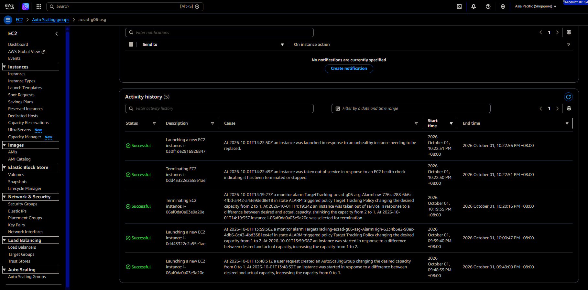
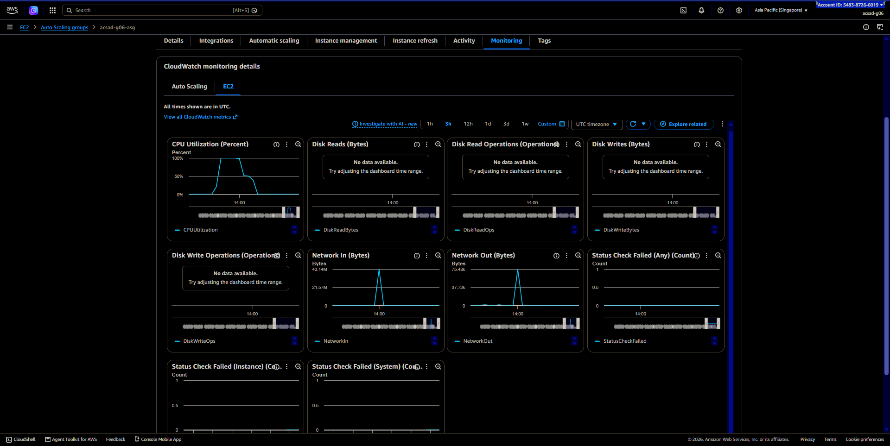

# Lab 2 Submission

## Instance Tracking
**First Instance**
- Instance ID: i-06af0da0a03e9a20e
- Availability Zone: ap-southeast-1b

**Second Instance**
- Instance ID: i-0dd43322e2a55e1ae
- Availability Zone: ap-southeast-1a

## Proof (Screenshots)
1. **Activity History:** Screenshot showing the Auto Scaling group's Activity history when the second instance launched.

   

2. **CloudWatch Alarm:** Screenshot of the target tracking alarm in the "In alarm" state.

   

## Questions
1. Why did the group stop at 2 instances?
   The Auto Scaling Group stopped at 2 instances because the Maximum capacity was set to 2. It could not launch a third instance.

2. Why did terminating an instance by hand not remove the cost?
   The ASG replaced the terminated instance because the Minimum capacity was set to 1. ASG automatically maintains the configured minimum number of instances.

3. Why is the target value set to your assigned value (e.g., 30-85 percent) instead of 99 percent?
   The target value is set below 99% to account for instance warmup time. A new instance can take 1–2 minutes to become healthy, so waiting until 99% CPU could cause the existing instance to become overloaded before the replacement is ready.

4. What did the automatic cutoff protect us from?
   The automatic cutoff protected us from unexpected AWS charges. If instances were left running, they would continue accumulating costs.

5. What changes when a load balancer sits in front of the group?
   A load balancer provides a single entry point (DNS name) and automatically distributes traffic across instances. Users no longer need individual instance IP addresses, and the load balancer sends traffic only to healthy instances.
