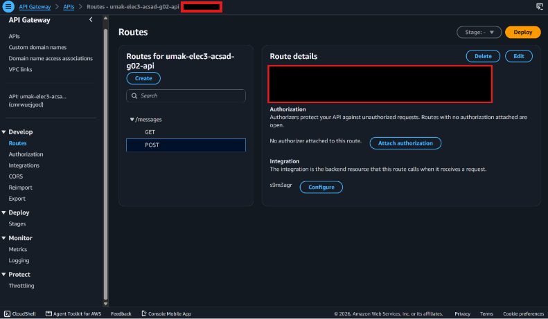
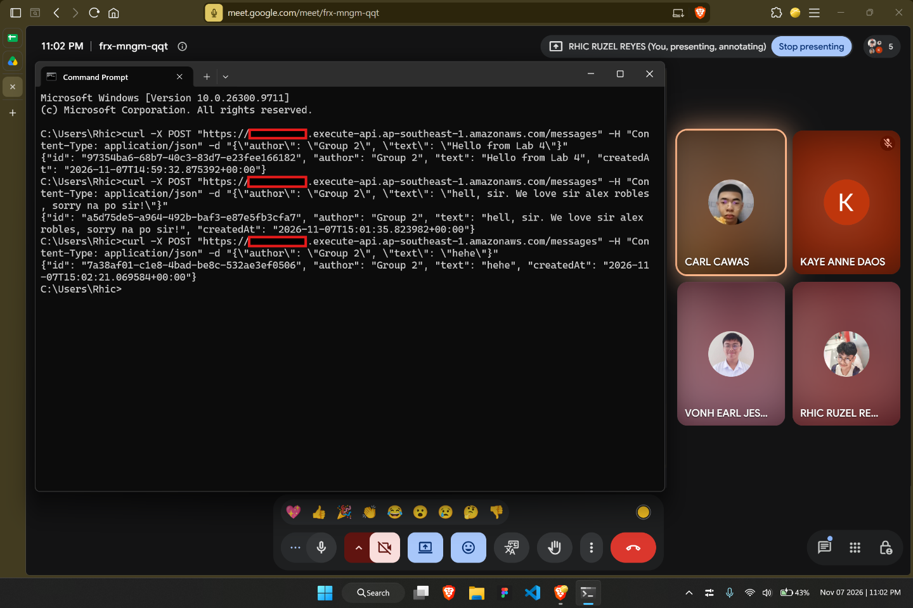
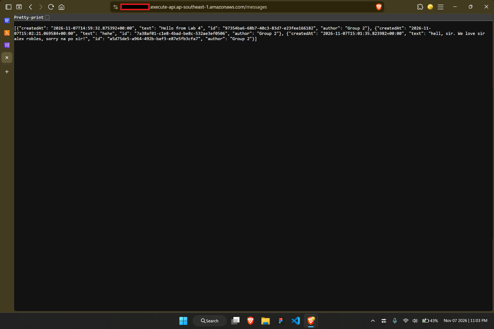
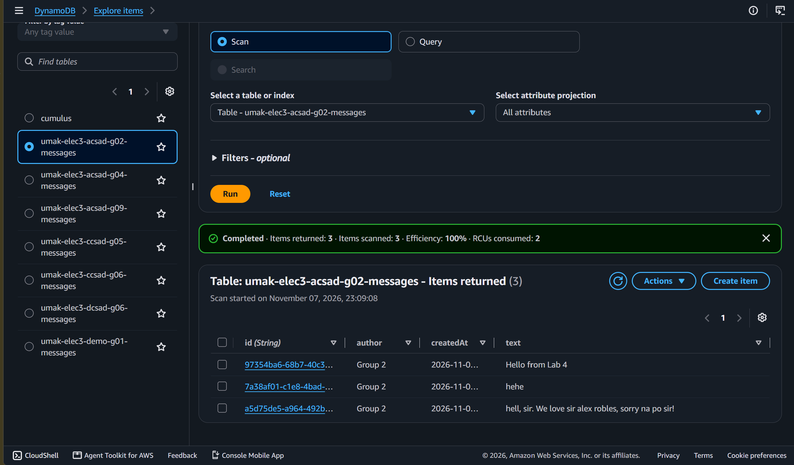

# Lab 4 Submission

<!--
How to use this template:

1. Copy this file to submissions/lab-4/group-<number>/submission.md
2. Replace every <answer> with your group's answer. Delete the angle brackets too.
3. Save routes.png, post.png, get.png, and items.png in the same folder.
4. Crop the AWS console top bar out of routes.png and items.png, and cover every ARN.
5. Cover your API ID, the part between https:// and .execute-api, in routes.png, post.png, and get.png. Your invoke URL goes only in the Google Form, never in this repository.
6. Do not write full names or student numbers in this file.
-->

## About us

- Group number: 2
- Section: 4-ACSAD
- Group IAM user: acsad-g02
- DynamoDB table name: umak-elec3-acsad-g02-messages
- HTTP API name: umak-elec3-acsad-g02-api

## Handler code

```python
import base64
import json
import uuid
from datetime import datetime, timezone

import boto3

GROUP_NAME = "Group 2 of IV-ACSAD"  # Keep your group's name from Seatwork 4.
TABLE_NAME = "umak-elec3-acsad-g02-messages"  # Change acsad-g03 to your group IAM user.

table = boto3.resource("dynamodb").Table(TABLE_NAME)


def respond(status_code, body):
    return {
        "statusCode": status_code,
        "headers": {"Content-Type": "application/json"},
        "body": json.dumps(body),
    }


def read_json_body(event):
    body = event.get("body") or "{}"
    if event.get("isBase64Encoded"):
        body = base64.b64decode(body).decode("utf-8")
    return json.loads(body)


def lambda_handler(event, context):
    route = event.get("routeKey")

    if route == "GET /messages":
        items = table.scan()["Items"]
        return respond(200, items)

    if route == "POST /messages":
        try:
            data = read_json_body(event)
        except ValueError:
            data = None
        if not isinstance(data, dict) or not data.get("text"):
            return respond(400, {"error": "Send a JSON body with a text field."})
        if len(str(data["text"])) > 280:
            return respond(400, {"error": "Keep the text at 280 characters or fewer."})
        message = {
            "id": str(uuid.uuid4()),
            "author": str(data.get("author") or GROUP_NAME)[:80],
            "text": str(data["text"]),
            "createdAt": datetime.now(timezone.utc).isoformat(),
        }
        table.put_item(Item=message)
        return respond(201, message)

    return respond(404, {"error": f"No route for {route}"})

```

## Screenshots









## Questions

1. Both routes call the same function. How does your code know which route a request came through?

   The code knows which route was requested by checking the routeKey inside the incoming event object provided by API Gateway. The line route = event.get("routeKey") extracts this value (e.g., "GET /messages" or "POST /messages"), and the function uses if statements to execute the appropriate logic for that specific route.

2. What answer do you get when you open the invoke URL without `/messages`? Why does API Gateway answer this way, and not your function?

   When opening the invoke URL without /messages, you get a {"message":"Not Found"} error. API Gateway answers this way because no route was defined for the root path (/). The request is rejected at the API Gateway level before it ever reaches the Lambda function, so the function is never triggered.

3. Your `GET /messages` route uses Scan. What happens to the cost of each GET request as the table grows to thousands of messages? Why?

   As the table grows, the cost and execution time of each GET request will increase. A Scan operation reads every single item in the entire DynamoDB table to return the result, rather than looking up a specific item. Because DynamoDB pricing (On-demand) is based on the amount of data read, scanning a table with thousands of messages consumes significantly more Read Capacity Units (RCUs) than a small table, directly increasing the cost.
