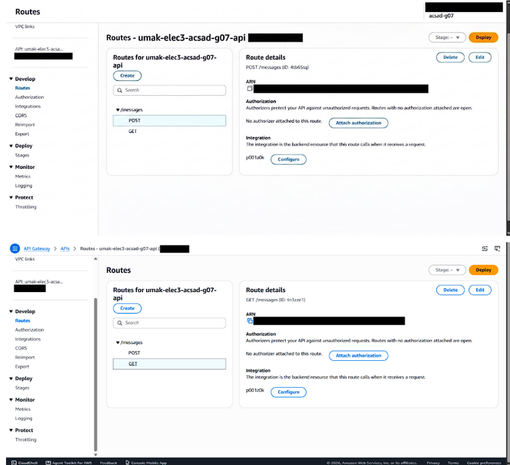
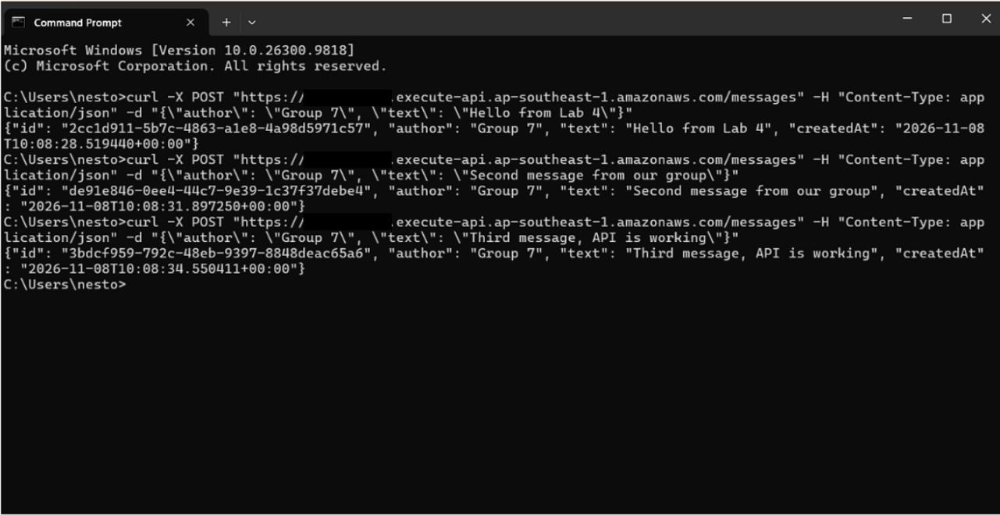
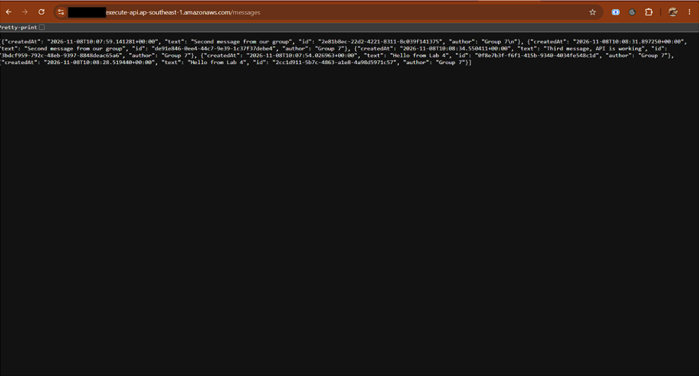
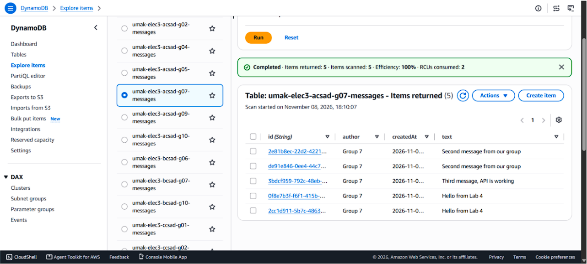

# Lab 4 Submission

<!--
How to use this template:

1. Copy this file to submissions/lab-4/group-<number>/submission.md
2. Replace every <answer> with your group's answer. Delete the angle brackets too.
3. Save routes.png, post.png, get.png, and items.png in the same folder.
4. Crop the AWS console top bar out of routes.png and items.png, and cover every ARN.
5. Cover your API ID, the part between https:// and .execute-api, in routes.png, post.png, and get.png. Your invoke URL goes only in the Google Form, never in this repository.
6. Do not write full names or student numbers in this file.
-->

## About us

- Group number: 07
- Section: IV - ACSAD
- Group IAM user: acsad-g07
- DynamoDB table name: umak-elec3-acsad-g07-messages
- HTTP API name: umak-elec3-acsad-g07-api

## Handler code

import base64
import json
import uuid
from datetime import datetime, timezone
 
import boto3
 
GROUP_NAME = "Group 7 of IV-ACSAD"  # Keep your group's name from Seatwork 4.
TABLE_NAME = "umak-elec3-acsad-g07-messages"  # Change acsad-g03 to your group IAM user.
 
table = boto3.resource("dynamodb").Table(TABLE_NAME)
 
 
def respond(status_code, body):
    return {
        "statusCode": status_code,
        "headers": {"Content-Type": "application/json"},
        "body": json.dumps(body),
	}
 
 
def read_json_body(event):
    body = event.get("body") or "{}"
    if event.get("isBase64Encoded"):
        body = base64.b64decode(body).decode("utf-8")
    return json.loads(body)
 
 
def lambda_handler(event, context):
    route = event.get("routeKey")
 
    if route == "GET /messages":
        items = table.scan()["Items"]
        return respond(200, items)
 
    if route == "POST /messages":
        try:
            data = read_json_body(event)
        except ValueError:
            data = None
        if not isinstance(data, dict) or not data.get("text"):
            return respond(400, {"error": "Send a JSON body with a text field."})
        if len(str(data["text"])) > 280:
            return respond(400, {"error": "Keep the text at 280 characters or fewer."})
        message = {
            "id": str(uuid.uuid4()),
            "author": str(data.get("author") or GROUP_NAME)[:80],
            "text": str(data["text"]),
            "createdAt": datetime.now(timezone.utc).isoformat(),
        }
        table.put_item(Item=message)
        return respond(201, message)
 
    return respond(404, {"error": f"No route for {route}"})

## Screenshots

## Questions

1. Both routes call the same function. How does your code know which route a request came through?

   The code checks event.get("routeKey") to identify whether the request is GET /messages or POST /messages.

2. What answer do you get when you open the invoke URL without `/messages`? Why does API Gateway answer this way, and not your function?

   You get a 404 Not Found error because API Gateway handles the routing and rejects requests that don't match a defined route before ever invoking the Lambda function.

3. Your `GET /messages` route uses Scan. What happens to the cost of each GET request as the table grows to thousands of messages? Why?

   The cost increases because a DynamoDB Scan reads every single item in the table, consuming more Read Capacity Units (RCUs) as the total table size grows.
