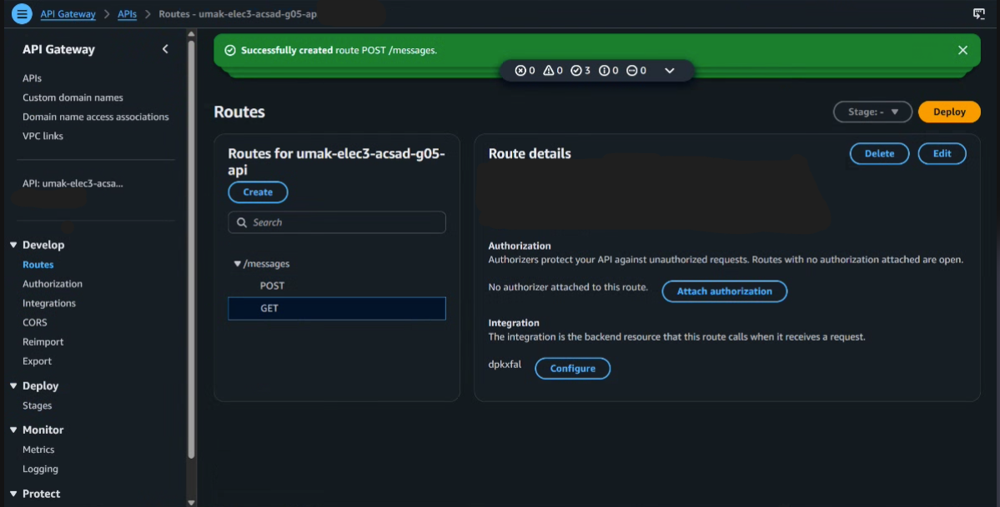
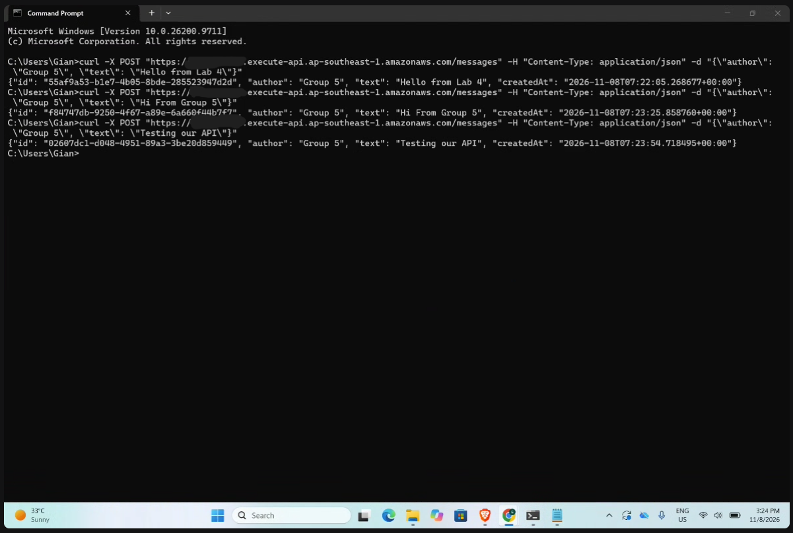
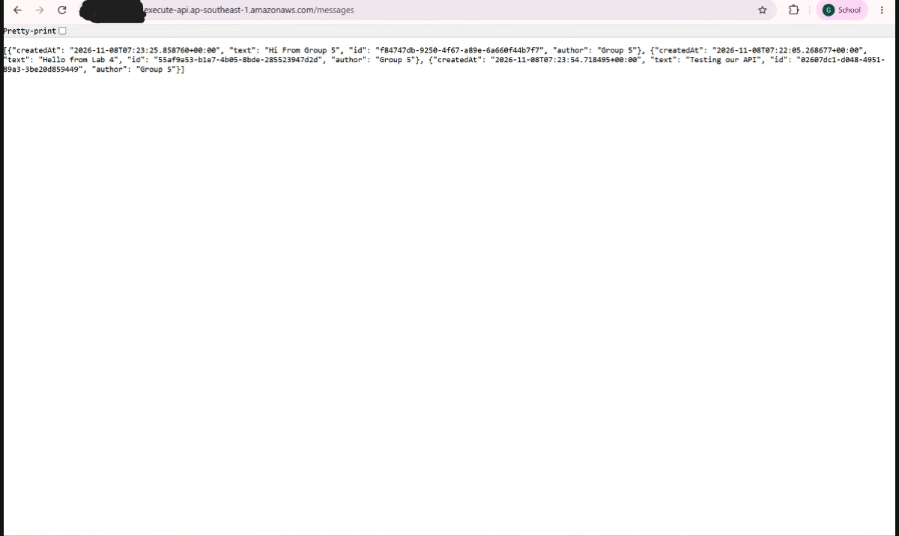
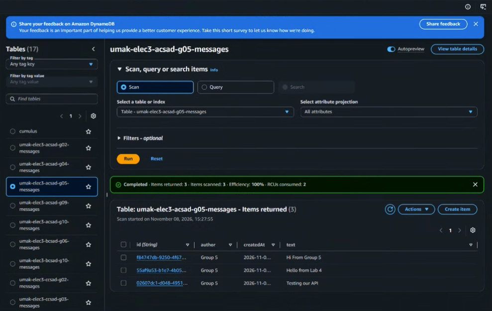

# Lab 4 Submission

## About us

- Group number: 5
- Section: IV-ACSAD
- Group IAM user: acsad-g05
- DynamoDB table name: umak-elec3-acsad-g05-messages
- HTTP API name: umak-elec3-acsad-g05-api

## Handler code

```python
import base64
import json
import uuid
from datetime import datetime, timezone

import boto3

GROUP_NAME = "Group 5 of IV-ACSAD"  # Keep your group's name from Seatwork 4.
TABLE_NAME = "umak-elec3-acsad-g05-messages"  # Change acsad-g03 to your group IAM user.

table = boto3.resource("dynamodb").Table(TABLE_NAME)


def respond(status_code, body):
    return {
        "statusCode": status_code,
        "headers": {"Content-Type": "application/json"},
        "body": json.dumps(body),
    }


def read_json_body(event):
    body = event.get("body") or "{}"
    if event.get("isBase64Encoded"):
        body = base64.b64decode(body).decode("utf-8")
    return json.loads(body)


def lambda_handler(event, context):
    route = event.get("routeKey")

    if route == "GET /messages":
        items = table.scan()["Items"]
        return respond(200, items)

    if route == "POST /messages":
        try:
            data = read_json_body(event)
        except ValueError:
            data = None
        if not isinstance(data, dict) or not data.get("text"):
            return respond(400, {"error": "Send a JSON body with a text field."})
        if len(str(data["text"])) > 280:
            return respond(400, {"error": "Keep the text at 280 characters or fewer."})
        message = {
            "id": str(uuid.uuid4()),
            "author": str(data.get("author") or GROUP_NAME)[:80],
            "text": str(data["text"]),
            "createdAt": datetime.now(timezone.utc).isoformat(),
        }
        table.put_item(Item=message)
        return respond(201, message)

    return respond(404, {"error": f"No route for {route}"})
```

## Screenshots









## Questions

1. Both routes call the same function. How does your code know which route a request came through?

   API Gateway sends the function an event that includes a routeKey field holding the route that matched, such as "GET /messages" or "POST /messages". Our handler reads it with event.get("routeKey") and uses if checks to run the Scan for the GET route or the PutItem for the POST route. Any other value returns a 404.

2. What answer do you get when you open the invoke URL without `/messages`? Why does API Gateway answer this way, and not your function?

   When we open the invoke URL without /messages, we get {"message":"Not Found"}. API Gateway answers by itself because the request path / does not match any route we created. We only made GET /messages and POST /messages. API Gateway sends a request to Lambda only when a route matches, so our function never runs for this request.

3. Your `GET /messages` route uses Scan. What happens to the cost of each GET request as the table grows to thousands of messages? Why?

   The cost of each GET request goes up as the table grows. Scan reads every item in the table, and on-demand DynamoDB charges for the amount of data read. With thousands of messages, each request reads and bills far more data than with a few messages. It also gets slower, because the function has to return a bigger list.
