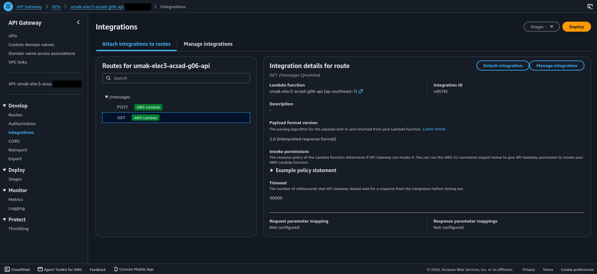
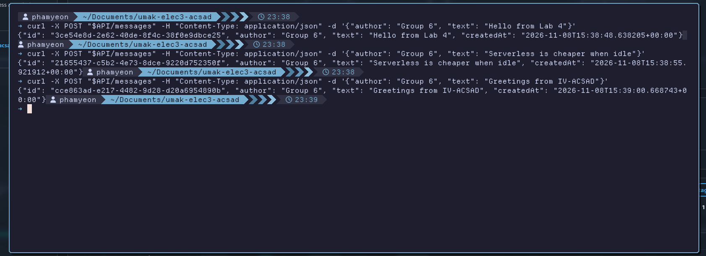
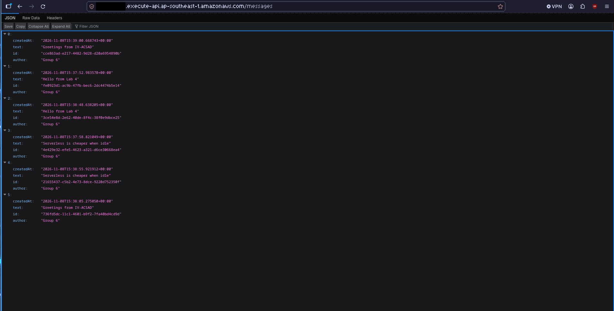
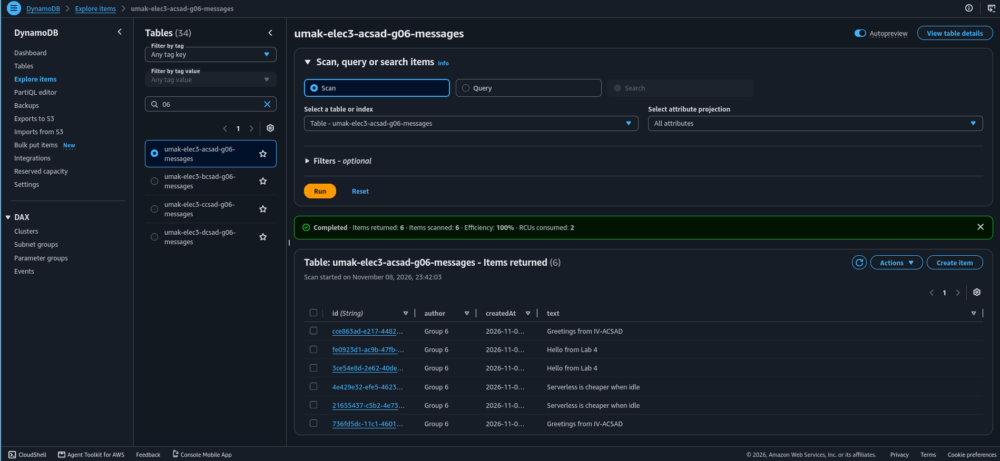

# Lab 4 Submission

## About us

- Group number: 6
- Section: IV-ACSAD
- Group IAM user: acsad-g06
- DynamoDB table name: umak-elec3-acsad-g06-messages
- HTTP API name: umak-elec3-acsad-g06-api

## Handler code

```python
import base64
import json
import uuid
from datetime import datetime, timezone

import boto3

GROUP_NAME = "Group 6 of IV-ACSAD"
TABLE_NAME = "umak-elec3-acsad-g06-messages"

table = boto3.resource("dynamodb").Table(TABLE_NAME)


def respond(status_code, body):
    return {
        "statusCode": status_code,
        "headers": {"Content-Type": "application/json"},
        "body": json.dumps(body),
    }


def read_json_body(event):
    body = event.get("body") or "{}"
    if event.get("isBase64Encoded"):
        body = base64.b64decode(body).decode("utf-8")
    return json.loads(body)


def lambda_handler(event, context):
    route = event.get("routeKey")

    if route == "GET /messages":
        items = table.scan()["Items"]
        return respond(200, items)

    if route == "POST /messages":
        try:
            data = read_json_body(event)
        except ValueError:
            data = None
        if not isinstance(data, dict) or not data.get("text"):
            return respond(400, {"error": "Send a JSON body with a text field."})
        if len(str(data["text"])) > 280:
            return respond(400, {"error": "Keep the text at 280 characters or fewer."})
        message = {
            "id": str(uuid.uuid4()),
            "author": str(data.get("author") or GROUP_NAME)[:80],
            "text": str(data["text"]),
            "createdAt": datetime.now(timezone.utc).isoformat(),
        }
        table.put_item(Item=message)
        return respond(201, message)

    return respond(404, {"error": f"No route for {route}"})
```

## Screenshots









## Questions

1. Both routes call the same function. How does your code know which route a request came through?

   With payload format version 2.0, API Gateway puts the matched route in the event as `routeKey`, for example `"GET /messages"` or `"POST /messages"`. Our handler reads `event.get("routeKey")` and uses `if` statements to pick the branch: a Scan for `GET /messages`, a `put_item` for `POST /messages`, and a 404 answer for anything else.

2. What answer do you get when you open the invoke URL without `/messages`? Why does API Gateway answer this way, and not your function?

   We get `{"message":"Not Found"}` with status 404. API Gateway matches each request against the routes of the API before it calls any integration. Our API has only `GET /messages` and `POST /messages`, and no `$default` route, so `GET /` matches nothing and API Gateway rejects it by itself. Our function never runs, which is why the answer is API Gateway's `message` format and not our function's `error` format, and why no new lines appear in our log group.

3. Your `GET /messages` route uses Scan. What happens to the cost of each GET request as the table grows to thousands of messages? Why?

   The cost of each GET grows with the size of the table. A Scan reads every item in the table, not only the ones that we need, and DynamoDB on-demand charges read request units for all the data that it reads (one unit per 4 KB for an eventually consistent read). With thousands of messages, every GET reads all of them, so it uses more read units, takes longer in Lambda (more billed milliseconds), and returns a bigger response. A Scan also stops at 1 MB per call, so a large table would need several paged calls. A Query on a key, with a limit, would keep the cost of each GET about the same as the table grows.
