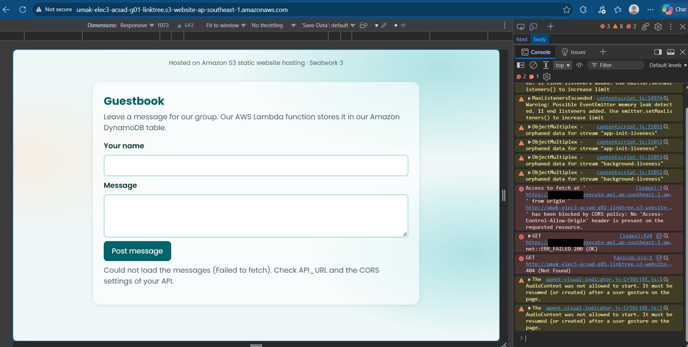
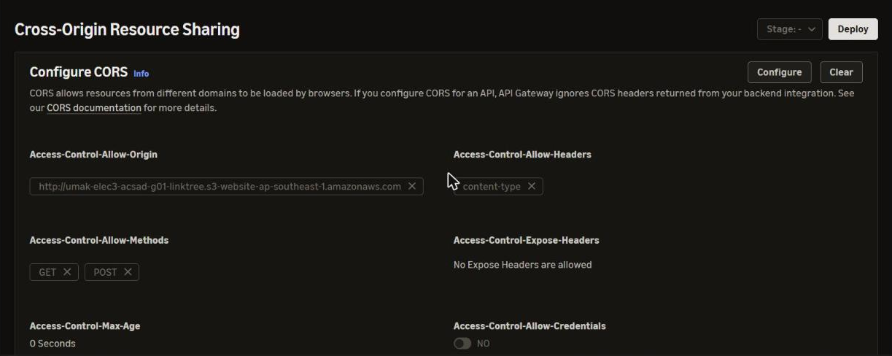
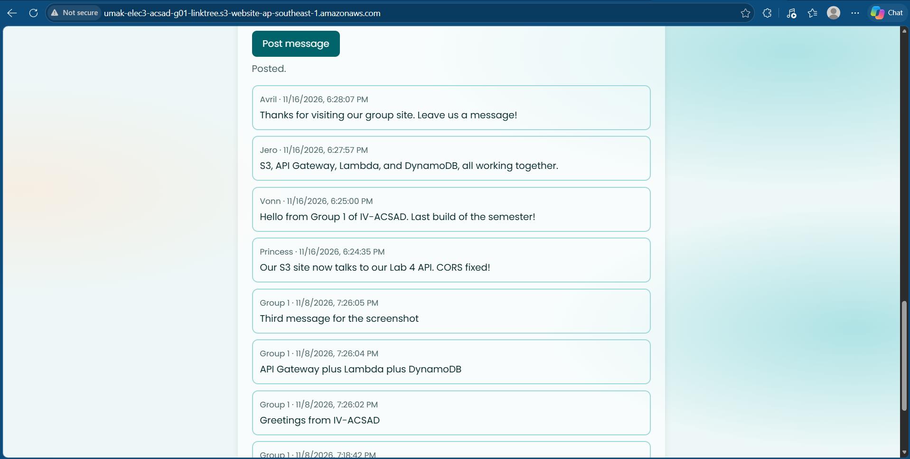
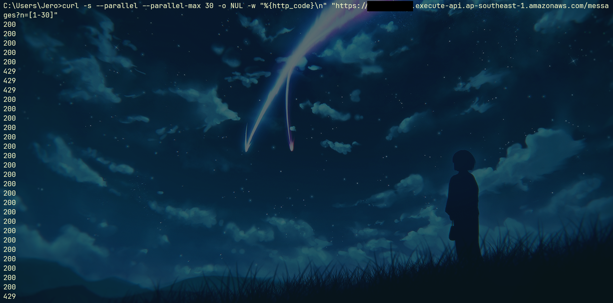

# Lab 5 Submission

<!--
How to use this template:

1. Copy this file to submissions/lab-5/group-<number>/submission.md
2. Replace every <answer> with your group's answer. Delete the angle brackets too.
3. Save cors-error.png, cors.png, site.png, and throttle.png in the same folder.
4. Crop the AWS console top bar out of cors.png, and cover every ARN.
5. Cover your API ID, the part between https:// and .execute-api, in cors-error.png, cors.png, and throttle.png.
6. Do not add your index.html. It holds your invoke URL.
7. Do not write full names or student numbers in this file.
-->

## About us

- Group number: 1
- Section: IV-ACSAD
- Group IAM user: acsad-g01
- Website endpoint: http://umak-elec3-acsad-g01-linktree.s3-website-ap-southeast-1.amazonaws.com
- HTTP API name: umak-elec3-acsad-g01-api

## Screenshots

## Questions

1. In Lab 4, your API answered `curl` and the address bar of your browser. In Step 3, the same API did not answer your page. Why?

   CORS is a browser rule for scripts on a page, and `curl` and the address bar are not scripts on a page, so they just send the request and show the answer. In Step 3, the guestbook's `fetch()` ran on our site's origin (`http`, the S3 website host) and called our API on a different origin (`https`, the `execute-api` host). The browser lets a script read a cross-origin answer only when the API sends `Access-Control-Allow-Origin` with our site in it, and our API did not send that header yet. The API still answered (the Console shows `200 (OK)`), but the browser blocked our page from reading it (MDN Web Docs, n.d.-a).

2. Which pillar of the AWS Well-Architected Framework does your throttle serve? Explain in two sentences.

   Our throttle serves the Reliability pillar, through best practice REL05-BP02, "Throttle requests to mitigate resource exhaustion due to unexpected increases in demand" (Amazon Web Services, n.d.). API Gateway's token bucket (rate 2, burst 5) answers extra requests with `429 Too Many Requests` before they reach our Lambda function and DynamoDB table, so a flood of requests to our public API cannot exhaust them, and normal guestbook posts keep working.

3. Your guestbook shows each message with `textContent`. What could a visitor do if the page put each message into the page as HTML with `innerHTML`?

   A visitor could post a message that holds HTML, such as ``. With `innerHTML`, the browser would parse it and run that JavaScript in the browser of everyone who opens our page, because the message stays in our table. This is stored cross-site scripting (XSS): the script could change our page, redirect visitors, or send requests as them. `textContent` shows the message as plain text, so the tag is displayed and never runs (MDN Web Docs, n.d.-b).

## References

Amazon Web Services. (n.d.). *REL05-BP02 Throttle requests*. AWS Well-Architected Framework, Reliability Pillar. https://docs.aws.amazon.com/wellarchitected/latest/reliability-pillar/rel_mitigate_interaction_failure_throttle_requests.html

MDN Web Docs. (n.d.-a). *Cross-Origin Resource Sharing (CORS)*. Mozilla. https://developer.mozilla.org/en-US/docs/Web/HTTP/Guides/CORS

MDN Web Docs. (n.d.-b). *Element: innerHTML property*. Mozilla. https://developer.mozilla.org/en-US/docs/Web/API/Element/innerHTML
