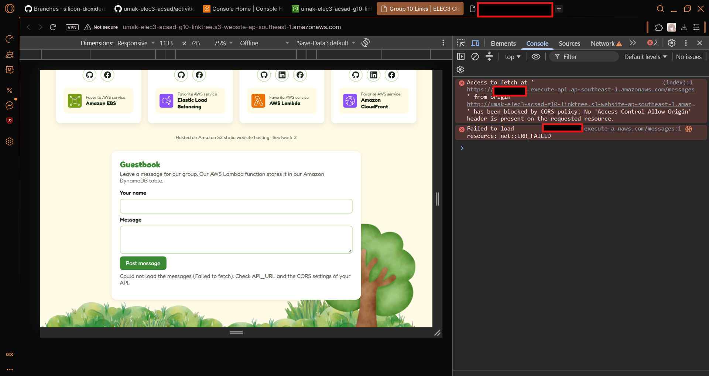
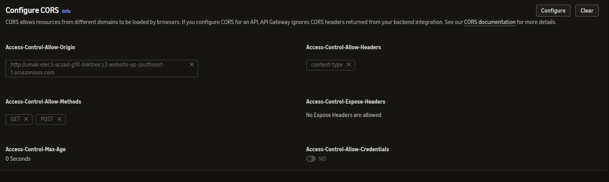
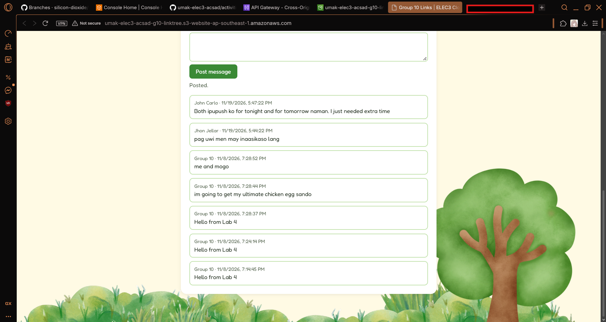
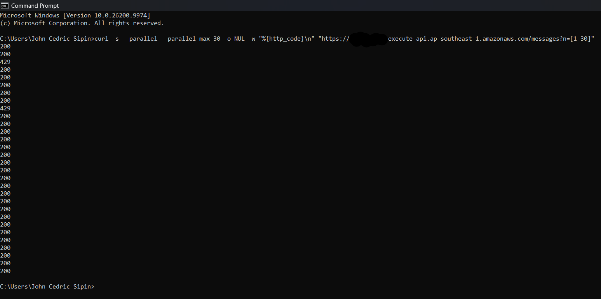

# Lab 5 Submission

<!--
How to use this template:

1. Copy this file to submissions/lab-5/group-<number>/submission.md
2. Replace every <answer> with your group's answer. Delete the angle brackets too.
3. Save cors-error.png, cors.png, site.png, and throttle.png in the same folder.
4. Crop the AWS console top bar out of cors.png, and cover every ARN.
5. Cover your API ID, the part between https:// and .execute-api, in cors-error.png, cors.png, and throttle.png.
6. Do not add your index.html. It holds your invoke URL.
7. Do not write full names or student numbers in this file.
-->

## About us

- Group number: group-10
- Section: ACSAD
- Group IAM user: acsad-group-10
- Website endpoint: http://umak-elec3-acsad-g10-linktree.s3-website-ap-southeast-1.amazonaws.com
- HTTP API name: umak-elec3-acsad-g10-api

## Screenshots

## Questions

1. In Lab 4, your API answered `curl` and the address bar of your browser. In Step 3, the same API did not answer your page. Why?

   `curl` and the address bar don’t enforce CORS, but browsers do when a page on one origin (your S3 site) calls another origin (the API). Your API didn’t send an Access-Control-Allow-Origin header for the S3 origin, so the browser blocked the page’s request even though the API itself worked.

2. Which pillar of the AWS Well-Architected Framework does your throttle serve? Explain in two sentences.

   The throttle serves the Reliability pillar (it also supports Cost Optimization). It caps how many requests reach Lambda and DynamoDB, so a traffic spike or abusive client can’t overwhelm the backend or run up the bill, and normal visitors still get served.

3. Your guestbook shows each message with `textContent`. What could a visitor do if the page put each message into the page as HTML with `innerHTML`?

   A visitor could post a message containing HTML or JavaScript, such as ``, and it would run in every visitor’s browser. That’s cross-site scripting (XSS), which could steal data, redirect users, or deface the page. textContent shows it as plain text, so nothing executes.
