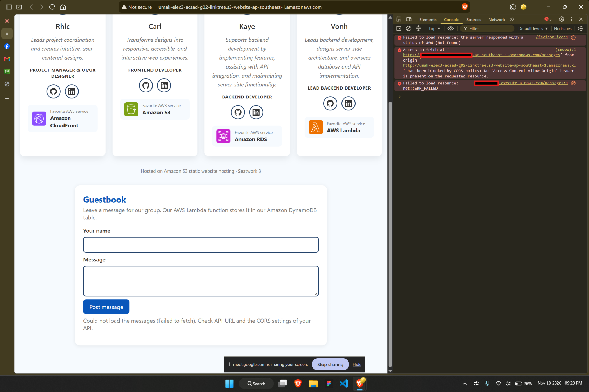
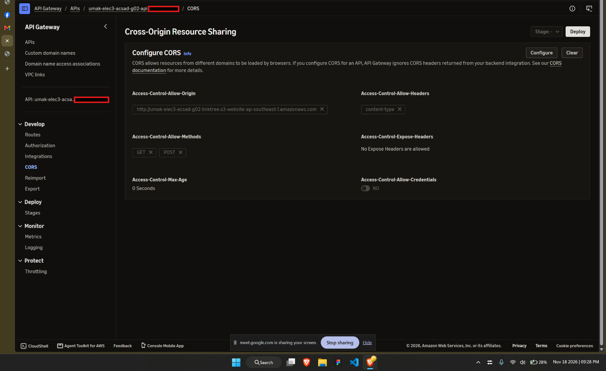
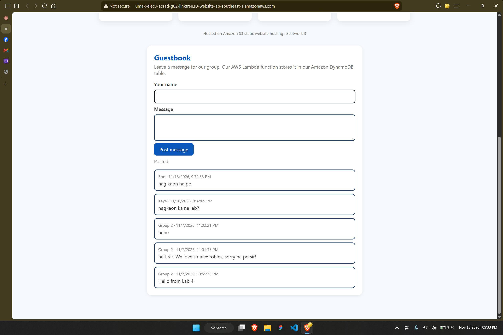
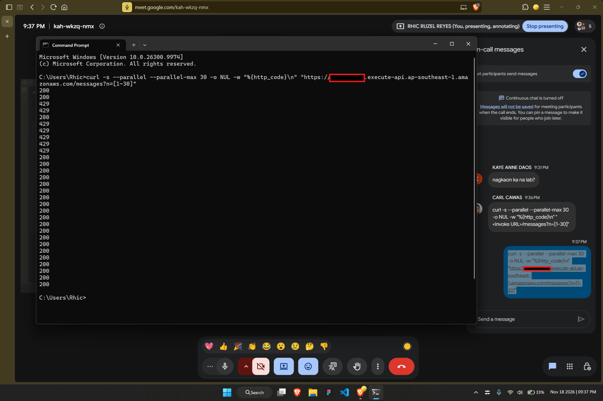

# Lab 5 Submission

<!--
How to use this template:

1. Copy this file to submissions/lab-5/group-<number>/submission.md
2. Replace every <answer> with your group's answer. Delete the angle brackets too.
3. Save cors-error.png, cors.png, site.png, and throttle.png in the same folder.
4. Crop the AWS console top bar out of cors.png, and cover every ARN.
5. Cover your API ID, the part between https:// and .execute-api, in cors-error.png, cors.png, and throttle.png.
6. Do not add your index.html. It holds your invoke URL.
7. Do not write full names or student numbers in this file.
-->

## About us

- Group number: 2
- Section: 4-ACSAD
- Group IAM user: acsad-g02
- Website endpoint: http://umak-elec3-acsad-g02-linktree.s3-website-ap-southeast-1.amazonaws.com/
- HTTP API name: umak-elec3-acsad-g02-api

## Screenshots

## Questions

1. In Lab 4, your API answered `curl` and the address bar of your browser. In Step 3, the same API did not answer your page. Why?

   curl and the browser address bar bypass CORS because they are not scripts running on a webpage, so the browser does not enforce cross-origin restrictions on them. However, once the request is made using javascript fetch / post inside index.html on our S3 website , it becomes a cross-origin request to API Gateway . Because our API had not yet returned an Access-Control-Allow-Origin header granting permission to our S3 origin, the browser blocked our webpage's script from reading the response.

2. Which pillar of the AWS Well-Architected Framework does your throttle serve? Explain in two sentences.

   It falls under the Reliability Pillar, because by setting thresholds for sudden bursts at 5 requests and refilling at rates of 2 tokens per second, it protects the system from sudden traffic spikes, so the system stays available and recoverable. Besides this, it also falls under the Cost Optimzation Pillar, since it prevents unecessary lambda invocations from abusive traffic, which lessens the billing amount.

3. Your guestbook shows each message with `textContent`. What could a visitor do if the page put each message into the page as HTML with `innerHTML`?

   If the page used innerHTML, a visitor could perform a site attack (Cross-Site Scripting (XSS)) by submitting malicious html and javascript code such as  with onerror or <script> tags or inline event handlers as a guestbook message. Because innerHTML parses strings as live HTML rather than just a plain text, that injected script would save to the database and execute in the browser of every future visitor allowing the attacker to deface the page, redirect users, or steal browser data.
