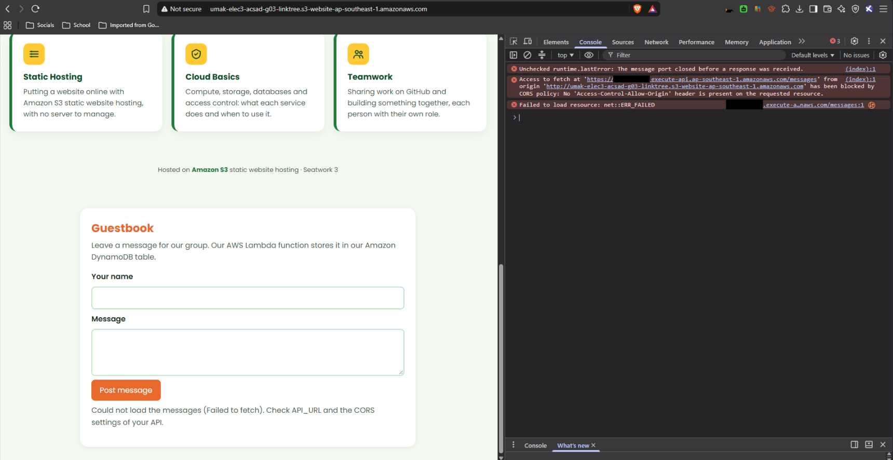
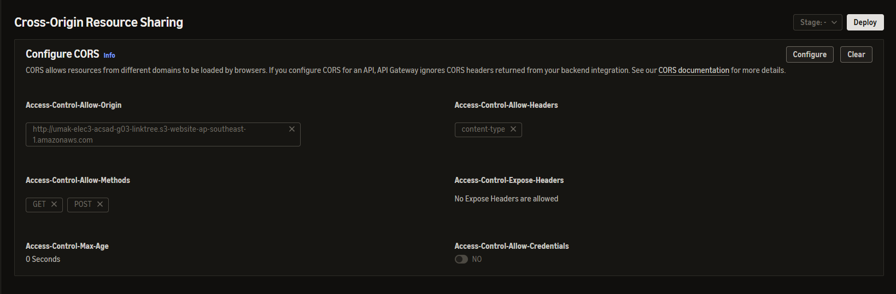
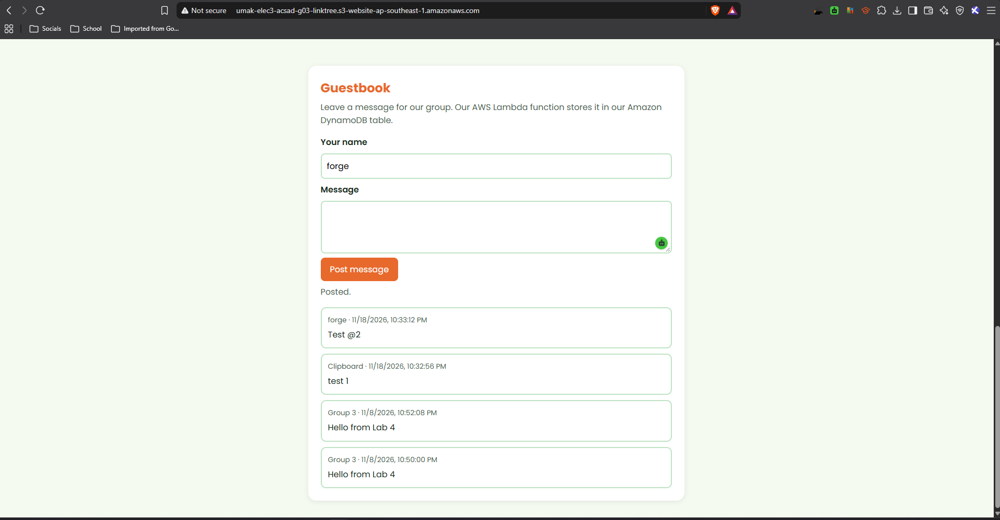
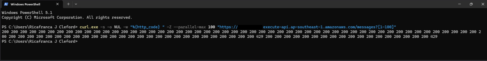

# Lab 5 Submission

## About us

- Group number: 3
- Section: IV-ACSAD
- Group IAM user: acsad-g03
- Website endpoint: [http://umak-elec3-acsad-g03-linktree.s3-website-ap-southeast-1.amazonaws.com](http://umak-elec3-acsad-g03-linktree.s3-website-ap-southeast-1.amazonaws.com/)
- HTTP API name: umak-elec3-acsad-g03-api

## Screenshots

## Questions

1. In Lab 4, your API answered `curl` and the address bar of your browser. In Step 3, the same API did not answer your page. Why?

   Browsers enforce the Same-Origin Policy on JavaScript `fetch()` requests, blocking our S3 website (`http://umak-elec3-acsad-g03-linktree.s3-website-ap-southeast-1.amazonaws.com`) from reading responses from a different origin (`execute-api`) unless the API explicitly returns matching `Access-Control-Allow-Origin` CORS headers. Tools like `curl` and direct navigation in the browser address bar are not cross-origin script requests, so they are not restricted by browser CORS checks.

2. Which pillar of the AWS Well-Architected Framework does your throttle serve? Explain in two sentences.

   Throttling primarily serves the **Reliability** pillar of the AWS Well-Architected Framework. By capping the steady-state request rate and burst concurrency at the API Gateway stage, it prevents traffic spikes or abusive loops from overwhelming our Lambda function and DynamoDB table so the service remains available for legitimate visitors.

3. Your guestbook shows each message with `textContent`. What could a visitor do if the page put each message into the page as HTML with `innerHTML`?

   A visitor could perform a Cross-Site Scripting (XSS) attack by submitting a message containing malicious HTML or JavaScript, such as `` or `<script>` tags. Because `innerHTML` parses and executes markup rather than treating it as plain text, that injected script would run in the browser of every subsequent visitor who loads the guestbook, allowing the attacker to deface the page, redirect users, or hijack browser data.
