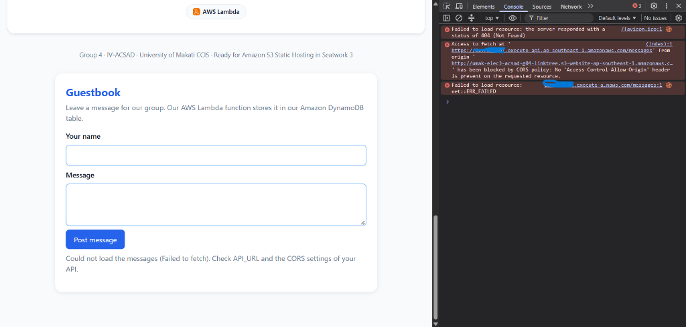
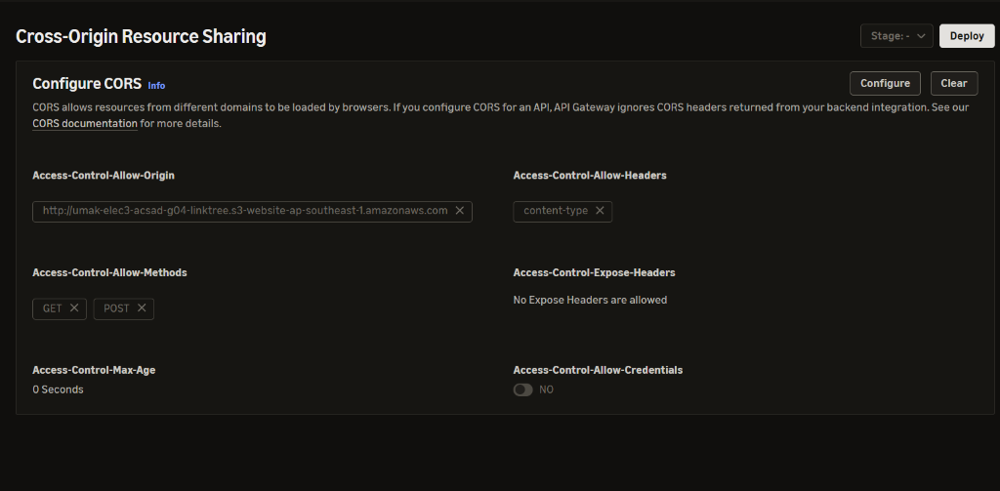
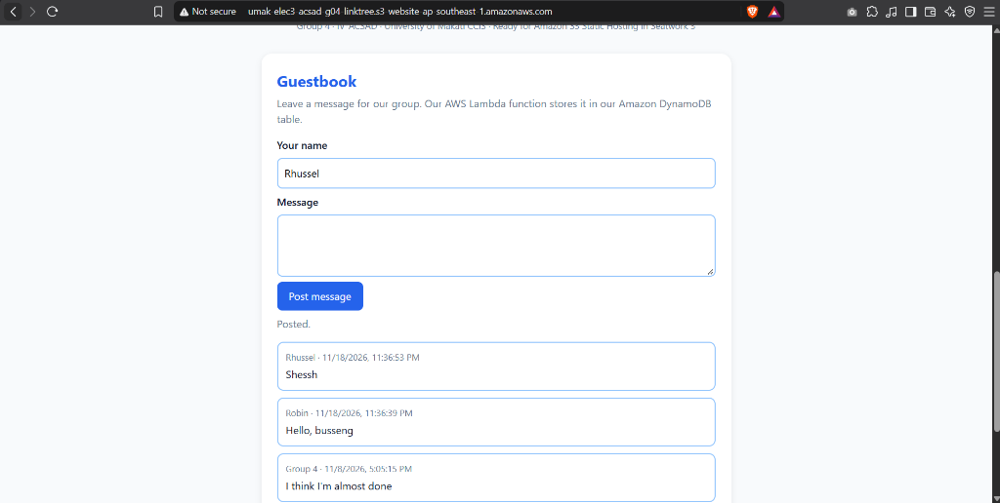
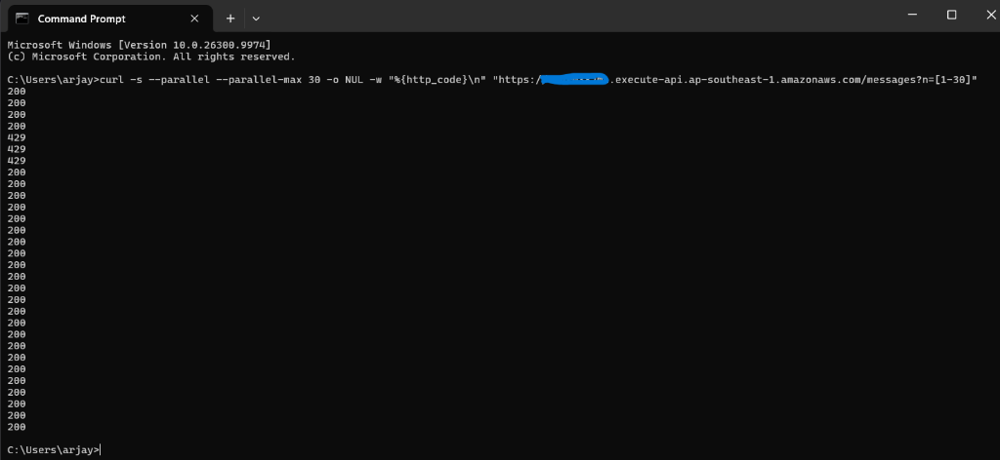

# Lab 5 Submission

<!--
How to use this template:

1. Copy this file to submissions/lab-5/group-<number>/submission.md
2. Replace every <answer> with your group's answer. Delete the angle brackets too.
3. Save cors-error.png, cors.png, site.png, and throttle.png in the same folder.
4. Crop the AWS console top bar out of cors.png, and cover every ARN.
5. Cover your API ID, the part between https:// and .execute-api, in cors-error.png, cors.png, and throttle.png.
6. Do not add your index.html. It holds your invoke URL.
7. Do not write full names or student numbers in this file.
-->

## About us

- Group number: 4
- Section: IV-ACSAD
- Group IAM user: acsad-g04
- Website endpoint: http://umak-elec3-acsad-g04-linktree.s3-website-ap-southeast-1.amazonaws.com
- HTTP API name: umak-elec3-acsad-g04-api

## Screenshots

## Questions

1. In Lab 4, your API answered `curl` and the address bar of your browser. In Step 3, the same API did not answer your page. Why?

   CORS (Cross-Origin Resource Sharing) is a browser-enforced security mechanism that applies specifically to client-side scripts (such as JavaScript `fetch`) making cross-origin HTTP requests. In Step 3, the script running on the origin `http://umak-elec3-acsad-g04-linktree.s3-website-ap-southeast-1.amazonaws.com` attempted to call the API on a different origin (`https://...execute-api.ap-southeast-1.amazonaws.com`), but the browser blocked reading the response because the API had no `Access-Control-Allow-Origin` header allowing the website's origin. In contrast, `curl` and the browser address bar are direct HTTP clients rather than scripts running inside an origin context on a web page, so the browser's CORS restriction does not apply to them.

2. Which pillar of the AWS Well-Architected Framework does your throttle serve? Explain in two sentences.

   The throttle primarily serves the Reliability pillar (while also supporting the Security and Cost Optimization pillars) by protecting the backend infrastructure from being overwhelmed during request floods or denial-of-service traffic. By rejecting excess requests at the API Gateway level with `429 Too Many Requests`, it prevents downstream Lambda execution concurrency and DynamoDB capacity from being exhausted, ensuring stable service availability and preventing uncontrolled compute costs.

3. Your guestbook shows each message with `textContent`. What could a visitor do if the page put each message into the page as HTML with `innerHTML`?

   If the page rendered submitted messages using `innerHTML`, it would be vulnerable to Stored Cross-Site Scripting (XSS). A malicious visitor could submit arbitrary HTML or JavaScript (such as `` or `<script>`), which the browser would execute when loading the guestbook, enabling attackers to hijack visitor sessions, steal sensitive browser data, redirect users to malicious websites, or alter and deface the page content.
