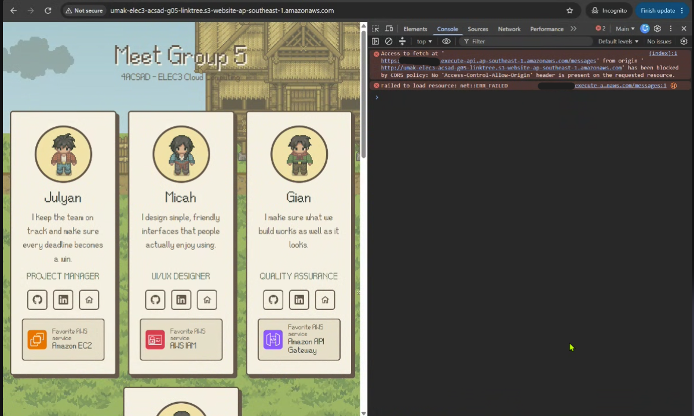
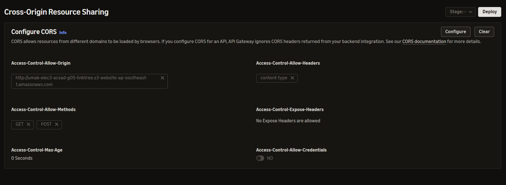
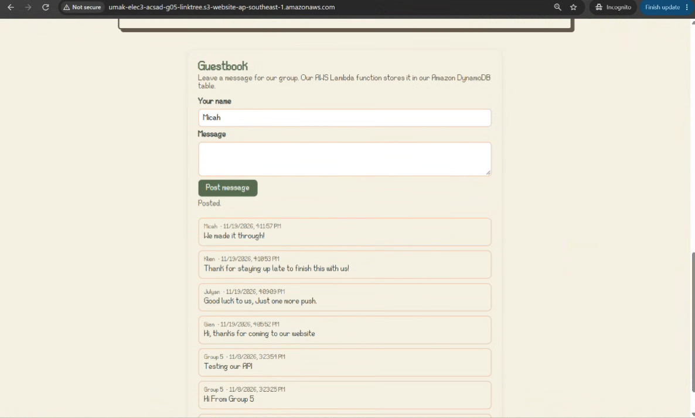
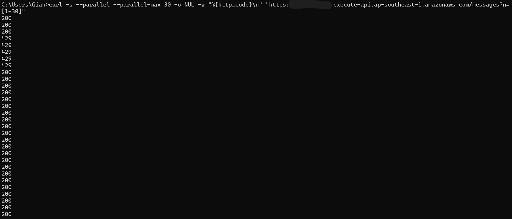

# Lab 5 Submission

## About us

- Group number: 5
- Section: IV-ACSAD
- Group IAM user: acsad-g05
- Website endpoint: http://umak-elec3-acsad-g05-linktree.s3-website-ap-southeast-1.amazonaws.com
- HTTP API name: umak-elec3-acsad-g05-api

## Screenshots

## Questions

1. In Lab 4, your API answered `curl` and the address bar of your browser. In Step 3, the same API did not answer your page. Why?

   The reason is CORS (cross-origin resource sharing), which is a rule that the browser enforces on scripts. Our page and our API are on different origins: the page is on `http` at the S3 website host, while the API is on `https` at the `execute-api` host. A script on a page can read an answer from another origin only when that origin allows the page with an `Access-Control-Allow-Origin` header. In Step 3, our API had no CORS settings yet, so it sent no such header, and the browser blocked the script from reading the answer. In Lab 4, `curl` and the address bar worked because neither of them is a script running on a page, so the browser did not apply the CORS rule to them.

2. Which pillar of the AWS Well-Architected Framework does your throttle serve? Explain in two sentences.

   The throttle serves the Reliability pillar. By limiting requests to 2 per second with a burst of 5, it keeps a flood of requests from overwhelming our API, Lambda function, and DynamoDB table, so the site stays available for normal visitors; requests over the limit get a `429` answer and never run the function.

3. Your guestbook shows each message with `textContent`. What could a visitor do if the page put each message into the page as HTML with `innerHTML`?

   A visitor could post a message that contains HTML or JavaScript, for example an `` tag with an `onerror` attribute that runs a script. Because the message is stored in our table and shown to everyone, the browser of every later visitor would treat it as real code and run it on our page. This is called cross-site scripting (XSS), and the script could change the page, redirect visitors to another site, or steal data from them. With `textContent`, the same message is displayed only as plain text, so it cannot run.
