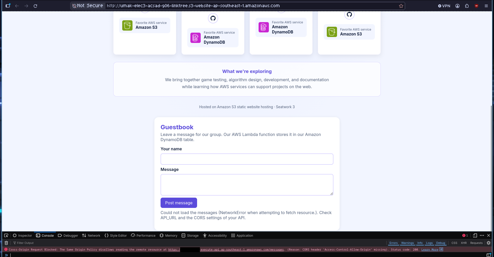
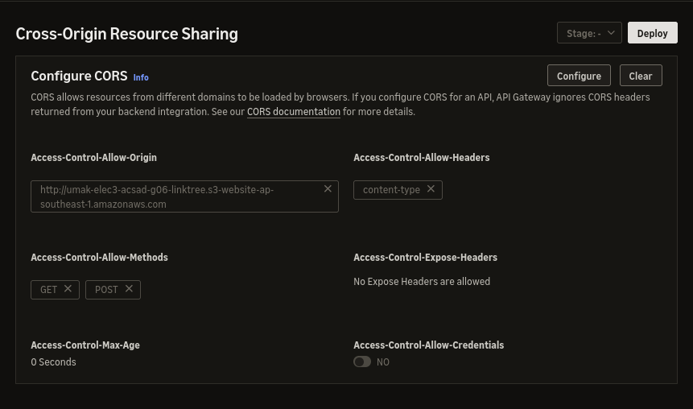
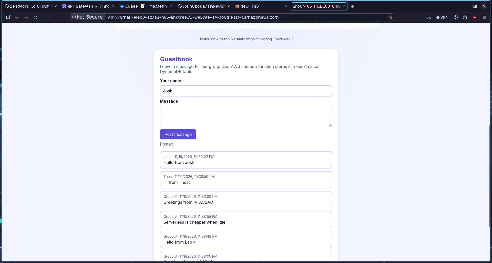
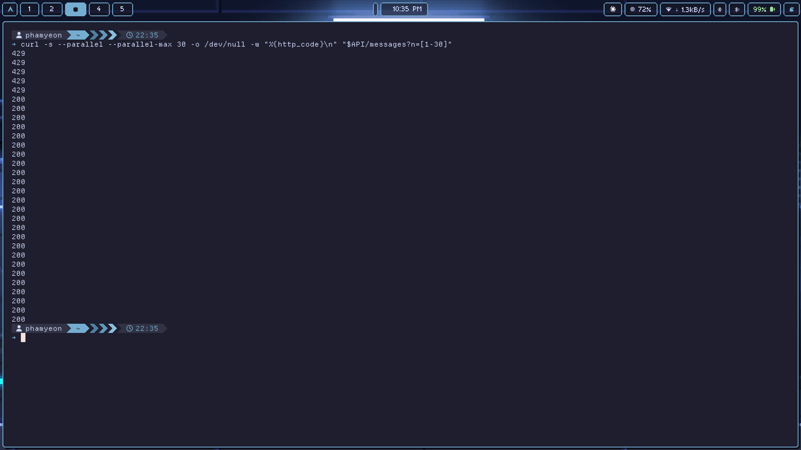

# Lab 5 Submission

## About us

- Group number: 6
- Section: IV-ACSAD
- Group IAM user: acsad-g06
- Website endpoint: http://umak-elec3-acsad-g06-linktree.s3-website-ap-southeast-1.amazonaws.com
- HTTP API name: umak-elec3-acsad-g06-api

## Screenshots

## Questions

1. In Lab 4, your API answered `curl` and the address bar of your browser. In Step 3, the same API did not answer your page. Why?

   CORS is a rule that the browser applies to scripts on a page, not a rule of the API. Our page comes from one origin (`http` at the S3 website host) and our API from another (`https` at the `execute-api` host). When a script on the page calls another origin with `fetch`, the browser only lets the script read the answer if the API sends an `Access-Control-Allow-Origin` header that names the page's origin, and for the POST it first sends an `OPTIONS` preflight. Our API sent no such header, so the browser blocked the calls. `curl` and the address bar are not scripts on a page from another origin, so the browser's CORS check never applied to them.

2. Which pillar of the AWS Well-Architected Framework does your throttle serve? Explain in two sentences.

   The throttle serves the Reliability pillar, because API Gateway lets through at most 2 requests per second with a burst of 5 and answers `429 Too Many Requests` to the rest, so a flood of requests cannot overload our Lambda function and DynamoDB table and the guestbook keeps working for real visitors. It also helps Cost Optimization, because the rejected requests never run our function or touch our table, so a flood cannot run up our bill.

3. Your guestbook shows each message with `textContent`. What could a visitor do if the page put each message into the page as HTML with `innerHTML`?

   A visitor could post a message that holds HTML with code, for example ``, and the page would run that code in the browser of every person who opens the guestbook. This is stored cross-site scripting (XSS). The code could change or deface our page, send visitors to another site, or post messages through our API in their name. With `textContent`, the browser shows the message as plain text, so the HTML never runs.
