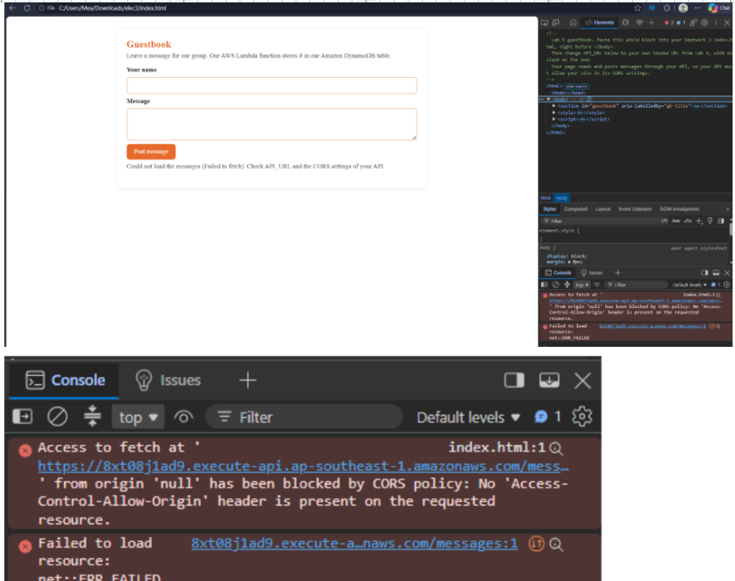
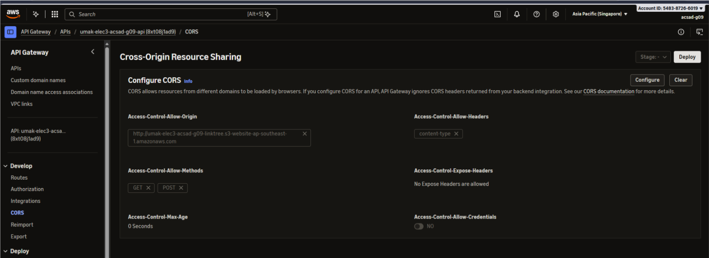
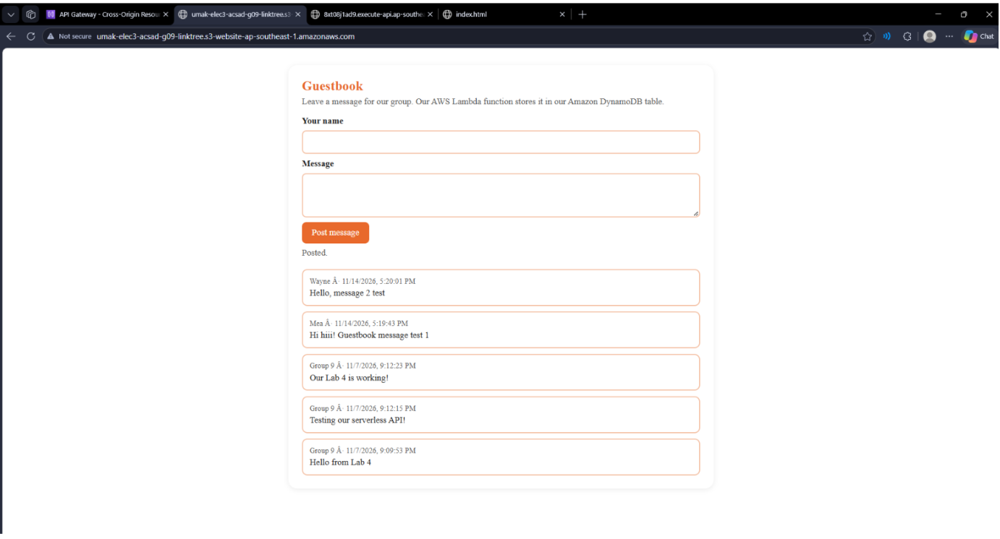
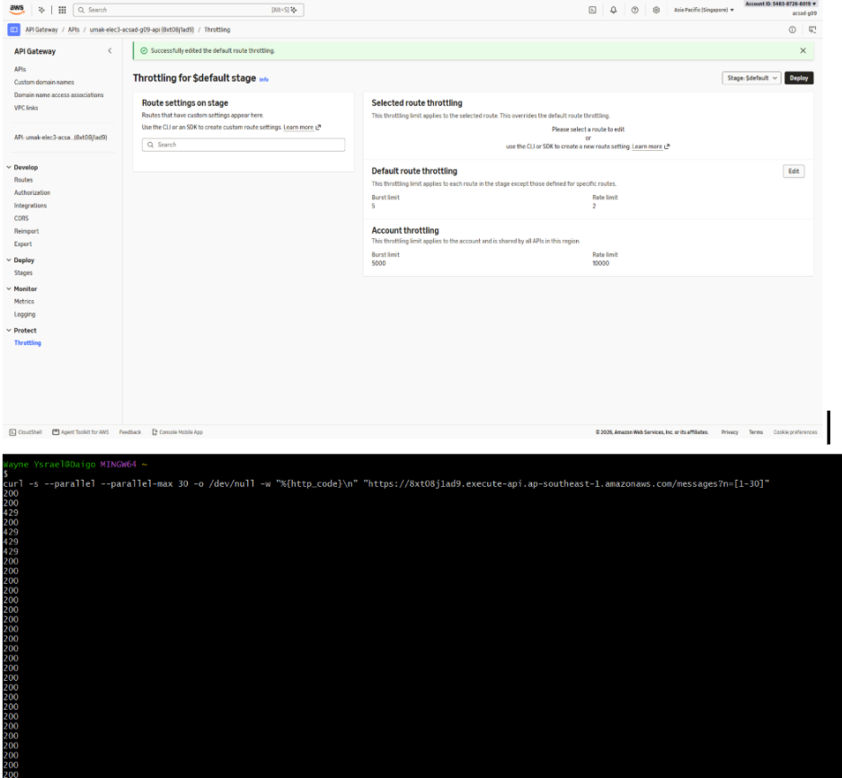

# Lab 5 Submission

## About us

- Group number: 9
- Section: IV-ACSAD
- Group IAM user: acsad-g09
- Website endpoint: http://umak-elec3-acsad-g09-linktree.s3-website-ap-southeast-1.amazonaws.com/
- HTTP API name: umak-elec3-acsad-g09-api

## Screenshots

## Questions

1. In Lab 4, your API answered `curl` and the address bar of your browser. In Step 3, the same API did not answer your page. Why?

   The API worked with curl and the browser's address bar because CORS is a browser security rule that applies to scripts running on a webpage. In Step 3, the webpage and API have different origins, and the API does not have the required Access-Control-Allow-Origin header to allow the request.

2. Which pillar of the AWS Well-Architected Framework does your throttle serve? Explain in two sentences.

   The throttle serves the **Reliability** pillar of the AWS Well-Architected Framework. It limits excessive requests to prevent the API from becoming overloaded and helps maintain its availability for other users.

3. Your guestbook shows each message with `textContent`. What could a visitor do if the page put each message into the page as HTML with `innerHTML`?

   A visitor could submit malicious HTML or JavaScript code that might execute when other users view the guestbook. This could lead to a Cross-Site Scripting (XSS) attack, allowing attackers to steal information or modify the webpage.
