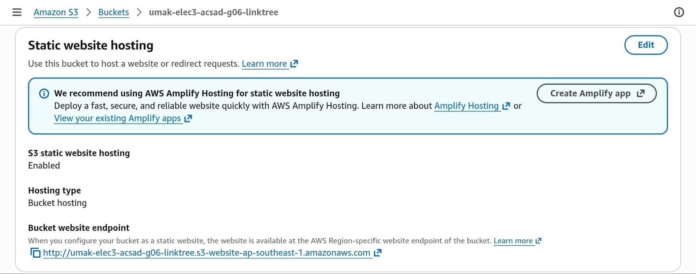
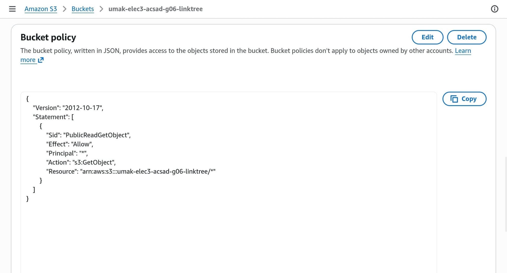
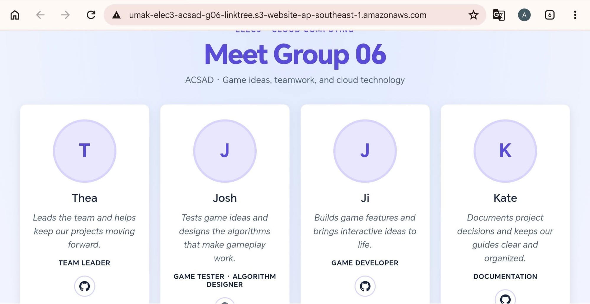

# Seatwork 3 Submission

<!--
How to use this template:

1. Save hosting.png, policy.png, and site.png in the same folder.
2. Crop the AWS console top bar out of hosting.png and policy.png.
3. Write GitHub usernames, not full names or student numbers.
-->

## About us

- Group number: 06
- Section: ACSAD
- Group IAM user: acsad-g06
- Bucket name: umak-elec3-acsad-g06-linktree
- Website endpoint: http://umak-elec3-acsad-g06-linktree.s3-website-ap-southeast-1.amazonaws.com/

## Screenshots

## Contribution

| GitHub username | What this groupmate did |
| --- | --- |
| amagpantaya12345923-gif | Group leader; coordinated the group |
| yellowboeing120 | Game tester and algorithm designer |
| Tlswlgus | Game developer |
| Bewoop | Documentation |
