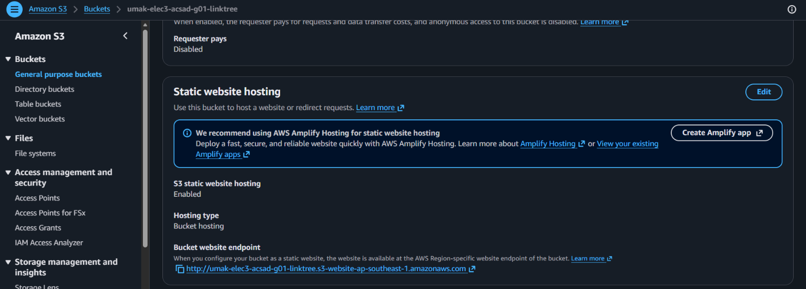
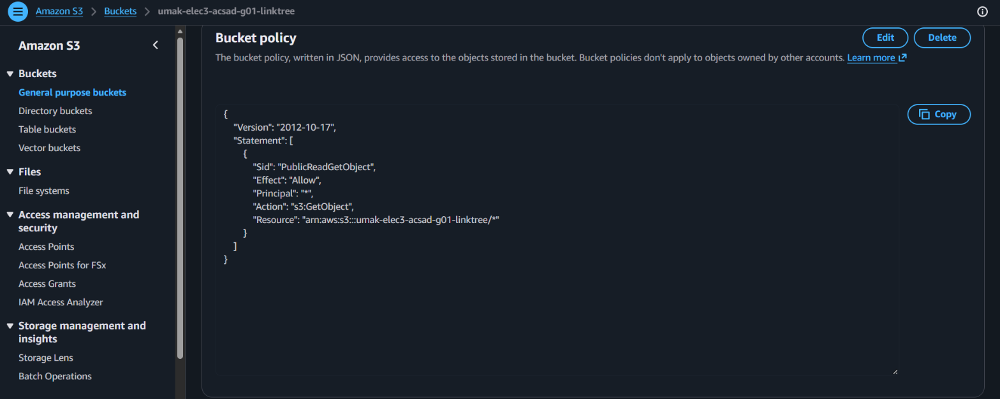
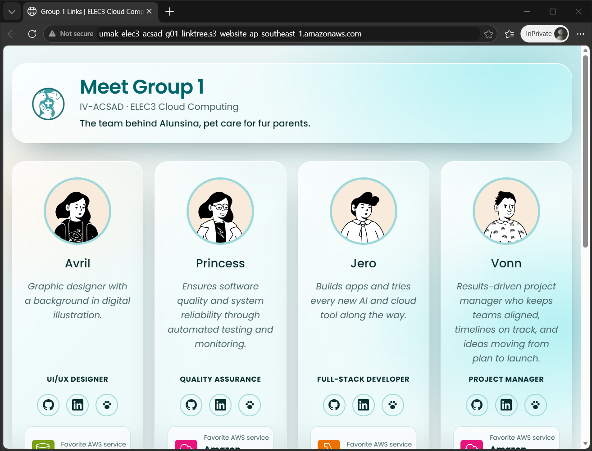

# Seatwork 3 Submission

<!--
How to use this template:

1. Copy this file to submissions/seatwork-3/group-<number>/submission.md
2. Replace every <answer> with your group's answer. Delete the angle brackets too.
3. Save hosting.png, policy.png, and site.png in the same folder.
4. Crop the AWS console top bar out of hosting.png and policy.png.
5. Write GitHub usernames, not full names or student numbers.
-->

## About us

- Group number: 1
- Section: IV-ACSAD
- Group IAM user: acsad-g01
- Bucket name: umak-elec3-acsad-g01-linktree
- Website endpoint: http://umak-elec3-acsad-g01-linktree.s3-website-ap-southeast-1.amazonaws.com

## Screenshots

## Contribution

| GitHub username | What this groupmate did |
| --- | --- |
| Jerothegreat | Set up the S3 bucket, website hosting, and bucket policy |
| cess-O | QA: tested the live page and its links |
| Vnslv | Project manager: kept the group on schedule |
| saintschalice | UI/UX: designed the page |
