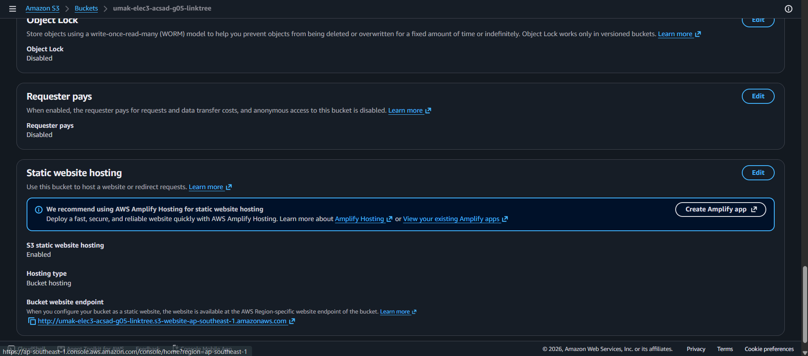
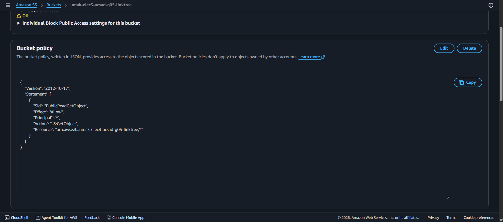
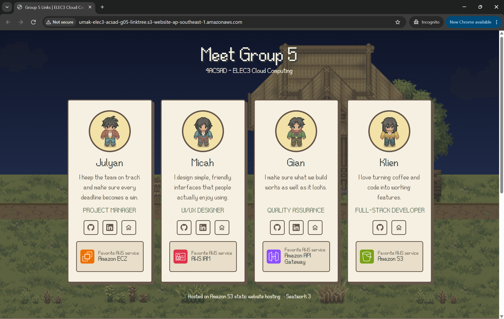

# Seatwork 3 Submission

## About us

- Group number: 5
- Section: IV-ACSAD
- Group IAM user: acsad-g05
- Bucket name: umak-elec3-acsad-g05-linktree
- Website endpoint: http://umak-elec3-acsad-g05-linktree.s3-website-ap-southeast-1.amazonaws.com

## Screenshots

## Contribution

| GitHub username | What this groupmate did |
| --- | --- |
| MrBep | Developer: built the group linktree page (index.html) from Seatwork 2, including the page structure, profile cards, and links, which we hosted on S3 |
| Rengokunn | Set up the S3 bucket, website hosting, Block Public Access, and bucket policy |
| klienfinity123 | QA: tested the live website endpoint and checked that the page and its links work; also opened the Pull Request |
| stratterium | UI/UX: designed the look and layout of the page and created the visual assets (images and graphics) used on it |
