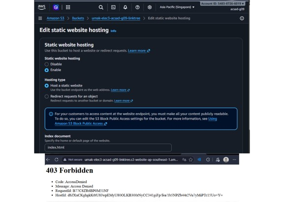
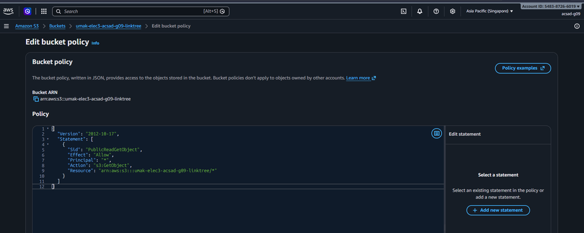
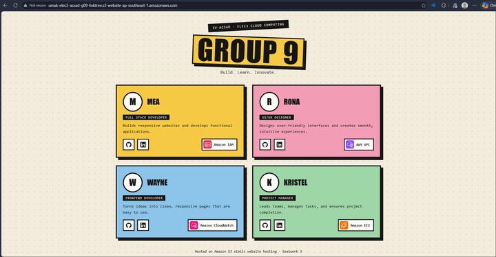

# Seatwork 3 Submission

## About us

- Group number: 9
- Section: IV-ACSAD
- Group IAM user: acsad-g09
- Bucket name: umak-elec3-acsad-g09-linktree
- Website endpoint: http://umak-elec3-acsad-g09-linktree.s3-website-ap-southeast-1.amazonaws.com

## Screenshots

## Contribution

| GitHub username | What this groupmate did |
| --- | --- |
| Azores-Mea | Navigated through the S3 console, created the bucket, configured static website hosting, and saved the screenshots. |
| WayneyYsrrael | Modified and saved the bucket policy to allow public read access using s3:GetObject. |
| rdanlogA12345581 | Arranged and checked the required screenshots for submission. |
| klomol-jo | Prepared the submission and created the pull request. |
