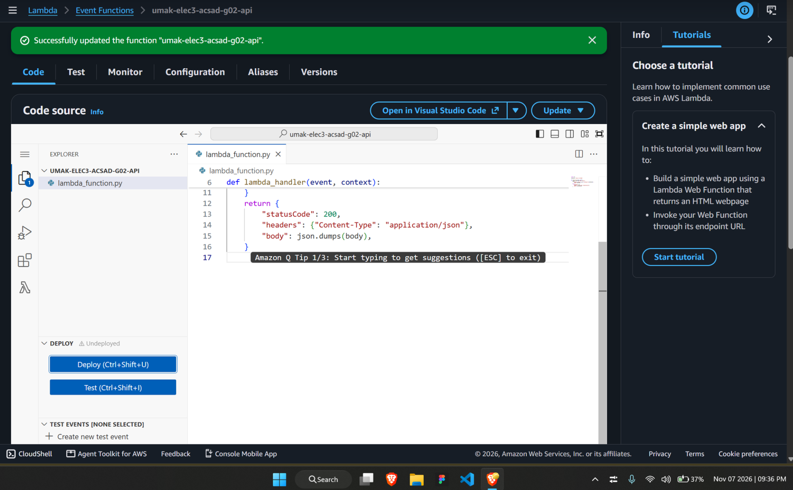
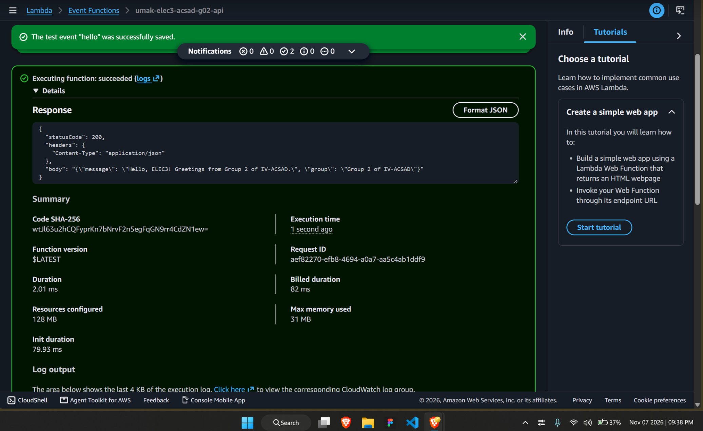
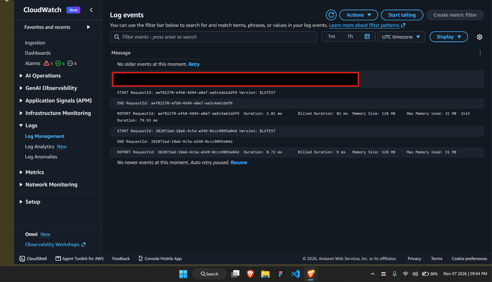

# Seatwork 4 Submission

<!--
How to use this template:

1. Copy this file to submissions/seatwork-4/group-<number>/submission.md
2. Replace every <answer> with your group's answer. Delete the angle brackets too.
3. Save code.png, test.png, and report.png in the same folder.
4. Crop the AWS console top bar out of all three screenshots, and cover every ARN.
5. Write GitHub usernames, not full names or student numbers.
-->

## About us

- Group number: 2
- Section: 4-ACSAD
- Group IAM user: acsad-g02
- Function name: umak-elec3-acsad-g02-api

## Handler code

```python
import json

GROUP_NAME = "Group 2 of IV-ACSAD"


def lambda_handler(event, context):
    visitor = event.get("name", "visitor")
    body = {
        "message": f"Hello, {visitor}! Greetings from {GROUP_NAME}.",
        "group": GROUP_NAME,
    }
    return {
        "statusCode": 200,
        "headers": {"Content-Type": "application/json"},
        "body": json.dumps(body),
    }

```

## REPORT lines

First run, a cold start:

```text
REPORT RequestId: aef82270-efb8-4694-a0a7-aa5c4ab1ddf9	Duration: 2.01 ms	Billed Duration: 82 ms	Memory Size: 128 MB	Max Memory Used: 31 MB	Init Duration: 79.93 ms
```

Second run, a warm start:

```text
REPORT RequestId: 282072ad-18a6-4c5a-a549-0ccc9095e04d	Duration: 8.72 ms	Billed Duration: 9 ms	Memory Size: 128 MB	Max Memory Used: 31 MB
```

## Question

Why does the second REPORT line have no Init Duration?

Since Lambda creates an execution environment, a small like place to run codes in the handler on the first start once the environment is established with that deployed code the next run will just call or reuse the same environment for it to run making the second run much smoother and faster.

## Screenshots







## Contribution

| GitHub username | What this groupmate did |
| --- | --- |
| shinu-syr | navigated the whole process in aws and vscode |
| eyakmwamwa | informed and documented the process |
| carlcawas | navigated the process, and answered the question |
| mik4rin | helped in answering the given questions |
