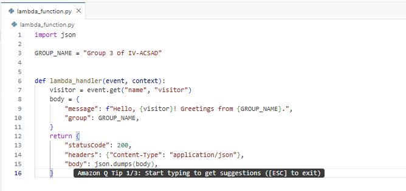
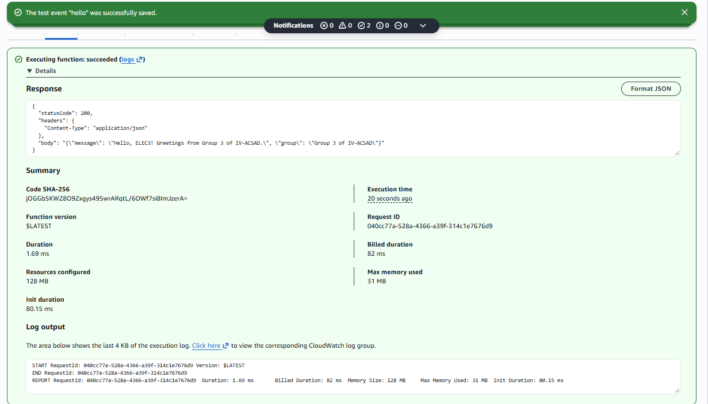
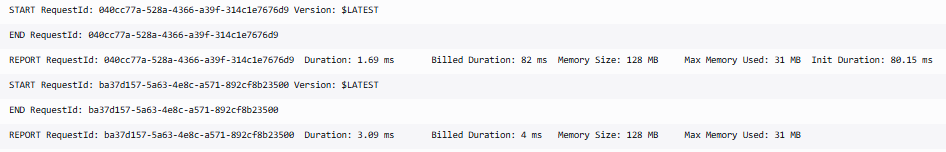

# Seatwork 4 Submission

<!--
How to use this template:

1. Copy this file to submissions/seatwork-4/group-<number>/submission.md
2. Replace every <answer> with your group's answer. Delete the angle brackets too.
3. Save code.png, test.png, and report.png in the same folder.
4. Crop the AWS console top bar out of all three screenshots, and cover every ARN.
5. Write GitHub usernames, not full names or student numbers.
-->

## About us

- Group number: 3
- Section: IV-ACSAD
- Group IAM user: acsad-g03
- Function name: 	umak-elec3-acsad-g03-api

## Handler code

```python
import json

GROUP_NAME = "Group 3 of IV-ACSAD" 


def lambda_handler(event, context):
    visitor = event.get("name", "visitor")
    body = {
        "message": f"Hello, {visitor}! Greetings from {GROUP_NAME}.",
        "group": GROUP_NAME,
    }
    return {
        "statusCode": 200,
        "headers": {"Content-Type": "application/json"},
        "body": json.dumps(body),
    }
```

## REPORT lines

First run, a cold start:

```text
REPORT RequestId: 040cc77a-528a-4366-a39f-314c1e7676d9	Duration: 1.69 ms	Billed Duration: 82 ms	Memory Size: 128 MB	Max Memory Used: 31 MB	Init Duration: 80.15 ms	
```

Second run, a warm start:

```text
REPORT RequestId: ba37d157-5a63-4e8c-a571-892cf8b23500	Duration: 3.09 ms	Billed Duration: 4 ms	Memory Size: 128 MB	Max Memory Used: 31 MB
```

## Question

Why does the second REPORT line have no Init Duration?

Because it was a warm start

## Screenshots







## Contribution

| GitHub username | What this groupmate did |
| --- | --- |
| edjjff | managed the pr submission |
| johnclefordricafranca | answered question for the task |
| LUZADA-SARAH | reviewed screenshots |
| reymarttskrt | checked if everything is in place and in order | 

