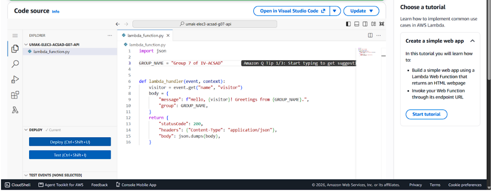
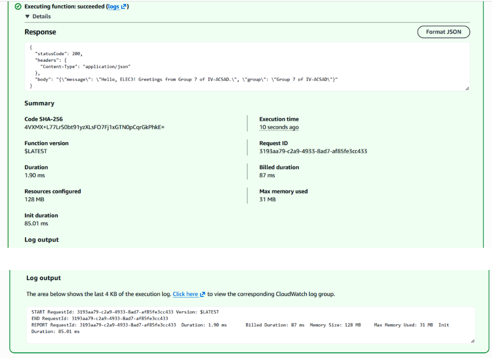
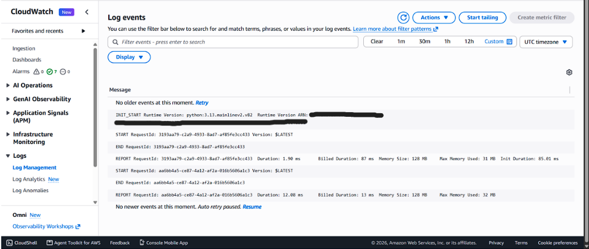

# Seatwork 4 Submission

<!--
How to use this template:

1. Copy this file to submissions/seatwork-4/group-<number>/submission.md
2. Replace every <answer> with your group's answer. Delete the angle brackets too.
3. Save code.png, test.png, and report.png in the same folder.
4. Crop the AWS console top bar out of all three screenshots, and cover every ARN.
5. Write GitHub usernames, not full names or student numbers.
-->

## About us

- Group number: 07
- Section: IV - ACSAD
- Group IAM user: acsad-g07
- Function name: umak-elec3-acsad-g07-api

## Handler code

import json

GROUP_NAME = "Group 7 of IV-ACSAD"  # Change this to your group's name.

def lambda_handler(event, context):
    visitor = event.get("name", "visitor")
    body = {
        "message": f"Hello, {visitor}! Greetings from {GROUP_NAME}.",
        "group": GROUP_NAME,
    }
    return {
        "statusCode": 200,
        "headers": {"Content-Type": "application/json"},
        "body": json.dumps(body),
    }

## REPORT lines

First run, a cold start:

REPORT RequestId: 3193aa79-c2a9-4933-8ad7-af85fe3cc433	Duration: 1.90 ms	Billed Duration: 87 ms	Memory Size: 128 MB	Max Memory Used: 31 MB	Init Duration: 85.01 ms

Second run, a warm start:

REPORT RequestId: aa6bb4a5-ce87-4a12-af2a-016b5606a1c3	Duration: 12.08 ms	Billed Duration: 13 ms	Memory Size: 128 MB	Max Memory Used: 32 MB

## Question

Why does the second REPORT line have no Init Duration?

The second REPORT line has no Init Duration because it represents a warm start. The execution environment was already initialized during the first invocation and kept running, so the second invocation reused the existing environment without needing to initialize it again. 

## Screenshots

## Contribution

| GitHub username | What this groupmate did |
| --- | --- |
| Sdjada | Created the lambda |
| N0micon18 | Created the document |
| yoonice0393 | passed the submission in GitHub |
| JCKS003 | helped with the doc |
