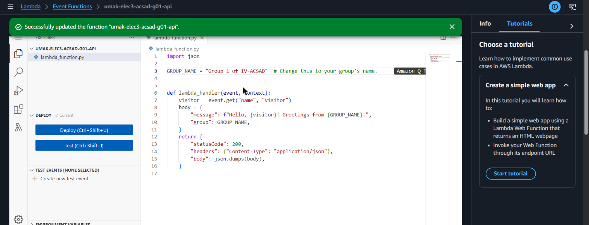
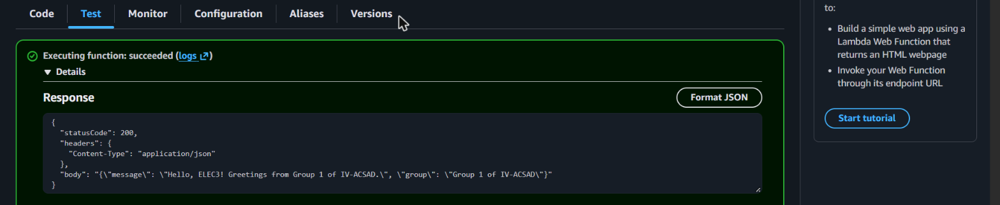
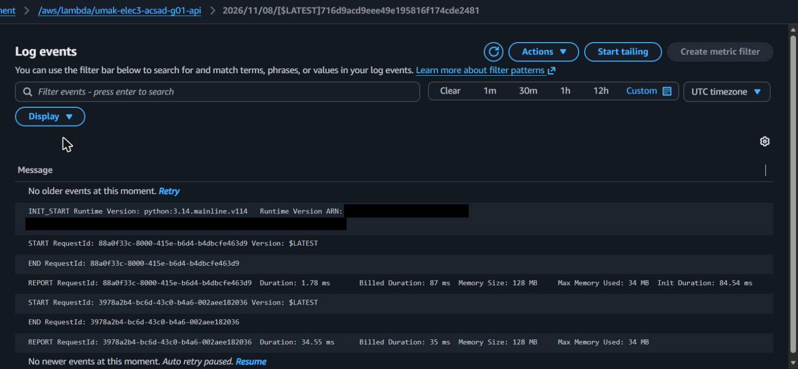

# Seatwork 4 Submission

<!--
How to use this template:

1. Copy this file to submissions/seatwork-4/group-<number>/submission.md
2. Replace every <answer> with your group's answer. Delete the angle brackets too.
3. Save code.png, test.png, and report.png in the same folder.
4. Crop the AWS console top bar out of all three screenshots, and cover every ARN.
5. Write GitHub usernames, not full names or student numbers.
-->

## About us

- Group number: 1
- Section: IV-ACSAD
- Group IAM user: acsad-g01
- Function name: umak-elec3-acsad-g01-api

## Handler code

```python
import json

GROUP_NAME = "Group 1 of IV-ACSAD"  # Change this to your group's name.


def lambda_handler(event, context):
    visitor = event.get("name", "visitor")
    body = {
        "message": f"Hello, {visitor}! Greetings from {GROUP_NAME}.",
        "group": GROUP_NAME,
    }
    return {
        "statusCode": 200,
        "headers": {"Content-Type": "application/json"},
        "body": json.dumps(body),
    }
```

## REPORT lines

First run, a cold start:

```text
REPORT RequestId: 88a0f33c-8000-415e-b6d4-b4dbcfe463d9	Duration: 1.78 ms	Billed Duration: 87 ms	Memory Size: 128 MB	Max Memory Used: 34 MB	Init Duration: 84.54 ms
```

Second run, a warm start:

```text
REPORT RequestId: 3978a2b4-bc6d-43c0-b4a6-002aee182036	Duration: 34.55 ms	Billed Duration: 35 ms	Memory Size: 128 MB	Max Memory Used: 34 MB
```

## Question

Why does the second REPORT line have no Init Duration?

The first run was a cold start. Lambda had no execution environment for our function yet, so it created one, started Python, and loaded our code before running the handler. That setup time is the Init Duration (84.54 ms), and the INIT_START line comes right before that run. Lambda keeps the environment for a while after a run. Our second run came soon after, so Lambda reused the same environment, which was already set up. Nothing had to be prepared again, so the second REPORT line has no Init Duration. It was a warm start. Both runs are in the same log stream, and only the first one has an INIT_START line.

## Screenshots







## Contribution

| GitHub username | What this groupmate did |
| --- | --- |
| Jerothegreat | Created the Lambda function with our group's role, wrote and deployed the handler |
| cess-O | QA: created the hello test event, ran both tests, and checked the response |
| Vnslv | Project manager: kept the group on schedule and opened the Pull Request |
| saintschalice | Found the REPORT lines in CloudWatch and wrote the answer to the question |
