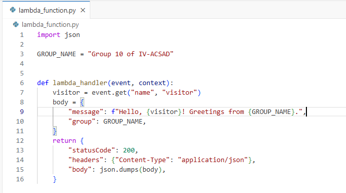
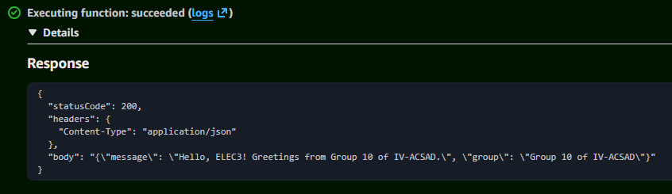
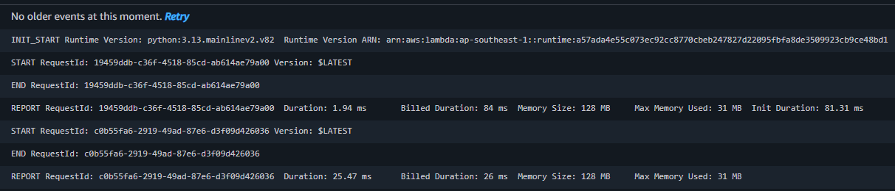

# Seatwork 4 Submission

<!--
How to use this template:

1. Copy this file to submissions/seatwork-4/group-<number>/submission.md
2. Replace every <answer> with your group's answer. Delete the angle brackets too.
3. Save code.png, test.png, and report.png in the same folder.
4. Crop the AWS console top bar out of all three screenshots, and cover every ARN.
5. Write GitHub usernames, not full names or student numbers.
-->

## About us

- Group number: 10
- Section: IV - ACSAD
- Group IAM user: acsa-g10
- Function name: umak-elec3-acsad-g10-api

## Handler code

```python
import json

GROUP_NAME = "Group 10 of IV-ACSAD"


def lambda_handler(event, context):
    visitor = event.get("name", "visitor")
    body = {
        "message": f"Hello, {visitor}! Greetings from {GROUP_NAME}.",
        "group": GROUP_NAME,
    }
    return {
        "statusCode": 200,
        "headers": {"Content-Type": "application/json"},
        "body": json.dumps(body),
    }
```

## REPORT lines

First run, a cold start:

```text
REPORT RequestId: 19459ddb-c36f-4518-85cd-ab614ae79a00	Duration: 1.94 ms	Billed Duration: 84 ms	Memory Size: 128 MB	Max Memory Used: 31 MB	Init Duration: 81.31 ms
```

Second run, a warm start:

```text
REPORT RequestId: c0b55fa6-2919-49ad-87e6-d3f09d426036	Duration: 25.47 ms	Billed Duration: 26 ms	Memory Size: 128 MB	Max Memory Used: 31 MB
```

## Question

Why does the second REPORT line have no Init Duration?

An initial request triggers a cold start where the execution environment is created and initialized, logging an Init Duration. Subsequent requests reuse this warm execution environment, bypassing the setup phase and leaving the Init Duration off the REPORT line.

## Screenshots







## Contribution

| GitHub username | What this groupmate did |
| --- | --- |
| silicon-dioxide | main navigator in aws |
| Kwin-Talattad | contributed by answering question |
| santiagojohncarlop-blip | read and verified the documentation |
| jmiranda12345681 | read and verified the documentation |

