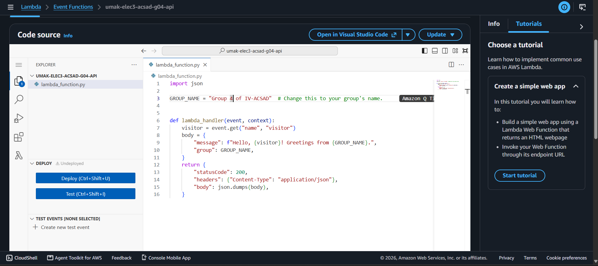
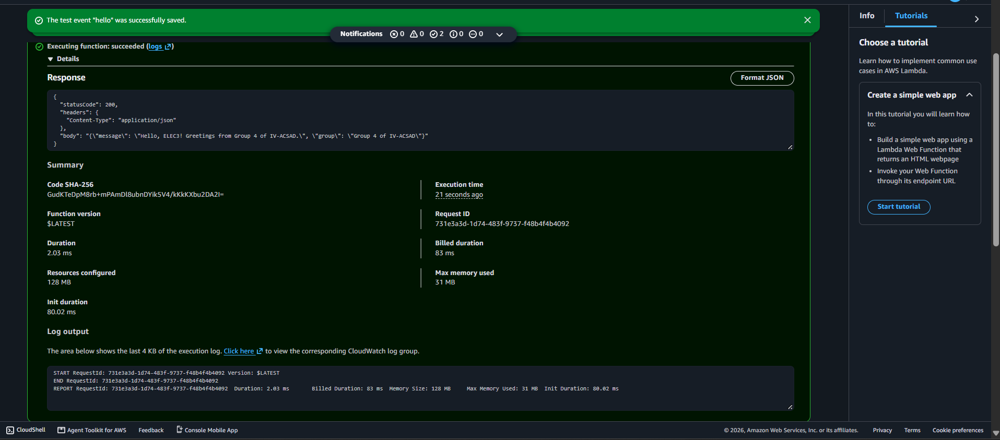
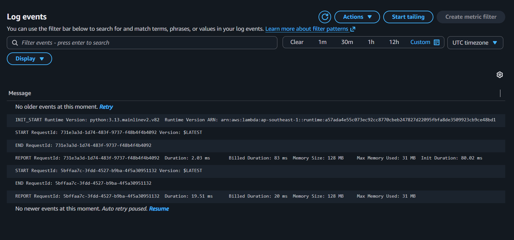

# Seatwork 4 Submission

<!--
How to use this template:

1. Copy this file to submissions/seatwork-4/group-<number>/submission.md
2. Replace every <answer> with your group's answer. Delete the angle brackets too.
3. Save code.png, test.png, and report.png in the same folder.
4. Crop the AWS console top bar out of all three screenshots, and cover every ARN.
5. Write GitHub usernames, not full names or student numbers.
-->

## About us

- Group number: 4
- Section: 4 acsad
- Group IAM user: acsad-g04
- Function name: umak-elec3-acsad-g04-api

## Handler code

import json

GROUP_NAME = "Group 4 of IV-ACSAD"  # Change this to your group's name.

def lambda_handler(event, context):
    visitor = event.get("name", "visitor")
    body = {
        "message": f"Hello, {visitor}! Greetings from {GROUP_NAME}.",
        "group": GROUP_NAME,
    }
    return {
        "statusCode": 200,
        "headers": {"Content-Type": "application/json"},
        "body": json.dumps(body),
    }

## REPORT lines

First run, a cold start:

REPORT RequestId: 731e3a3d-1d74-483f-9737-f48b4f4b4092	Duration: 2.03 ms	Billed Duration: 83 ms	Memory Size: 128 MB	Max Memory Used: 31 MB	Init Duration: 80.02 ms	

Second run, a warm start:

REPORT RequestId: 5bffaa7c-3fdd-4527-b9ba-4f5a30951132	Duration: 19.51 ms	Billed Duration: 20 ms	Memory Size: 128 MB	Max Memory Used: 31 MB

## Question

Why does the second REPORT line have no Init Duration?

The second REPORT line does not show any Init Duration because the Lambda function was already warm. During a cold start (the first run), AWS needs to initialize the runtime, download the code, and set up the execution environment, which accounts for the Init Duration. Once the environment is initialized, subsequent requests (warm starts) can reuse the existing environment, eliminating the need for initialization and thus resulting in no recorded Init Duration.

## Screenshots

## Contribution

| GitHub username | What this groupmate did |
| --- | --- |
| Steeshesh | Created the `umak-elec3-acsad-g04-api` Lambda function in `ap-southeast-1` with Python 3.13 and configured the `umak-elec3-acsad-g04-lambda-role` execution role. |

| Note-Program | Wrote and deployed the Python `lambda_handler` code returning the group JSON greeting and captured `code.png`. |

| EvapeGT | Configured the `hello` test event, executed the cold and warm start test runs, and captured `test.png`. |

| chupapichuros | Located the CloudWatch log stream, extracted the two `REPORT` lines (`report.png`), and answered the Init Duration question in `submission.md`. |
