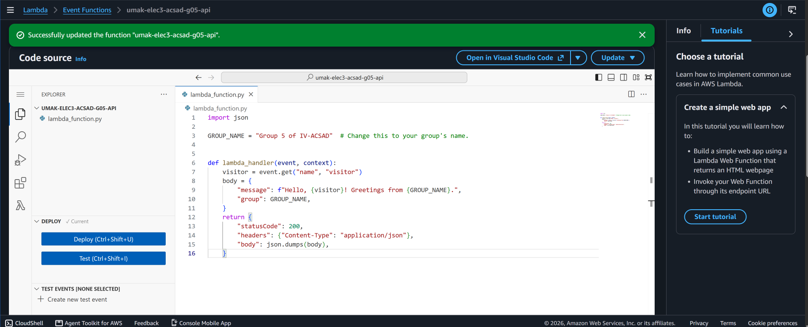
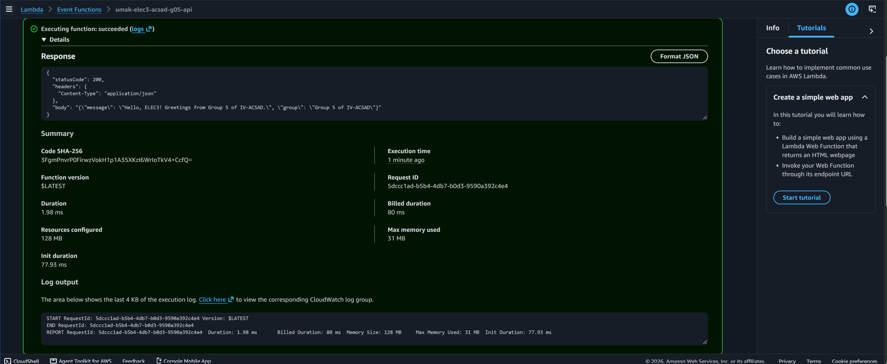
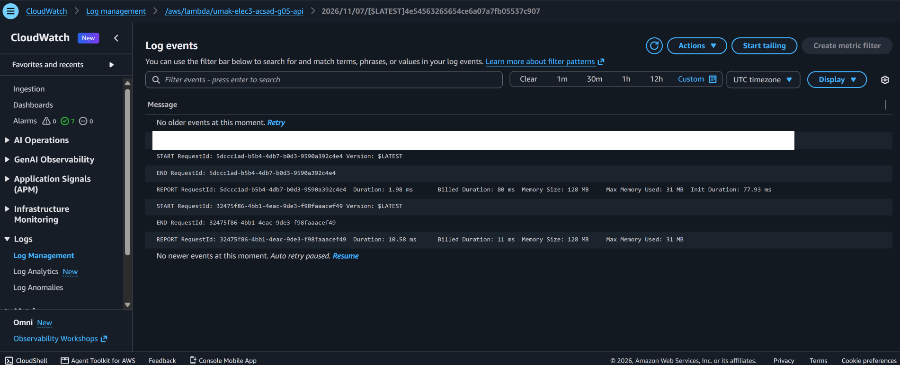

# Seatwork 4 Submission

## About us

- Group number: 5
- Section: IV-ACSAD
- Group IAM user: acsad-g05
- Function name: umak-elec3-acsad-g05-api

## Handler code

```python
import json

GROUP_NAME = "Group 5 of IV-ACSAD"  # Change this to your group's name.


def lambda_handler(event, context):
    visitor = event.get("name", "visitor")
    body = {
        "message": f"Hello, {visitor}! Greetings from {GROUP_NAME}.",
        "group": GROUP_NAME,
    }
    return {
        "statusCode": 200,
        "headers": {"Content-Type": "application/json"},
        "body": json.dumps(body),
    }
```

## REPORT lines

First run, a cold start:

```text
REPORT RequestId: 5dccc1ad-b5b4-4db7-b0d3-9590a392c4e4 Duration: 1.98 ms Billed Duration: 80 ms Memory Size: 128 MB Max Memory Used: 31 MB Init Duration: 77.93 ms
```

Second run, a warm start:

```text
REPORT RequestId: 32475f86-4bb1-4eac-9de3-f98faaacef49 Duration: 10.58 ms Billed Duration: 11 ms Memory Size: 128 MB Max Memory Used: 31 MB
```

## Question

Why does the second REPORT line have no Init Duration?

Init Duration measures the initialization phase, when Lambda creates a new execution environment, starts the Python runtime, and loads our code. That only happens on a cold start. After our first test, Lambda kept the environment alive, and because we pressed Test again right away, the second run reused it. It skipped initialization and went straight to lambda_handler, so there was nothing to time. That is also why the second run has no INIT_START line. A cold start would return after a new deploy, a code change, or a long idle period.

## Screenshots







## Contribution

| GitHub username | What this groupmate did |
| --- | --- |
| MrBep | Guided the group through the steps and gave instructions to the groupmate working in the AWS console. |
| Rengokunn | Carried out the steps in the AWS console: created the Lambda function, deployed the handler, ran the test event twice, and found the REPORT lines in CloudWatch. |
| klienfinity123 | Took the screenshots and compiled the files and details needed for the submission. |
| stratterium | Organized and answered submission.md, formatted submission.md against the template, and opened the Pull Request. |
