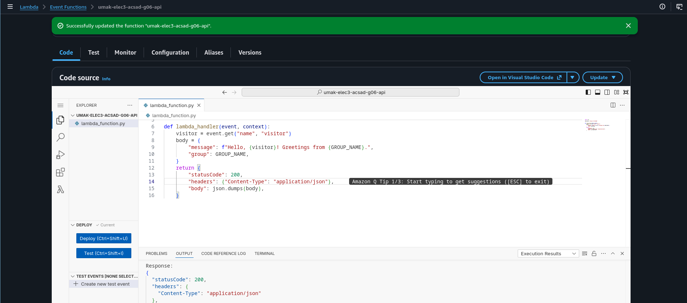
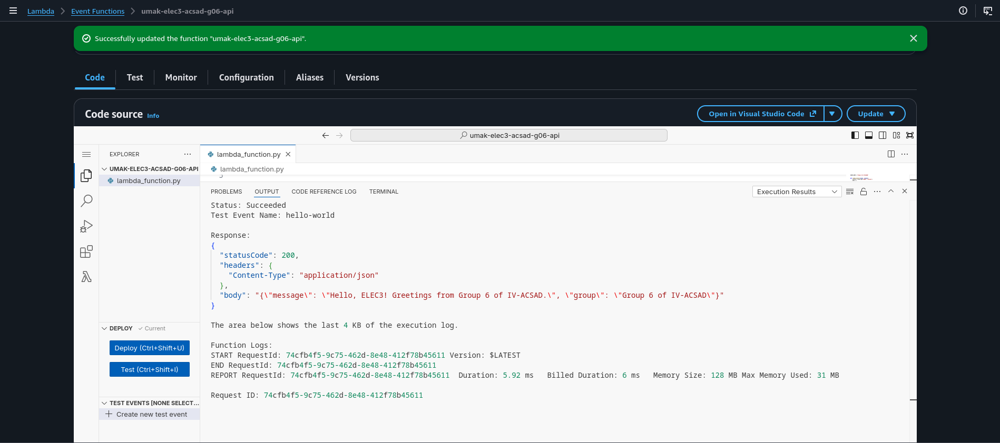
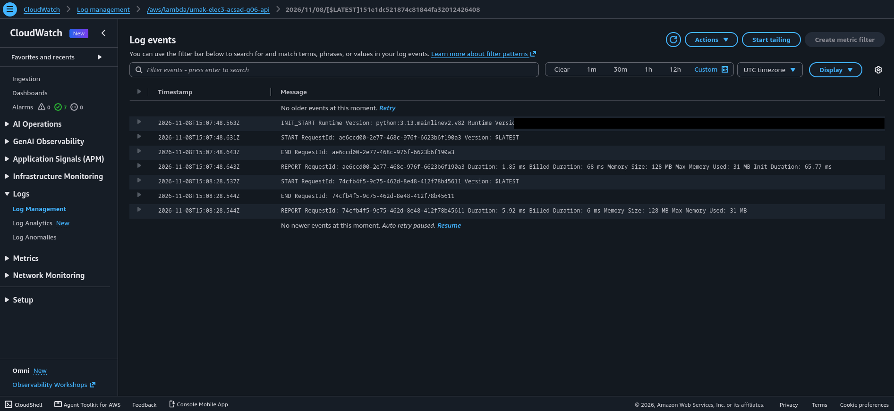

# Seatwork 4 Submission

## About us

- Group number: 6
- Section: IV-ACSAD
- Group IAM user: acsad-g06
- Function name: umak-elec3-acsad-g06-api

## Handler code

```python
import json

GROUP_NAME = "Group 6 of IV-ACSAD"


def lambda_handler(event, context):
    visitor = event.get("name", "visitor")
    body = {
        "message": f"Hello, {visitor}! Greetings from {GROUP_NAME}.",
        "group": GROUP_NAME,
    }
    return {
        "statusCode": 200,
        "headers": {"Content-Type": "application/json"},
        "body": json.dumps(body),
    }
```

## REPORT lines

First run, a cold start:

```text
REPORT RequestId: ae6ccd00-2e77-468c-976f-6623b6f190a3 Duration: 1.85 ms Billed Duration: 68 ms Memory Size: 128 MB Max Memory Used: 31 MB Init Duration: 65.77 ms
```

Second run, a warm start:

```text
REPORT RequestId: 74cfb4f5-9c75-462d-8e48-412f78b45611 Duration: 5.92 ms Billed Duration: 6 ms Memory Size: 128 MB Max Memory Used: 31 MB
```

## Question

Why does the second REPORT line have no Init Duration?

The second run came right after the first, so Lambda reused the execution environment that it had already created for the first run. That was a warm start: Python was already running and our code was already loaded, so Lambda skipped the init phase and went straight to calling `lambda_handler`. Init Duration only measures that setup work, so it shows only on a cold start, when Lambda has to create a new environment.

## Screenshots







## Contribution

| GitHub username | What this groupmate did |
| --- | --- |
| tlswlgus | Created the function in the Lambda console, deployed the handler, and ran the test event |
| yellowboeing120 | Checked the function name, Region, runtime, and execution role against the brief |
| amagpantaya12345923-gif | Found the two REPORT lines in CloudWatch and wrote the answer to the question |
| Bewoop | Took and cropped the screenshots and filled in submission.md |
