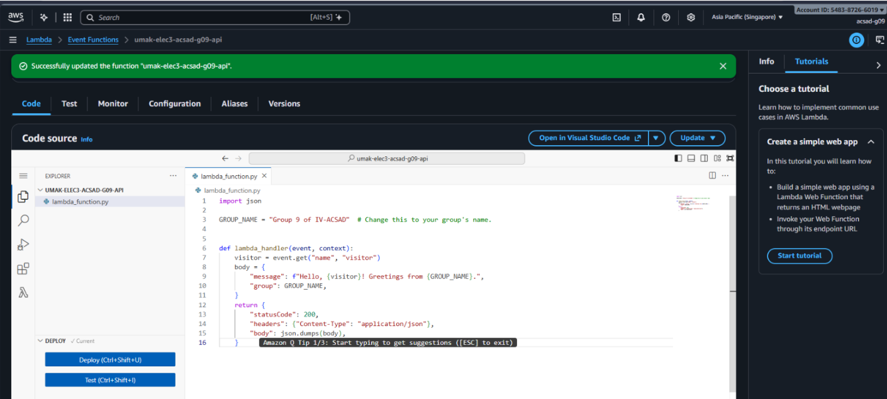
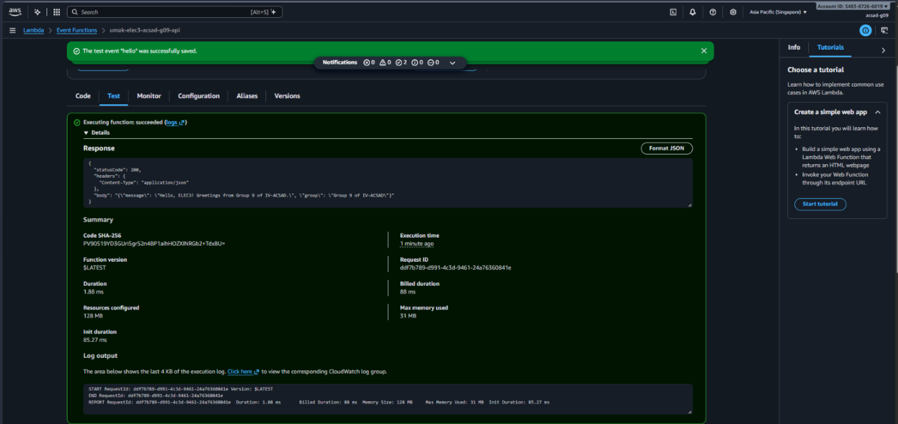
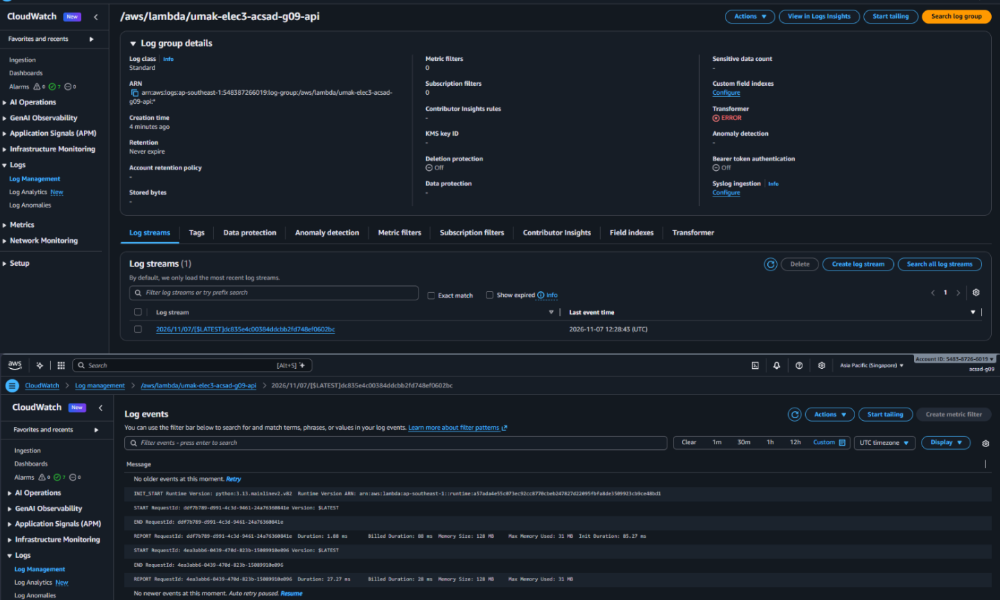

# Seatwork 4 Submission

<!--
How to use this template:

1. Copy this file to submissions/seatwork-4/group-<number>/submission.md
2. Replace every <answer> with your group's answer. Delete the angle brackets too.
3. Save code.png, test.png, and report.png in the same folder.
4. Crop the AWS console top bar out of all three screenshots, and cover every ARN.
5. Write GitHub usernames, not full names or student numbers.
-->

## About us

- Group number: 9
- Section: IV - ACSAD
- Group IAM user: acsad-g09
- Function name: umak-elec3-acsad-g09-api

## Handler code

import json

GROUP_NAME = "Group 9 of IV-ACSAD"  


def lambda_handler(event, context):
    visitor = event.get("name", "visitor")
    body = {
        "message": f"Hello, {visitor}! Greetings from {GROUP_NAME}.",
        "group": GROUP_NAME,
    }
    return {
        "statusCode": 200,
        "headers": {"Content-Type": "application/json"},
        "body": json.dumps(body),
    }


## REPORT lines

First run, a cold start:

```text
REPORT RequestId: ddf7b789-d991-4c3d-9461-24a76360841e	Duration: 1.88 ms	Billed Duration: 88 ms	Memory Size: 128 MB	Max Memory Used: 31 MB	Init Duration: 85.27 ms
```

Second run, a warm start:

```text
REPORT RequestId: 4ea3abb6-0439-470d-823b-15089910e096	Duration: 27.27 ms	Billed Duration: 28 ms	Memory Size: 128 MB	Max Memory Used: 31 MB
```

## Question

Why does the second REPORT line have no Init Duration?

The second run is a warm start, which means AWS Lambda reused the existing execution environment. Since it was already initialized during the first run, it did not need to initialize again.

## Screenshots







## Contribution

| GitHub username | What this groupmate did |
| --- | --- |
| klomol-jo | Finalized the work, and prepared the files for submission.  |
| Azores-Mea | Created the function, modified the lambda handler, and recorded the report/log lines in CloudWatch. Prepared the screenshots and contents needed for submission.md. |
| WayneyYsrrael | Created a test event and run it twice |
| rdanlogA12345581
 | Arranged and checked the needed screenshots for submission |
