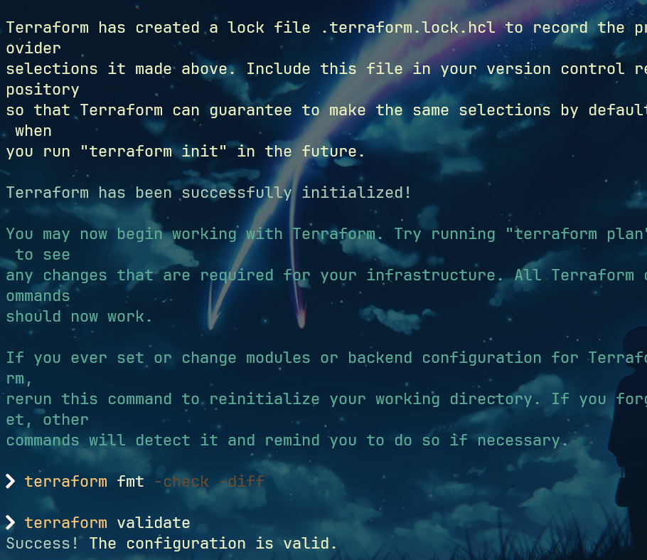

# Seatwork 5 Submission

<!--
How to use this template:

1. Copy this file to submissions/seatwork-5/group-<number>/submission.md
2. Replace every <answer> with your group's answer. Delete the angle brackets too.
3. Save template.yaml and main.tf in the same folder.
4. Do not put an access key, a password, an invoke URL, or the AWS account number in any file.
5. Write GitHub usernames, not full names or student numbers.
-->

## About us

- Group number: 1
- Section: IV-ACSAD
- Group IAM user: acsad-g01
- Table name: umak-elec3-acsad-g01-messages
- Bucket name: umak-elec3-acsad-g01-linktree

## Files

- [`template.yaml`](template.yaml): our CloudFormation template
- [`main.tf`](main.tf): our Terraform file

## Validation evidence

Terraform initialized successfully. `terraform fmt -check -diff` reported no formatting differences, and `terraform validate` returned `Success! The configuration is valid.` These checks did not deploy resources to AWS.

## Questions

1. Suppose that our group user could create stacks, and we ran `aws cloudformation deploy` with our template today. What happens, and why?

Deployment would fail because our table and bucket already exist with the same names. CloudFormation would try to create them again rather than adopt them. Managing these existing resources requires a resource-import process (Amazon Web Services).

2. Why is a change written in a template and reviewed in a Pull Request safer than the same change made in the console? Which Well-Architected pillar does it serve?

A Pull Request lets groupmates review changes and catch mistakes before deployment. This supports the **Operational Excellence** pillar by treating infrastructure as code to reduce human error and improve consistency (Amazon Web Services, 2023).

## Contribution

| GitHub username | What this groupmate did |
| --- | --- |
| Jerothegreat | Set up the branch and submission folder (Step 1) and checked the files and answers from Steps 2–5. |
| cess-O | Mainly worked on the CloudFormation table, bucket, and bucket policy (Steps 2–3); checked by Jerothegreat. |
| Vnslv | Mainly worked on the matching Terraform resources (Step 4); checked by Jerothegreat. |
| saintschalice | Mainly worked on the written answers and submission details (Step 5); checked by Jerothegreat. |

## References

Amazon Web Services. (2023, October 3). [*Design principles*](https://docs.aws.amazon.com/wellarchitected/2023-10-03/framework/oe-design-principles.html).

Amazon Web Services. [*How do I resolve the “Resource already exists in the stack” error for my CloudFormation stack?*](https://repost.aws/knowledge-center/cloudformation-stack-resource-failure). AWS re:Post.

Amazon Web Services. [*Import AWS resources into a CloudFormation stack*](https://docs.aws.amazon.com/AWSCloudFormation/latest/UserGuide/import-resources.html).
